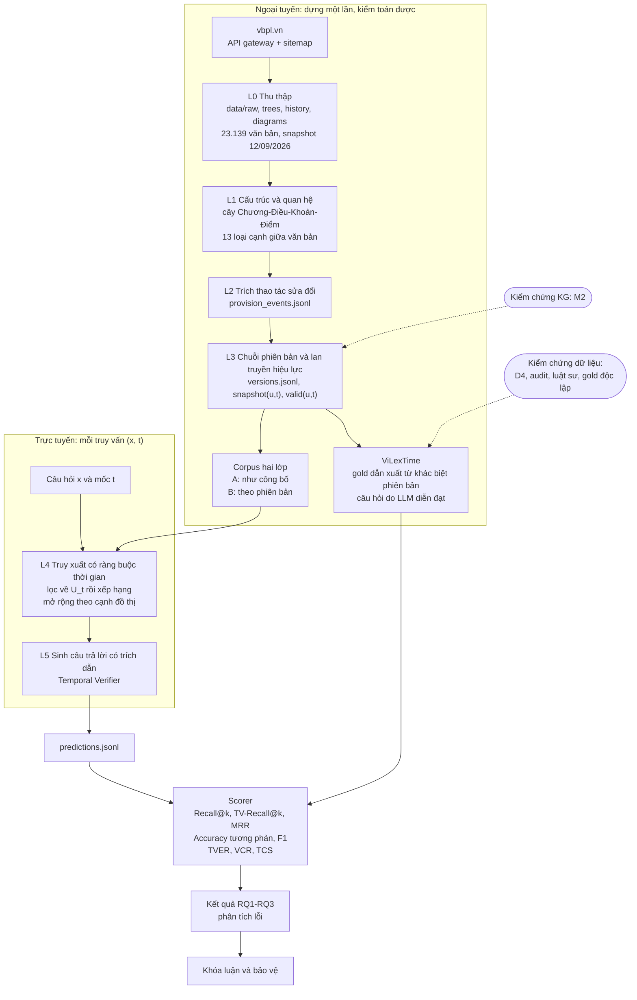
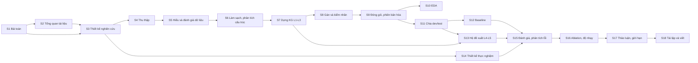
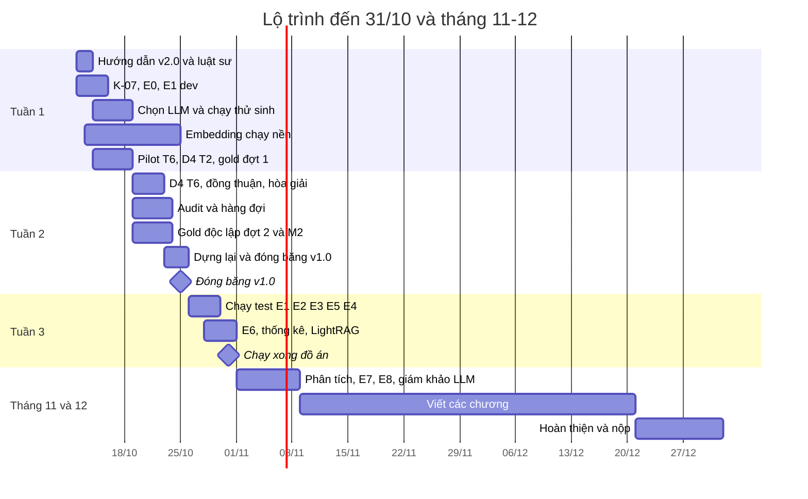

# MASTER RESEARCH GUIDE — Temporal-Aware KG-RAG cho hỏi đáp pháp luật Việt Nam theo mốc hiệu lực

> **Tài liệu định hướng trung tâm của khóa luận.** Lập ngày 11/10/2026 trên trạng thái repo
> nhánh `feature/framework`, commit `2213f44`. Căn cứ chính là đề cương đã nộp
> `docs/DeCuongKLTN_23521635_23521643_UIT.docx`, gọi tắt là **đề cương UIT**.
>
> Tài liệu này **không thay** các nguồn sự thật đang có. Tiến độ vẫn ghi ở
> `docs/plans/active/master-plan.md`; quyết định lâu dài vẫn ghi ở `docs/decisions/`.
> Đây là bản đồ nối đề cương, dữ liệu, code và kết quả thành một mạch nghiên cứu mà nhóm
> tự giải thích và tự bảo vệ được.
>
> Người soạn: Claude (AI), theo yêu cầu của nhóm. Mọi nhận định là đề xuất để nhóm kiểm
> tra lại, không phải kết luận thay nhóm.
>
> **Cập nhật 11/10/2026, lần 2:** nhóm đã chốt các quyết định ở §0.6 (lý do ở §13.3). Mốc mới: chạy
> xong đồ án trước 31/10; nhiệm vụ theo ngày ở §12.4.

### Quy ước đọc

| Nhãn | Nghĩa |
|---|---|
| **[Đã kiểm]** | Người soạn tự chạy lệnh hoặc đọc file gốc ngày 11/10/2026 |
| **[Repo]** | Lấy từ tài liệu trong repo, chưa chạy lại |
| **[Web]** | Đã tra trên web ngày 11/10/2026; URL ở Phụ lục D |
| **[Giả định]** | Giả định để lập kế hoạch, phải xác minh |
| **[Giả thuyết]** | Cần thực nghiệm để khẳng định hoặc bác bỏ |
| **[Khuyến nghị]** | Ý kiến của người soạn, có lý do; nhóm là người quyết |
| **[Chưa biết]** | Thông tin còn thiếu; có ghi cách lấy |
| *(Chung)* / *(Riêng)* | Hướng dẫn cho mọi đề tài / dành riêng cho đề tài này |

- Ưu tiên: **P0** cần để kết quả đúng hoặc để kịp hạn · **P1** tăng độ chặt · **P2** tùy chọn.
- Trạng thái: ⬜ Chưa bắt đầu · 🟡 Đang thực hiện · 🔶 Đã triển khai, chưa kiểm chứng · ✅ Đã kiểm chứng · ⛔ Có vấn đề chặn.
- Số viết theo kiểu Việt Nam như trong repo: `1.225` là một nghìn hai trăm hai lăm, `0,236` là số thập phân.

### Mục lục

0. Đọc trong 10 phút
1. Executive Summary — bức tranh toàn cảnh
2. Research Framing — nền tảng nghiên cứu
3. Current State Audit — những gì đã làm
4. End-to-End Research Pipeline
5. Dataset Engineering
6. Literature Review và Research Gap
7. Modeling Strategy và Baselines
8. Experimental Design
9. Evaluation Framework
10. Reproducibility và Research Engineering
11. Thesis Writing Mapping
12. Roadmap và Prioritization
13. Decision Log
14. Learning Roadmap
15. Critical Review — phản biện như hội đồng

Phụ lục A (thuật ngữ) · B (bản đồ tài liệu trong repo) · C (lệnh kiểm tra nhanh) · D (nguồn đã tra)

---

## 0. Đọc trong 10 phút

### 0.1 Đề tài thật sự là gì

Luật thay đổi theo thời gian. Cùng câu hỏi *"Không đội mũ bảo hiểm khi đi xe máy thì bị phạt bao
nhiêu?"*, hỏi cho ngày 15/03/2021 thì đáp án nằm ở khoản 2 Điều 6 Nghị định 100/2019; hỏi cho ngày
15/03/2025 thì nằm ở khoản 4 Điều 7 Nghị định 168/2024 (Hình 1 của đề cương UIT). Hệ RAG thông
thường coi kho văn bản là tĩnh, nên dễ trích **đúng điều luật nhưng sai phiên bản**. Đề cương gọi
lỗi này là *temporal hallucination*.

Đề tài làm ba việc:

1. **Đo lỗi.** Dựng bộ đánh giá ViLexTime để đo mức độ LLM và hệ RAG dùng sai phiên bản luật
   Việt Nam (RQ1).
2. **Giảm lỗi.** Dựng hệ RAG dùng đồ thị tri thức có phiên bản: mỗi Điều/Khoản/Điểm có chuỗi
   phiên bản và khoảng hiệu lực; hệ chỉ được dùng bằng chứng có hiệu lực tại ngày hỏi (RQ2).
3. **Giải thích vì sao giảm.** Tách lợi ích đến từ đâu: từ ngày hiệu lực của *văn bản*, từ chuỗi
   phiên bản của từng *điều khoản*, hay từ việc *lan truyền hiệu lực* trên cây điều khoản (RQ3).

**Luận điểm trung tâm** sau quyết định M4 ngày 01/10 [Repo: `docs/plans/active/phase-5-6-framework.md`]
là một **[Giả thuyết]**: tính đúng theo thời gian do *biểu diễn* quyết định (hệ truy xuất "nhìn
thấy" gì về hiệu lực của từng đơn vị), không do model lớn hay bộ xếp hạng giỏi. Đồ thị có giá trị
vì nó **kiến tạo** được biểu diễn đủ (L2 trích thao tác sửa đổi, L3 dựng chuỗi phiên bản và lan
truyền hiệu lực). Thí nghiệm chính là một *thang biểu diễn*: bốn mức thông tin thời gian (tier), cộng
một nấc trung gian tách riêng lợi ích của lời văn đã hợp nhất (§7.4). Giả thuyết này **chưa được đo
end-to-end**.

### 0.2 Đang ở đâu (11/10/2026)

| Khối việc | Trạng thái | Một câu |
|---|---|---|
| Thu thập và xử lý kho văn bản | ✅ | 23.139 văn bản, snapshot 12/09/2026, `verify_pipeline.py` qua toàn bộ [Đã kiểm] |
| Đồ thị tri thức L0–L3 | 🔶 | Đã dựng chuỗi phiên bản; **chưa có 100 truy vấn đối chiếu tay** để chứng minh `snapshot(u,t)` đúng (mốc M2) |
| Bộ dữ liệu ViLexTime | 🔶 | Máy dựng xong 2.730 dòng / 653 câu hỏi; **2.730/2.730 dòng `review.status = unchecked`** [Đã kiểm]; kiểm chéo D4 mới 166/300 |
| Khung thực nghiệm (L4–L5, baseline, scorer) | 🟡 | Chạy được, 499 test qua [Đã kiểm]; truy xuất dày (dense) chưa có |
| **Kết quả cho RQ1–RQ3** | ⬜ | **Chưa có file kết quả nào trong repo**, ngoài probe kiểm scorer [Đã kiểm] |
| Viết khóa luận | ⬜ | Có bản nháp phần bài toán và lập luận đồ thị; chưa có chương nào |

Nói thẳng: một tháng qua dồn vào dữ liệu và bộ đánh giá. Phần đó làm kỹ, kiểm tra nhiều và có
tài liệu tốt. Rủi ro lớn nhất bây giờ là **có bộ dữ liệu đẹp nhưng không kịp có kết quả**.

### 0.3 Mốc thời gian và năm việc P0 tuần này

**Mốc đã chốt (11/10/2026):**

- **31/10/2026: chạy xong đồ án**, theo yêu cầu của GVHD. Nghĩa là ViLexTime v1.0 đã kiểm định và
  đóng băng, mọi thực nghiệm P0 đã chạy trên test, có bảng kết quả kèm khoảng tin cậy.
- **Cuối tháng 12/2026: nộp khóa luận.** Tháng 11–12 dành cho phân tích, viết và chuẩn bị bảo vệ.
- **Sau khóa luận: bài báo.** GVHD chọn hội nghị.
- Lịch trong master plan và trong đề cương chỉ còn giá trị tham khảo.

**Năm việc P0 tuần này** (danh sách nhiệm vụ đầy đủ ở §12.4):

1. **Chốt hướng dẫn gán nhãn v2.0** và gửi cố vấn luật cùng phiếu T5. D4 và pilot T6 đang chờ việc này.
2. **Thêm `b7v`, `b7pp` rồi chạy E0, E1 trên dev.** Đây là kết quả khoa học đầu tiên, không tốn lệnh
   gọi LLM và không chờ nhãn người (§8).
3. **Chọn LLM sinh rẻ nhất qua được cổng chất lượng** (§7.5); đo tốc độ embed rồi cho chạy nền (§7.7).
4. **Rút mẫu gold độc lập 120 dòng và bắt đầu gán mù** (§5.3.5).
5. **Kiểm 9 tài liệu tham khảo của đề cương**, bắt đầu từ [4], [6], [7] (§6.4); báo GVHD cách đếm
   "câu" và thước đo AC1.

### 0.4 Thông tin còn thiếu

| [Chưa biết] | Vì sao quan trọng | Cách lấy |
|---|---|---|
| GVHD có chấp nhận cách đếm theo cặp (câu hỏi, mốc) không | Quyết định câu chữ trong bảng lệch đề cương | Việc W1-03 (§12.4) |
| Ngày cố vấn luật trả lời | T5 và phần pháp lý của hướng dẫn v2.0 phụ thuộc vào đó | Hẹn trả lời trước 21/10; phương án dự phòng ở việc W2-07 |
| Thời gian embed trên CPU | Quyết định B3, B4 có kịp 31/10 không | Đo trên 2.000 đoạn, chốt cấu hình trước 14/10 |
| Hội nghị cho bài báo | Quy định ẩn danh quyết định khi nào được công khai repo và dataset | GVHD chọn sau khóa luận; trong lúc chờ, giữ repo GitHub và dataset Hugging Face ở chế độ riêng tư |
| Mẫu trình bày KLTN của khoa | Số chương, demo bắt buộc, giới hạn trang | Mẫu KLTN của khoa |
| Quy định của trường về khai báo dùng AI | Repo cho thấy AI tham gia viết câu hỏi, nhãn, code, báo cáo | Để sau (E5); hỏi GVHD khi viết |

### 0.5 Cách dùng tài liệu này

- Lần đầu: đọc §0, §1, §15.
- Trước khi chạy thí nghiệm: §7, §8, §9.
- Khi viết: §11. Khi ôn bảo vệ: §13, §14, §15.3.
- Trạng thái chi tiết của từng việc: §3 và master plan. Nhiệm vụ theo ngày đến 31/10: §12.4.

### 0.6 Các quyết định đã chốt ngày 11/10/2026

Lý do chi tiết của từng quyết định ở §13.3.

| Mã | Quyết định |
|---|---|
| A1 | Chạy xong đồ án trước 31/10; nộp khóa luận cuối tháng 12; bài báo làm sau, GVHD chọn hội nghị |
| A2 | Báo cỡ bộ dữ liệu theo nhiều cấp: 503 văn bản → 653 câu hỏi → 1.225 cặp (câu hỏi, mốc) ở chế độ ranh giới → 2.730 mẫu trên 4 chế độ. Đối chiếu khung 1.100–1.300 của đề cương theo cặp. Không mở rộng; 373 câu dự trữ chỉ dùng để thay dòng bị loại (§5.7) |
| A3 | Đồng thuận: AC1 ≥ 0,80 và p_neg ≥ 0,60 là chính; báo kèm κ; ghi rõ AC1 được chọn sau lượt pilot |
| B1 | Đóng băng cơ cấu bộ dữ liệu hiện tại (T1 150 · T2 450 · T3 199 · T5 38 · T6 388 dòng ranh giới); chỉ loại hoặc thay dòng theo kết quả kiểm định |
| B2 | Thang biểu diễn 5 nấc: `b2ctx` → `b7` → `b7v` → `b7plus` → `b7pp`; `proposed` báo riêng ở dòng "cộng thành phần trực tuyến" |
| B3 | Bảng chính dùng truy xuất từ vựng (BM25 qua FTS5) cho mọi nấc; dense chỉ để kiểm độ bền |
| B4 | Kiểm định H0, H1 (đã sửa), H2, H3; H4 là phân tích thăm dò (§2.4) |
| B5 | Đại lượng chính theo §9.3; thêm chỉ số "tỷ lệ câu trả lời chứa nội dung phiên bản sai" vào scorer |
| B6 | Gold độc lập: 120 dòng + 30 dòng gán đôi; gán mù rồi mới mở đáp án KG; ngưỡng M2 ≥ 114/120 (§5.3.5) |
| B7 | LLM sinh: không thuộc họ Claude, DeepSeek; chọn nhà cung cấp rẻ nhất qua được cổng chất lượng; thêm một model khác họ để kiểm độ bền (§7.5) |
| B8 | Pilot 20 dòng T6 lấy từ 276 dòng chưa có nhãn; giữ 20 nhãn T6 cũ trong D4; thêm cột phiên bản hướng dẫn cho mọi nhãn (§5.3.4) |
| B9 | Lưu kết quả trong `runs/` kèm sổ chạy; `references.bib`; ADR 0005 (§10.2) |
| C1 | Dense: `AITeamVN/Vietnamese_Embedding` chạy CPU trên máy cá nhân (§7.7) |
| C2 | Sinh câu trả lời chỉ ở chế độ `giua_khoang`; các chế độ khác chỉ-truy-xuất; thêm T2 ở `ranh_gioi`, `truoc_hieu_luc` cho 3 hệ nếu kịp (§8.5) |
| C3 | Chạy LightRAG thật trên tập con (§8.3, E4) |
| C4 | Giám khảo LLM là cột phụ, hiệu chuẩn trên 100 mẫu người gán sau 31/10 (§9.8) |
| C5 | "Thí nghiệm chuyển miền" đổi thành phân rã kết quả theo miền |
| E1 | Tuyên bố tính mới dạng hẹp, kèm "theo khảo sát của chúng tôi", sau một lượt tìm có mục tiêu (§6.5) |
| E2 | Bài báo làm sau khóa luận; giữ repo và dataset riêng tư cho tới khi kiểm quy định ẩn danh của hội nghị |
| E3 | Demo bản tối thiểu, làm trong tháng 11 |
| E4 | `related_work_paper/FiscalQA.md` thay bằng ghi chú tóm tắt rồi mới commit |
| E5 | Khai báo dùng AI: để sau |

---

## Phần 1. Executive Summary — Bức tranh toàn cảnh

### 1.1 Đề tài bằng ngôn ngữ dễ hiểu *(Riêng)*

Hãy hình dung một luật sư được hỏi về một vụ việc xảy ra năm 2021. Việc đầu tiên họ làm không phải
tìm điều luật nói về chủ đề đó, mà xác định **điều luật nào đang có hiệu lực vào năm 2021**. Hệ RAG
thông thường bỏ qua bước này: nó tìm đoạn văn giống câu hỏi nhất, bất kể đoạn đó còn hiệu lực hay
không.

Ví dụ thật trong corpus [Repo: `docs/orientation.md` §2] cho thấy vì sao việc này khó:

| Phiên bản | Hiệu lực | Nội dung điểm đ khoản 4 Điều 84 Nghị định 98/2020/NĐ-CP |
|---|---|---|
| v1 | `[2020-10-15, 2022-01-31)` | "…tại các điểm a, b, d và e khoản 3 Điều 4…" |
| v2 | `[2022-01-31, 2025-02-21)` | "…tại các điểm a, b, d, e **và l** khoản 3 Điều 4…" |
| v3 | `[2025-02-21, …)` | "…tại các điểm d, đ, g, i khoản 1 Điều 28 của Luật Xử lý vi phạm hành chính và…" |

Ba điều rút ra:

1. Một câu hỏi có **ba đáp án đúng** tùy ngày hỏi.
2. v1 và v2 chỉ khác hai chữ "và l". BM25 hay embedding đều không phân biệt được, vì hai đoạn
   *thực sự* giống nhau. Chỉ khoảng hiệu lực phân biệt được chúng.
3. v2 do Nghị định 17/2022/NĐ-CP tạo ra. Nghị định này nói về hóa chất và vật liệu nổ, khác hẳn
   lĩnh vực của văn bản bị sửa. Không mô hình ngữ nghĩa nào nối được hai văn bản; chỉ quan hệ
   tường minh giữa văn bản làm được.

Tự kiểm: `grep provision:40778740-2c7f-11f1-abee-c9b7a53cf5c7 data/derived/versions.jsonl`.

Ba loại thông tin quyết định hiệu lực nằm **ngoài** nội dung chữ của điều khoản [Repo:
`docs/graph_justification.md` §3]:

- **I1** — chuỗi phiên bản và khoảng hiệu lực của chính điều khoản;
- **I2** — chuỗi đơn vị cấp trên: bãi bỏ một Điều thì mọi Khoản, Điểm bên dưới mất hiệu lực dù
  không ai nêu tên chúng;
- **I3** — các văn bản tác động và bao đóng bắc cầu của chúng.

Một biểu diễn chứa cả I1–I3 về bản chất là một đồ thị có kiểu và có phiên bản. Đó là lý do đề tài
dùng đồ thị, không phải vì đồ thị đang thịnh hành.

### 1.2 Phát biểu bài toán

Đề cương UIT, công thức (1):

```text
q = (x, t)  ↦  S(q) = (a, E),     E ⊆ U_t = { u ∈ U : valid(u, t) }
```

- `x`: câu hỏi pháp lý tiếng Việt. `t`: mốc áp dụng (thời điểm phát sinh hành vi hay quan hệ).
- `U`: tập đơn vị pháp lý (Điều/Khoản/Điểm, cùng Chương/Mục làm khung).
- `valid(u, t)`: `u` có hiệu lực tại `t`. Trong repo, nó được định nghĩa đệ quy
  [Repo: `docs/graph_justification.md` (3)]:
  `valid(u,t) = [snapshot(u,t) ≠ ⊥] ∧ [π(u) = ⊥ ∨ valid(π(u), t)]`, với `π(u)` là đơn vị cấp
  trên và `snapshot(u,t)` là phiên bản có khoảng nửa mở `[s, e)` chứa `t`.
- Đầu ra: câu trả lời `a` cùng tập bằng chứng `E`. Khi không đơn vị nào trong `U_t` trả lời được
  (ví dụ điều khoản đã bị bãi bỏ), đầu ra đúng là nói rõ "không có hiệu lực tại `t`" kèm lý do.

| Thành phần | Trong đề tài |
|---|---|
| Đối tượng nghiên cứu | Văn bản quy phạm pháp luật (QPPL) cấp trung ương trên vbpl.vn, ở cấp Điều/Khoản/Điểm, cùng các quan hệ sửa đổi, bổ sung, thay thế, bãi bỏ |
| Đầu vào | Câu hỏi không chứa ngày (ngày nằm ở trường `as_of`) |
| Đầu ra | Câu trả lời, trích dẫn phiên bản, hoặc khẳng định "không có hiệu lực" với lý do thuộc từ vựng đóng |
| Trong phạm vi | Hiệu lực theo thời gian, hiểu theo nghĩa hình thức (de jure) |
| Ngoài phạm vi | Hiệu lực theo không gian và đối tượng; xung đột quy phạm; văn bản địa phương; bảng biểu, ảnh; huấn luyện lại LLM. Điều khoản chuyển tiếp chỉ được đánh dấu; hiệu lực trở về trước chỉ là tập chẩn đoán |

### 1.3 Mục tiêu ứng dụng và mục tiêu nghiên cứu

| | Mục tiêu ứng dụng | Mục tiêu nghiên cứu khoa học |
|---|---|---|
| Câu hỏi | "Hệ có trả lời đúng luật tại ngày `t` không?" | "Các hệ hiện có sai ở mức nào, vì sao, và thông tin nào sửa được lỗi đó?" |
| Sản phẩm | Hệ hỏi đáp có trích dẫn, giao diện minh họa | ViLexTime, phép so sánh có kiểm soát, phân tích lỗi |
| Thành công nghĩa là | Đúng nhiều, trích dẫn hợp lệ, chạy được | Trả lời RQ1–RQ3 kèm khoảng tin cậy, **kể cả khi kết quả âm** |
| Bẫy nếu lẫn hai thứ | Tối ưu điểm số mà không giải thích được vì sao | Viết khóa luận như mô tả code đã làm |

Khóa luận được chấm chủ yếu theo cột phải. Demo là để minh họa cột phải, không thay nó.

### 1.4 Pipeline tổng thể



Hai điều cần nắm từ hình này:

1. **Có hai "bộ dữ liệu" khác nhau về bản chất.** *Corpus* (kho văn bản, chuyển thành đồ thị và
   corpus hai lớp) là không gian tìm kiếm. *ViLexTime* là thước đo. Tiêu chí chất lượng của hai thứ
   khác nhau (§5.0).
2. **Có ba vòng kiểm chứng độc lập:** KG có đúng không (M2), bộ dữ liệu có đúng không (D4, audit,
   gold độc lập), và kết quả có đáng tin không (probe, khoảng tin cậy, phân tích lỗi). Thiếu vòng
   nào thì kết luận tương ứng bị yếu.

### 1.5 Mối liên hệ giữa các giai đoạn

```text
L2 trích sửa đổi ──► L3 chuỗi phiên bản ──┬─► U_t mà hệ đề xuất dùng      (hệ thống)
                                          └─► gold của ViLexTime          (thước đo)
```

Một lỗi ở L2 (ví dụ bỏ sót một lần sửa đổi) đi vào **cả hệ thống lẫn gold**. Khi đó hệ đề xuất vẫn
"đúng theo gold" dù sai theo luật. Đây là *vòng tròn gold–KG* (JUDGE N1). Vì vậy hai việc không
thể thiếu: (a) kiểm chứng L3 bằng người (M2), (b) một tập gold không đi qua L2–L3 (gold độc lập).

Đường găng từ hôm nay:

```text
hướng dẫn v2.0 ─► D4 + hòa giải ─► audit ─► đóng băng ViLexTime v1.0 ─► chạy trên test ─► phân tích ─► viết
                                       ▲
gold độc lập + M2 ─────────────────────┘
song song, không chờ ai: E1 thang chỉ-truy-xuất trên dev ─► chọn LLM ─► chạy thử sinh trên dev
```

### 1.6 Sản phẩm cuối cùng cần có

| # | Sản phẩm | Đề cương UIT nói | Hiện trạng | "Xong" khi |
|---|---|---|---|---|
| 1 | ViLexTime | ~1.100–1.300 câu, bằng chứng cấp Điều/Khoản/Điểm, kiểm định thủ công, đánh giá đồng thuận | 🔶 2.730 dòng, 1.225 dòng ranh giới, 653 câu hỏi; chưa kiểm định xong | Tag `vilextime-v1.0`, datasheet đủ, IAA, tỷ lệ lỗi trên gold độc lập |
| 2 | Đồ thị tri thức có nhận biết thời gian (L0–L3) | Cấu trúc, quan hệ, chuỗi phiên bản, hiệu lực theo thời gian | 🔶 dựng xong, kiểm nội bộ tốt | M2 đạt; precision/recall L2 công bố kèm khoảng tin cậy |
| 3 | Hệ Temporal-Aware KG-RAG | Lọc theo hiệu lực, truy xuất lai, mở rộng đồ thị, sinh có trích dẫn, Temporal Verifier, giao diện minh họa | 🟡 khung chạy được; dense, giao diện chưa có | Chạy end-to-end trên test; demo chọn mốc `t` |
| 4 | Thực nghiệm so sánh | 5 nhóm phương pháp nền, 3 nhóm tiêu chí | ⬜ | Bảng chính, ablation, phân tích lỗi, khoảng tin cậy |
| 5 | Khóa luận, slide, demo bảo vệ | GĐ7 15/12–26/12 | ⬜ | Nộp trước cuối tháng 12/2026, theo mẫu của khoa |
| 6 | Bài báo | Không có trong đề cương UIT (có trong bản cũ) | ⬜ | Làm sau khóa luận; GVHD chọn hội nghị (chốt 11/10) |

### 1.7 Năm rủi ro lớn nhất

| # | Rủi ro | Vì sao nghiêm trọng | Dấu hiệu đã thấy | Giảm thiểu |
|---|---|---|---|---|
| R1 | **Thời gian và chưa có kết quả** | GVHD yêu cầu chạy xong đồ án trước 31/10 (còn 20 ngày) mà chưa có số nào cho RQ1–RQ3 | Khoảng 44% commit dành cho ViLexTime và đánh giá, 4% cho framework (ước tính thô theo tên commit) | Chạy E1 ngay tuần này; đóng băng phạm vi dữ liệu; lịch 3 tuần ở §12 |
| R2 | **Vòng tròn gold–KG, M2 chưa đạt** | Hệ đề xuất có thể "thắng" vì gold sinh từ chính KG của nó | Recall L2 62,2%; M2 mới có so khớp tự động 80,02% trên 51 VBHN [Repo] | Gold độc lập gộp M2; báo hai cột kết quả (§5.3, §8) |
| R3 | **Kiểm định người chưa xong** | Chưa gọi được là bộ dữ liệu đã kiểm định | D4 166/300; audit 0/375; T5 0/34 ý kiến luật sư [Đã kiểm/Repo] | Ưu tiên giờ công người cho đúng việc (§12) |
| R4 | **Tài liệu tham khảo và tuyên bố tính mới** | Hội đồng tra ra một tài liệu không tồn tại là mất uy tín cả khóa luận | 3/9 tài liệu đề cương UIT chưa xác minh được [Web]; repo ghi nhiều trích dẫn "viết theo trí nhớ" | Kiểm từng tài liệu; thu hẹp tuyên bố "đầu tiên" (§6) |
| R5 | **Nhóm chưa làm chủ thiết kế** | Hội đồng hỏi "vì sao" chứ không hỏi "làm gì" | Nhóm tự nhận; tài liệu dày đặc, nhiều quyết định do AI đề xuất | Sổ quyết định §13, lộ trình học §14, câu hỏi tự kiểm §15.3 |

---

## Phần 2. Research Framing — Xác lập nền tảng nghiên cứu

### 2.1 Vấn đề nghiên cứu và động cơ

**Vấn đề.** RAG pháp lý đang dùng kho tri thức tĩnh, trong khi hiệu lực của điều khoản thay đổi
theo thời gian. Lỗi phát sinh không trông giống lỗi: trích dẫn có thật, số hiệu đúng, chỉ phiên bản
sai.

**Bằng chứng trên chính corpus** [Repo: `docs/graph_justification.md` §4, snapshot 12/09/2026, tái
lập bằng `scripts/explore/compare_representations.py`]:

| Quan sát | Số đo | Biểu diễn bị bác bỏ |
|---|---|---|
| Nội dung trùng khớp nhưng hiệu lực trái ngược | 8.210 nhóm; chọn ngẫu nhiên trong nhóm sai ~47,5% | Chỉ dùng nội dung (BM25, dense) |
| Văn bản "hết hiệu lực một phần" | 2.051 văn bản chứa 351.813 đơn vị (27,8%) | Chỉ lọc theo ngày cấp văn bản (B7) |
| Mất hiệu lực chỉ vì đơn vị cấp trên bị bãi bỏ | 14.157 đơn vị, gấp ~2,4 lần số đơn vị bị bãi bỏ trực tiếp | Trạng thái riêng từng đơn vị, không lan truyền |
| Tác động bắc cầu | Bao đóng tới 2.963 văn bản (mẫu 1.000) | Chỉ quan hệ trực tiếp |

Các số này là **cận dưới**. Chúng chỉ đếm trùng khớp tuyệt đối và chỉ những ghi nhận bãi bỏ định vị
được trên cây (§8 của tài liệu nguồn). Chúng chứng minh *điều kiện cần* (thông tin bị mất), chưa
chứng minh hệ dùng đồ thị trả lời đúng hơn. Phần sau là việc của thực nghiệm.

### 2.2 Mục tiêu nghiên cứu

Đề cương UIT có **hai** mục tiêu cụ thể: (1) xây dựng ViLexTime, (2) xây dựng kiến trúc
Temporal-Aware KG-RAG. Bản đề cương cũ trong git (commit `c8987ff`) có thêm "bộ chỉ số TVER, VCR,
TCS" và "đồ thị tri thức" như hai đóng góp riêng. Bản UIT đã gộp chúng vào khung đánh giá và kiến
trúc. **Khi viết, bám bản UIT.**

### 2.3 Câu hỏi nghiên cứu và cách đo

| RQ | Phát biểu (đề cương UIT) | Biến độc lập | Đại lượng chính | So sánh | Kết luận được phép |
|---|---|---|---|---|---|
| RQ1 | LLM và RAG hiện có mắc lỗi áp dụng sai phiên bản ở mức nào trên pháp luật Việt Nam? | Loại hệ: LLM không truy xuất, RAG phẳng | Accuracy tương phản; tỷ lệ câu trả lời chứa nội dung của phiên bản sai; TVER (kèm độ phủ trích dẫn); TCS | B1, B2, B3/B4 | "Trên ViLexTime, hệ X dùng sai phiên bản ở y% số câu (KTC 95%)". **Không** được nói "LLM nói chung" |
| RQ2 | Biểu diễn theo phiên bản có giảm lỗi so với RAG phẳng và GraphRAG phi thời gian? | Biểu diễn: phẳng / đồ thị phi thời gian / đồ thị có phiên bản | Chênh lệch TV-Recall@1, Accuracy, TCS, TVER | B2–B6 với hệ đề xuất | "Giảm z điểm (KTC)" trên ViLexTime, **có cột gold độc lập** |
| RQ3 | Lợi ích đến từ biểu diễn đồ thị hay chỉ từ lọc theo siêu dữ liệu thời gian? | Nấc thang biểu diễn, giữ cố định mọi thứ khác | TVER, VCR, TV-Recall@1 theo từng nấc | `b2ctx` → `b7` → `b7v` → `b7plus` → `b7pp` | "Phần lợi ích do I1/I2 đóng góp" chỉ khi khoảng tin cậy của chênh lệch không chứa 0 |

### 2.4 Giả thuyết (đã chốt 11/10)

**Giả thuyết ở đây là gì.** Là một dự đoán viết ra **trước khi** chạy trên test, kèm điều kiện cụ thể
để nói dự đoán đó sai. Viết trước để không ai, kể cả nhóm, chỉnh dự đoán cho khớp kết quả. Bằng chứng
"đã viết trước" là ngày commit của ADR 0005 sớm hơn ngày có file kết quả test đầu tiên.

**Giả thuyết chính H0 (đề cương UIT):** mô hình hóa chuỗi phiên bản và hiệu lực ở cấp cấu trúc pháp lý
cải thiện truy xuất đúng phiên bản so với chỉ lọc theo ngày hiệu lực cấp văn bản. Nói nôm na: biết từng
khoản có hiệu lực từ ngày nào đến ngày nào thì tìm đúng phiên bản tốt hơn so với chỉ biết văn bản chứa
nó còn hiệu lực hay không.

- *Đo:* TV-Recall@1 và TVER của nấc 3–4 (`b7plus`, `b7pp`) so với nấc 2 (`b7`), trên test, chế độ
  `giua_khoang`. TV-Recall@1 chỉ tính trên dòng có đáp án, vì lớp B không có đơn vị lệnh bãi bỏ để
  chấm trúng ở dòng không có đáp án (ADR 0005 §4).
- *Ủng hộ khi:* khoảng tin cậy 95% của chênh lệch nằm hẳn về phía có lợi. *Bác bỏ khi:* khoảng tin cậy
  chứa 0; khi đó đề tài đi theo nhánh "điểm quyết định B7" (§2.7).
- *Ví dụ (số giả định):* `b7` đạt 0,40, `b7pp` đạt 0,62, chênh 0,22 với khoảng tin cậy [0,18; 0,26] →
  ủng hộ. Chênh 0,01 với khoảng tin cậy [−0,03; 0,05] → không ủng hộ.

**H1–H4** lấy từ `docs/graph_justification.md` §7 (không có trong đề cương), đã rà và chốt như sau:

| | Nói nôm na | Đo trên (test, `giua_khoang`) | Vai trò | Ghi chú |
|---|---|---|---|---|
| H1 (đã sửa) | Hai phiên bản càng giống nhau, RAG thường càng dễ trích nhầm phiên bản | VCR của B2–B4: 114 dòng lát gần giống so với 240 dòng T2 còn lại; cả hai đều đúng 2 phiên bản | Kiểm định | Bản cũ so với T1, nhưng 150/150 dòng T1 chỉ có một phiên bản [Đã kiểm], nên VCR trên T1 luôn bằng 0 và phép so sánh không kiểm được gì |
| H2 | Khoảng cách giữa hệ đề xuất và B7 lớn nhất ở T6 | 312 dòng T6 | Kiểm định, ghi là kỳ vọng theo cấu trúc | B7 không thể biết một khoản bị bãi bỏ khi văn bản còn hiệu lực; giá trị nằm ở độ lớn khoảng cách so với T2, T3 |
| H3 | Không lan truyền hiệu lực từ cấp trên thì hệ dùng nhầm khoản đã mất hiệu lực vì Điều chứa nó bị bãi bỏ | `b7plus` so với `b7pp` (kiểm định, ADR 0005 XN5); `a4` so với `proposed` (lặp lại), trên 121 dòng T6 sau ngày nút cha bị bãi bỏ | Kiểm định | Giả thuyết mới nhất của đề tài: lan truyền là phần các công trình khác chưa tách riêng |
| H4 | Bỏ mở rộng theo đồ thị làm giảm chính xác nhiều nhất ở T3; B5 có TCS thấp hơn hệ đề xuất | — | Thăm dò: báo số, không kiểm định | Tình huống cần mở rộng chỉ chạm 4/974 dòng [Repo, 01/10] |

> **Khuyến nghị K-01 (P0).** *Nên làm:* ghi H0–H4 đúng như trên, cùng đại lượng chính (§9.3), phép so
> sánh và kiểm định thống kê (§8.4), vào `docs/decisions/0005-ke-hoach-phan-tich.md` **trước** khi chạy
> bất kỳ hệ nào trên test. *Vì sao:* sửa giả thuyết sau khi thấy kết quả là HARKing (đặt giả thuyết sau
> khi biết kết quả); hội đồng và phản biện có thể hỏi. *Kiểm tra:* ngày commit ADR sớm hơn ngày của file
> kết quả test đầu tiên.

### 2.5 Khoảng trống nghiên cứu và đóng góp

**Văn liệu cho thấy gì** (chi tiết §6):

- Hỏi đáp pháp luật theo mốc thời gian **đã có** công trình quốc tế 2025–2026: bộ hỏi đáp luật Đức
  theo thời gian (Prior và cộng sự, ICAIL 2026, 312 cặp hỏi đáp) [Web]; FiscalQA Pro cho luật thuế
  Pháp (32.436 phiên bản điều luật, 209 câu chấm điểm) [Web]; LawShift (NeurIPS 2025 Datasets and
  Benchmarks, 31 loại thay đổi điều luật) [Web]; VersionRAG cho tài liệu kỹ thuật có phiên bản [Web].
  Vì vậy **không được** viết "benchmark pháp luật theo thời gian đầu tiên".
- Ở Việt Nam: VLQA loại điều đã bãi bỏ khỏi corpus [Repo, mức đọc B]; ViHERMES có truy vết sửa đổi
  nhưng ưu tiên nút cuối chuỗi, không có trường mốc thời gian [Repo, mức đọc A]. Đây là bằng chứng
  cho khoảng trống trong nước, nhưng phải đọc lại bài gốc trước khi viết.

**Tuyên bố bảo vệ được** (sau một lượt tìm có mục tiêu, §6.5): *"Theo khảo sát của chúng tôi,
ViLexTime là bộ đánh giá hỏi đáp theo mốc thời gian đầu tiên cho pháp luật Việt Nam ở cấp
Khoản/Điểm, có trường hợp bãi bỏ một phần và hiệu lực lan truyền từ đơn vị cấp trên, kèm độ đồng
thuận giữa người với người."*

| Đóng góp | Loại | Đã có bằng chứng | Còn thiếu để gọi là "đã chứng minh" |
|---|---|---|---|
| ViLexTime | Tài nguyên | Bản phát hành, schema, scorer, datasheet, `check_release.py` | IAA, audit, tỷ lệ lỗi trên gold độc lập, tag v1.0 |
| KG có phiên bản cho luật Việt Nam (L0–L3) | Kỹ thuật, tài nguyên | 1.595.823 phiên bản; precision L2 58/60 [Repo] | M2; recall L2 được công bố như giới hạn |
| Kiến trúc L4–L5 | Phương pháp (áp dụng có kiểm soát) | Code, test | Kết quả end-to-end |
| Phân tích nguồn gốc lợi ích (thang biểu diễn) | Khoa học | Thiết kế; phép đo bề mặt 01/10 | Số liệu thang kèm khoảng tin cậy |
| Accuracy tương phản, TVER, VCR, TCS | Định nghĩa vận hành cho bài toán | Scorer, probe | Không tuyên bố mới cho TCS: đây là *contrast consistency* của Gardner và cộng sự (2020) với nhóm cỡ 2 [Web] |

### 2.6 Phạm vi, giả định, giới hạn

- **[Giả định] A1:** siêu dữ liệu và lời văn trên vbpl.vn phản ánh đúng văn bản chính thức. Đã biết
  có ngoại lệ: cổng lưu trùng văn bản (78 cặp), để "Còn hiệu lực" cho văn bản đã bị thay thế, sai năm
  `effFrom` [Repo: datasheet §5, §8].
- **[Giả định] A2:** ngày một phiên bản bắt đầu bằng ngày có hiệu lực của văn bản sửa đổi. Sai khi
  có hiệu lực trở về trước hoặc văn bản có nhiều ngày hiệu lực (cờ `split_effective_date`).
- **[Giả định] A3:** câu hỏi do LLM viết đại diện cho nhu cầu tra cứu hợp lý. Đây là giả định yếu
  nhất; câu hỏi thật của người dân chưa được dùng.
- **[Giả định] A4:** hiệu lực hình thức (de jure) đủ cho bài toán. Điều khoản chuyển tiếp và áp dụng
  hồi tố nằm ngoài mô hình.
- **[Giả định] A5:** thế giới dừng ở ngày chụp 12/09/2026 (trường `retrieved_at`).

### 2.7 Đối tượng so sánh và tiêu chí thành công

Thành công **không** có nghĩa là "hệ đề xuất thắng mọi baseline". Tiêu chí đề xuất:

1. ViLexTime v1.0 qua checklist sẵn sàng (§5.6).
2. Hệ đề xuất và mọi baseline chạy end-to-end trên toàn bộ test với cấu hình được ghi lại.
3. RQ1–RQ3 được trả lời bằng số kèm khoảng tin cậy, kể cả khi kết quả âm.
4. Phép so sánh chính được kiểm lại trên gold độc lập.
5. Người khác tái lập được từ snapshot, tag và lệnh trong README.

Đề cương cũ đặt sẵn một **điểm quyết định B7**: nếu lọc theo ngày cấp văn bản đạt gần mức hệ đề
xuất, đóng góp chuyển sang hướng "tài nguyên và phân tích". Nên giữ nhánh này như một kết quả hợp lệ
đã khai báo trước, không phải một thất bại.

### 2.8 Ma trận nhất quán: đề cương UIT và thực tế repo

| # | Hạng mục | Đề cương UIT | Thực tế | Đánh giá | [Khuyến nghị] |
|---|---|---|---|---|---|
| 1 | Thời gian | 07/09–26/12/2026, 7 giai đoạn | Lịch trong master plan (theo đề cương cũ, đến 01/02/2027) chỉ để tham khảo. **Chốt 11/10:** chạy xong đồ án trước 31/10, nộp khóa luận cuối tháng 12 | ✓ | Lịch mới ở §12; cập nhật master plan |
| 2 | Cỡ bộ dữ liệu | "khoảng 1.100–1.300 câu hỏi"; Bảng 1 tổng 1.150, T2 ghi "400 (200 cặp)" | 1.225 dòng ranh giới; 653 câu hỏi khác nhau; 2.730 dòng ở bốn chế độ [Đã kiểm] | ⚠ | **Chốt 11/10 (A2):** báo nhiều cấp; đối chiếu khung theo cặp (câu hỏi, mốc), vì Bảng 1 tự đếm mỗi vế của một cặp T2 là một câu; báo GVHD |
| 3 | Sáu nhóm, quota | T1 250 · T2 400 · T3 200 · T4 150 · T5 50 · T6 100 | T1 150 · T2 450 (gồm 150 gần giống, tức T4 cũ) · T3 199 · T5 38 · T6 388 [Repo: datasheet §8] | ⚠ có lý do | Bảng "dự kiến – thực tế – lý do" trong khóa luận |
| 4 | T5 | "có lợi cho đối tượng áp dụng" | Theo Điều 152 Luật BHVBQPPL, bỏ vế "có lợi" (cố vấn luật 20/09) | ⚠ | Ghi rõ **Luật 80/2015/QH13**; luật này bị Luật 64/2025/QH15 thay thế từ 01/04/2025 [Web], nên chính quy tắc hồi tố cũng thay đổi theo thời gian |
| 5 | Vai trò LLM | "LLM chỉ hỗ trợ diễn đạt câu hỏi" | LLM viết câu hỏi, đáp án ngắn (được chấm Accuracy/F1/TCS), nhãn sơ bộ, đề xuất loại dòng [Repo: datasheet §3] | ⚠ | Công bố; audit người; cột chính không dùng Claude hay DeepSeek |
| 6 | Kiểm định | "Kiểm định chéo dữ liệu và đánh giá độ đồng thuận", không nêu ngưỡng | Pilot κ 0,236; AC1 chọn làm thước đo chính | ✓ không trái bản UIT | **Chốt 11/10 (A3):** AC1 và p_neg là chính; báo κ; nói rõ thời điểm chọn AC1 (§5.3) |
| 7 | Miền | Bốn miền tiêu biểu | Corpus gieo từ bốn miền rồi mở rộng theo phả hệ; 425/653 lineage mang nhãn ngoài bốn miền [Repo] | ⚠ | Mô tả đúng: "đa miền, gieo từ bốn miền" |
| 8 | Phương pháp nền | LLM không truy xuất; BM25/dense/hybrid; GraphRAG phi thời gian; KG phân cấp; lọc siêu dữ liệu | Cấu hình b1–b7, b7plus đã khai báo; dense chưa có; B5, B6 là bản xấp xỉ nội bộ | 🟡 | P1 làm dense; mô tả B5/B6 trung thực (§7) |
| 9 | Chỉ số | Recall@k, MRR, TV-Recall@k; Accuracy, EM/F1, LLM-as-judge; TVER, VCR, TCS | Scorer đủ, trừ giám khảo LLM chưa hiệu chuẩn; Accuracy dạng tương phản; TV-Recall@k định nghĩa lại | 🟡 | Ghi định nghĩa chính thức trong khóa luận (§9); giám khảo LLM là cột phụ, hiệu chuẩn sau 31/10 (C4) |
| 10 | Temporal Verifier | Kiểm lại tính hợp lệ của trích dẫn | Chế độ `reject` sinh lại một lần; gần như không có tác dụng khi đã lọc trước bằng tier `propagated` [Repo] | ⚠ | Đo và báo đúng vai trò (§7.6) |
| 11 | Thí nghiệm chuyển miền | GĐ6 | Chưa định nghĩa được: miền đa nhãn, hệ không huấn luyện | ⚠ | **Chốt 11/10 (C5):** đổi thành phân rã kết quả theo miền; ghi vào bảng lệch |
| 12 | Giao diện minh họa | GĐ5 và GĐ7 | Chưa có | ⬜ | **Chốt 11/10 (E3):** demo tối thiểu, làm trong tháng 11 |
| 13 | Tài liệu tham khảo | 9 mục | 3 mục chưa xác minh được [Web] | ⛔ | P0 (§6.4) |
| 14 | Hành chính | MSSV Nguyễn Minh Trí ghi "23621643" | Tên file và master plan dùng "23521643" | ⚠ | Dùng MSSV đúng trên bìa khóa luận |

### 2.9 Điểm yếu của đề cương và cách điều chỉnh

Đề cương UIT đã nộp, không sửa được. Cách xử lý chuẩn là **công bố chỗ lệch có lý do**, không giấu.

> **Khuyến nghị K-02 (P0).** *Nên làm:* trong Chương 1 có mục "Điều chỉnh so với đề cương" dạng bảng
> (cam kết – thực hiện – lý do – bằng chứng). *Vì sao:* hội đồng đối chiếu đề cương; lệch có lý do
> được chấp nhận, lệch im lặng thì không. *Thực hiện:* dùng §2.8 và datasheet §6 làm nguồn; gửi GVHD
> trước để có xác nhận bằng email. *Kiểm tra:* mọi dòng ⚠/⛔ ở §2.8 đều có mặt trong bảng.

Bốn điểm yếu về thiết kế, kèm hướng xử lý:

1. **Giả thuyết chỉ so với lọc cấp văn bản.** Nó không nói gì về RQ2 (so với GraphRAG phi thời
   gian). Bổ sung giả thuyết vận hành H1–H4 (K-01).
2. **"Thí nghiệm chuyển miền" không có nghĩa rõ** khi hệ không huấn luyện và miền đa nhãn. Đổi thành
   phân rã kết quả theo miền trên các lineage có nhãn miền từ seed.
3. **"Kiến trúc" gồm thành phần có bề mặt đo được nhỏ** (Verifier, mở rộng đồ thị). Đóng góp nên
   trình bày là *kiến tạo biểu diễn* (L2–L3) cộng *lọc theo hiệu lực* (L4); thành phần trực tuyến
   khác báo đúng mức hiệu ứng đo được.
4. **Chỉ số chưa có định nghĩa hình thức trong bản UIT.** Khóa luận phải định nghĩa lại đầy đủ và
   nhất quán với scorer (§9).

---

## Phần 3. Current State Audit — Đánh giá những gì đã làm

### 3.1 Tiến trình theo lịch sử Git *(Riêng)*

126 commit từ 05/09 đến 11/10/2026 [Đã kiểm `git log`]:

| Thời gian | Việc chính | Commit tiêu biểu |
|---|---|---|
| 05/09 | Crawler và graph builder, Stage 1–5b | `31d5b18` |
| 11–12/09 | Lõi miền thời gian: version chain, event applier, validity, snapshot; adapter Neo4j | `a9170a9` → `10b33ab` |
| 12–17/09 | Audit corpus; chuyển sang index SQLite; snapshot lên Hugging Face; backfill v2; **M1 đạt 17/09** | `c8987ff`, `fa90cb5`, `7e0ec2b` |
| 18–22/09 | L2 event có trạng thái; dựng chuỗi phiên bản thật; nạp Neo4j; kiểm E1 bằng văn bản hợp nhất | `d9a43df`, `921bd2a`, `47c6df3` |
| 20–25/09 | Kế hoạch GĐ4; pool ứng viên; câu hỏi T1–T6; hướng dẫn gán nhãn | `93bb856` → `a8ebab8` |
| 28–30/09 | Nhãn model; schema 1.1–1.2; scorer và probe; xử lý phản biện JUDGE; chia split | `2cffff4`, `fc99e87`, `4ff5d44` |
| 01–02/10 | Framework L4–L5 (P1–P3, mở rộng, giám khảo); đổi tên package `vilexgraph` | `2ac7d28`, `597101d` |
| 06–11/10 | Audit bộ dữ liệu; sửa pool T6; AC1; bản phát hành 11/10; dựng lại D4; ADR 0004 | `d801403` → `2213f44` |

Phân bổ công sức ước tính thô theo từ khóa trong tên commit (chỉ để định hướng, không chính xác):
ViLexTime và đánh giá ~56 commit, KG L0–L3 ~37, dữ liệu và crawl ~12, framework L4–L5 ~5, tài liệu
~4, khác ~12. Hình dạng này khớp với cảm nhận của nhóm: thời gian dồn vào dữ liệu và bộ đánh giá.

### 3.2 Bảng kiểm kê

| # | Hạng mục | Trạng thái | Bằng chứng | Vấn đề / rủi ro | Việc tiếp |
|---|---|---|---|---|---|
| 1 | Nguồn và phương pháp crawl | ✅ | `docs/crawling-plan.md`: API gateway công khai, sitemap, BFS theo cạnh phả hệ, đóng chiều ngược (Stage 2b) [Repo] | Một nguồn duy nhất; cổng thay đổi liên tục | Chuyển phần nguồn và phương pháp vào Chương 3 |
| 2 | Snapshot đóng băng, sao lưu | ✅ | `data/SNAPSHOT.txt`: as_of 2026-09-12, 23.139 văn bản [Đã kiểm]; HF dataset `tricaominh/temporal_vietnames_law` qua `scripts/push_snapshot.sh` [Đã kiểm script]; tải về kiểm lại 17/09 [Repo] | Chế độ công khai/riêng tư của repo HF chưa kiểm | Ghi sha256 snapshot vào khóa luận |
| 3 | Độ phủ của crawl | ✅ có giới hạn | `scripts/check/measure_recall.py`: khoảng trống 0,4–1,6% vũ trụ trung ương; đã bổ sung 8 từ khóa [Repo] | Cố ý loại nhóm kế toán, kiểm toán, đấu thầu…; 1.870 đích dẫn chiếu không có nội dung | Viết vào giới hạn phạm vi, có số |
| 4 | Phạm vi QPPL trung ương | ✅ | ADR 0002; `src/vilexgraph/build/vocab/scope.py`; 20.318 QPPL trung ương, 17.307 văn bản vào corpus truy xuất [Repo] | Metadata không tách được Quyết định cá biệt khỏi Quyết định quy phạm | Ghi trong giới hạn |
| 5 | Cây cấu trúc và lời văn | ✅ | `verify_pipeline.py` qua toàn bộ; 98,94% nút khớp được có lời văn ngoài hàng đợi; 770 văn bản trong hàng đợi review [Đã kiểm] | 770 văn bản cũ đánh số không khớp, cố ý không đoán | Báo như giới hạn |
| 6 | Tách Khoản/Điểm từ HTML | ✅ | 100/100 mẫu kiểm tay đúng [Repo: backfill T5] | Đoạn trích dẫn trong văn bản sửa đổi dễ bị tách nhầm | — |
| 7 | Bảng mã 13 loại quan hệ | ✅ | `data/reference_type_map.json` kiểm tay với giao diện cổng; mã lạ là lỗi dừng [Repo] | — | — |
| 8 | **L2** trích thao tác sửa đổi | 🔶 | `data/derived/provision_events.jsonl` ~50,6 nghìn event, 19.182 được áp; precision 58/60 = 96,7% (Wilson 95%: 88,6–99,1); recall 62,2% so với `expiryProvisions` [Repo] | Mẫu precision nhỏ (đề cương cũ hứa 200); ~21,9 nghìn event `needs_review`; câu có hai thao tác bị gán sai | Báo precision kèm khoảng tin cậy; recall là giới hạn chính |
| 9 | **L3** chuỗi phiên bản, lan truyền | 🔶 | `data/derived/versions.jsonl` 1.595.823 phiên bản; hai lần dựng trùng SHA-256; 6.108/6.108 cặp khớp `ValidityService` [Repo] | Nhất quán nội bộ chưa phải là đúng theo luật. **M2 chưa đạt**: mới so tự động với VBHN, khớp 80,02% trên 51 VBHN [Repo] | P0: mẫu kiểm tay gộp gold độc lập (§5.3) |
| 10 | Neo4j, Milvus | 🔶 | Neo4j nạp hai lượt ngày 19/09, số đếm ổn định; volume Docker đã mất; Milvus chưa có vector [Repo] | RAM máy 7 GB | Không cần cho bảng chính; nạp lại khi làm demo |
| 11 | Pool ứng viên ViLexTime | ✅ | `scripts/pipeline/build_question_pool.py`; cổng `norm_continuity` sửa lỗi pool T6 ngày 07/10 [Repo] | Tín hiệu "chuyển chỗ" cố ý bắt dư; 18/20 dòng hàng đợi chưa kiểm | Kiểm nốt hàng đợi chuyển chỗ |
| 12 | Bản phát hành ViLexTime | 🔶 | `release.jsonl` 2.730 dòng, 653 lineage, schema 1.4.0; `check_release.py` OK [Đã kiểm] | **2.730/2.730 dòng `review.status = unchecked`** [Đã kiểm]; v1.0 chưa đóng băng | Kiểm định xong rồi đóng băng |
| 13 | Câu hỏi | 🔶 | `data/vilextime/questions.jsonl`; bộ kiểm tự động C2; Claude viết 389, DeepSeek 225, người sửa 3 [Repo] | Người viết trùng với nhóm (H3 gần như toàn DeepSeek); 5 cụm mở đầu chiếm 19% | Báo tách theo `question_source` |
| 14 | Đáp án ngắn | 🔶 | 1.031 phiên bản, đều do `claude-opus-5-5` viết, bắt buộc là một đoạn của lời văn gold [Repo] | Đây là thứ Accuracy, F1, TCS chấm | Đưa vào audit |
| 15 | Kiểm chéo D4 | 🟡 | A 166/300, B 165/300; theo nhóm: T2 58 và 57/100, T3 50/50, T5 38/38, T6 20/112 [Đã kiểm]. Lần đo 07/10 trên bộ cũ: p_o 0,70; κ 0,236; AC1 0,52; p_neg 0,40 [Đã kiểm `data/review/crosscheck_result.json`] | Nhãn giữ lại gán theo hướng dẫn v1.2; TSV không có cột phiên bản hướng dẫn theo dòng; T6 chờ v2.0 | Hướng dẫn v2.0 → gán nốt → hòa giải → biên bản |
| 16 | Audit nhãn model | ⬜ | 0/375 nhãn bắt buộc [Repo] | Nhãn model chỉ là cận trên của chất lượng | P0 |
| 17 | Ý kiến luật sư cho T5 | ⬜ | `t5_documents.tsv` 0/8, `t5_items.tsv` 0/34 [Repo] | T5 có thể co lại nữa | P0, khối lượng nhỏ |
| 18 | Gold độc lập + kiểm snapshot (J7 + M2) | ⬜ | — | Phản biện mạnh nhất chưa có lời đáp | P0 |
| 19 | Split dev/test | ✅ | Theo văn bản đích, băm sha1 20/80, T5 luôn ở test; không lineage hay văn bản nào ở hai tập [Đã kiểm `check_release.py`] | Runner chấm test nếu không truyền `--split` | Luôn truyền `--split dev` khi phát triển |
| 20 | Datasheet, giấy phép, manifest | 🔶 | `docs/vilextime-datasheet.md`; `data/vilextime/LICENSE` CC BY 4.0; `data/vilextime/manifest.json` [Repo] | Nhận định giấy phép chờ luật sư | Hoàn tất khi đóng băng |
| 21 | Scorer và probe | ✅ | `scripts/eval/score_vilextime.py`; probe chạy lại 11/10 ở `giua_khoang`: oracle TV-Recall@1 1,000; "ngày gần nhất" 0,710, TCS 0,576; "rào đón" Accuracy tương phản 0,323 so với 0,837 kiểu lỏng [Đã kiểm] | Các probe cho thấy scorer bắt được câu trả lời rào đón | Chạy lại sau khi đóng băng |
| 22 | Framework L4–L5 | 🔶 | `src/vilexgraph/framework/`; 14 cấu hình trong `systems.py` [Đã kiểm]; index BM25 2.978.024 đơn vị [Repo]; 499 test qua [Đã kiểm] | Chưa đối chiếu tier `propagated` với `ValidityService` trên ≥ 200 cặp; dense chưa viết | P0 đối chiếu; P1 dense |
| 23 | Giám khảo LLM | 🔶 | `scripts/eval/judge_vilextime.py` [Repo] | Chưa hiệu chuẩn với người | P1 |
| 24 | LLM sinh chính | ⬜ | Ràng buộc ADR 0004 §3: không thuộc họ Claude, không thuộc họ DeepSeek | Chưa chọn | P0 |
| 25 | Thực nghiệm RQ1–RQ3 | ⬜ | Không có file dự đoán nào ngoài probe [Đã kiểm] | — | §8 |
| 26 | Khảo sát tài liệu | 🟡 | `docs/graph_justification.md` §5, `reports/` | 3/9 tài liệu đề cương chưa xác minh được; nhiều trích dẫn ghi "viết theo trí nhớ" | §6 |
| 27 | Viết khóa luận | ⬜ | Nháp: `paper/problem_statement.md`, `docs/graph_justification.md`, datasheet | — | §11 |
| 28 | Giao diện minh họa | ⬜ | — | Đề cương UIT có cam kết | P1, bản tối thiểu |

### 3.3 Các điểm kiểm tra bắt buộc

**(a) Quy trình crawl và tính hợp lệ của nguồn.** Nguồn là Cơ sở dữ liệu quốc gia về văn bản pháp
luật của Bộ Tư pháp. `robots.txt` của vbpl.vn chỉ chặn `/api/` và `/Pages/`, không áp cho domain
gateway [Repo: crawling-plan §6]. Crawler giữ khoảng cách tối thiểu 0,3 giây giữa hai request, thử
lại lỗi mạng và 5xx, không thử lại 4xx, ghi danh văn bản lỗi vĩnh viễn [Đã kiểm
`src/vilexgraph/build/sources/api_client.py`, `data/fetch_failures.txt`]. Điều khoản sử dụng của
gateway chưa có trong repo [Chưa biết]; rủi ro thấp vì nội dung là văn bản pháp luật công khai, nhưng
nên ghi một câu trong khóa luận.

**(b) Đầy đủ, chính xác, đa dạng, đại diện.**

- *Đầy đủ:* đã đo (recall crawl, độ phủ lời văn). Tốt hơn mặt bằng chung.
- *Chính xác:* đã tìm và sửa lỗi của cổng có câu nguồn làm bằng chứng (9 văn bản hết hiệu lực mà
  cổng chưa ghi; năm `effFrom` sai) [Repo].
- *Đa dạng:* nhiều loại văn bản (Nghị định, Thông tư, Luật…), mốc `as_of` trải từ trước 2000 đến
  2026, nhiều miền.
- *Đại diện:* **có hai thiên lệch chọn mẫu cần nói thẳng.** (1) ViLexTime chỉ chứa thay đổi mà L2
  phát hiện được, nên bỏ qua đúng những ca khó mà L2 bỏ sót. (2) Phễu chọn lineage ưu tiên điều khoản
  dễ diễn đạt thành câu hỏi: 1.490 lineage được viết câu → 299 bị loại tự động → 32 bị loại sau gán
  nhãn [Repo: datasheet §3].

**(c) Trùng lặp, nhiễu, thiếu, sai định dạng, sai nhãn.**

| Loại | Ví dụ thật trong repo | Cách đang xử lý |
|---|---|---|
| Trùng lặp | 78 cặp văn bản cùng số hiệu, cùng ngày ký; cạnh lặp tới 206 lần trong `edges.jsonl` | Khử trùng theo bộ (nguồn, đích, loại); báo trong datasheet |
| Nhiễu | Hai phiên bản chỉ khác hoa thường hoặc dấu câu | Cờ `cosmetic_change` |
| Thiếu | `hasContent: true` nhưng thân rỗng (287 văn bản); thiếu `effFrom` | Đo độ dài thực; cờ `temporal_anchor`, loại khỏi benchmark |
| Sai định dạng | Hai kiểu HTML không liên quan nhau | Hai bộ phân tích riêng |
| Sai nhãn | Lỗi siêu dữ liệu của cổng; nhãn model chưa audit; lỗi L2 | Quyết định `effective_to` có câu nguồn; audit; gold độc lập |

**(d) Rò rỉ dữ liệu (data leakage).**

| Nguồn rò rỉ | Trạng thái |
|---|---|
| Cùng lineage ở dev và test | ✅ chặn bằng cấu trúc, `check_release.py` kiểm |
| Cùng văn bản ở dev và test | ✅ chặn |
| Câu hỏi để lộ đáp án, ngày, số hiệu | ✅ bộ kiểm C2 (`copies_the_answer`, `mentions_a_date`, `cites_a_provision`) |
| Trường gold lọt vào prompt | ✅ runner chỉ thấy `id`, `question`, `as_of` [Đã kiểm docstring `scripts/eval/run_vilextime.py`] |
| Ngày ranh giới để lộ phiên bản | 🟡 giảm bằng `spread_as_of` cho T1 và bảng chính `giua_khoang`; báo T3, T5 theo chế độ |
| Luật đã ký nhưng chưa có hiệu lực | 🟡 chế độ `truoc_hieu_luc` kiểm riêng |
| Model đã thuộc văn bản (contamination) | ⬜ chưa đo |
| Model viết câu hỏi cũng là thí sinh | ✅ cột chính không dùng Claude và DeepSeek (ADR 0004 §3) |
| **Vòng tròn gold–KG** | ⛔ chưa giải; cần gold độc lập |

**(e) Nhất quán schema, nhãn, tiền xử lý.** Schema 1.4.0 theo quy tắc SemVer của ADR 0003 §8; từ
vựng đóng cho `no_answer_reason`, `flags`, mã lý do; khoảng nửa mở `[start, end)` dùng thống nhất.
Điểm yếu: nhãn D4 trộn hai phiên bản hướng dẫn (v1.2 và sắp tới v2.0) mà TSV không ghi phiên bản
theo từng dòng.

**(f) Truy vết từ mẫu cuối về nguồn.** Mạnh. Dòng phát hành → `derivation.transitions[].event_id`
→ văn bản tác động → `data/raw/<id>.json` → `source_url` trên vbpl.vn.

**(g) Tái tạo dataset từ pipeline.** Tốt. Thứ tự lệnh có trong README và datasheet; hai lần dựng
trùng SHA-256 [Repo]; manifest ghi sha256. Phần không dựng lại được (câu hỏi và đáp án ngắn do LLM
viết, nhãn người) được lưu trong git, đúng cách.

**(h) Quyết định kỹ thuật chưa có lý do rõ ràng.**

| Tham số / quyết định | Giá trị | Đánh giá | [Khuyến nghị] |
|---|---|---|---|
| Độ sâu truy xuất `k` | 20 | Hợp lý, chưa nói vì sao | Một câu lý do (vừa ngữ cảnh LLM); báo độ nhạy k ∈ {5, 10, 20} ở chế độ chỉ-truy-xuất (rẻ) |
| SEEDS, FANOUT của mở rộng đồ thị | 5, 3 | Chưa tinh chỉnh | Tinh chỉnh trên dev hoặc ghi là mặc định |
| Lề 30 ngày (`giua_khoang`, `truoc_hieu_luc`) | 30 ngày | Quy ước | Một câu lý do; không cần thí nghiệm |
| Ngưỡng gần giống | similarity ≥ 0,9 | Quy ước | Báo phân phối similarity (trung vị 0,957 ở bản 29/09) |
| Tỷ lệ dev | 20% | Phổ biến | Giữ |
| Model embedding | `AITeamVN/Vietnamese_Embedding` (chốt 02/10) | Chưa so sánh | Thử nhanh trên dev nếu kịp; nếu không, ghi là lựa chọn mặc định |
| Phân bổ quota | T6 nhận phần thiếu | Có lý do (H3) | Giữ, báo trong bảng lệch |
| Ngưỡng đồng thuận | AC1 ≥ 0,80, p_neg ≥ 0,60 | Chọn sau lượt pilot | Nói rõ thời điểm chọn (§5.3) |

### 3.4 Giữ, sửa, kiểm định, làm lại, dừng

| Hành động | Hạng mục |
|---|---|
| **Giữ** | Pipeline crawl và snapshot; `data/` là nguồn sự thật (ADR 0001); phạm vi QPPL (ADR 0002); schema 1.4.0 (ADR 0003); scorer và probe; split theo văn bản; registry "một pipeline, nhiều công tắc"; bộ test |
| **Sửa** | Lịch trong master plan theo §12 (chốt 11/10); danh mục tài liệu tham khảo; định nghĩa nấc 4 của thang biểu diễn (§7.4); cột phiên bản hướng dẫn trong TSV kiểm chéo; H1–H4 thành văn bản |
| **Kiểm định** | L3 bằng người (M2); gold độc lập; tier `propagated` so với `ValidityService` trên ≥ 200 cặp; tác dụng thật của Verifier; giám khảo LLM (nếu dùng) |
| **Làm lại** | Không có hạng mục lớn. Xem lại 20 nhãn T6 cũ trong D4 có bị ảnh hưởng bởi phán quyết "chuyển chỗ" không |
| **Dừng, không làm thêm** | Mở rộng lên 1.500 câu; thêm chế độ `as_of`, facet hay trường schema mới; thêm ghi chú nghiên cứu mới cho bộ dữ liệu; nâng cấp hạ tầng (Milvus 2.5) khi chưa có lý do thực nghiệm |

---

## Phần 4. End-to-End Research Pipeline

### 4.1 Sơ đồ phụ thuộc giữa các giai đoạn



Mức: **[B]** bắt buộc · **[Q]** quan trọng tùy điều kiện · **[N]** nâng cao, có thể lược.
Các giai đoạn đã xong được viết ngắn, tập trung vào điều cần trình bày và điều còn phải kiểm.

### S1. Phát biểu bài toán — [B] — ✅ nội dung, 🟡 ký hiệu

- **Mục tiêu, vì sao:** biến ý tưởng thành bài toán hình thức có đầu vào, đầu ra, ràng buộc. Mọi
  lựa chọn sau (dữ liệu, chỉ số, baseline) suy ra từ đây.
- **Kiến thức nền:** vị từ logic, khoảng nửa mở, cây; khái niệm hiệu lực của VBQPPL.
- **Input → Output:** đề cương UIT → phát biểu chính thức cho Chương 1 và đầu Chương 3.
- **Khuyến nghị:** lấy `paper/problem_statement.md` làm nền, vì nó đã có bảng truy vết số liệu và
  đánh dấu chỗ chưa kiểm.
- **Lỗi thường gặp:** đánh số công thức không thống nhất. Đã xảy ra: đề cương UIT có (1); đề cương cũ
  có (1)–(9); `graph_justification.md` có (1)–(5).
- **DoD:** một bảng ký hiệu duy nhất, mọi chương dùng nó; GVHD đã đọc.
- **Artifact:** bảng ký hiệu; nháp Chương 1.

### S2. Tổng quan tài liệu và khoảng trống — [B] — 🟡

Chi tiết ở §6. **DoD:** mọi tài liệu được trích đã mở bản gốc; bảng so sánh có cột "mức đọc";
tuyên bố khoảng trống dựa trên bảng đó.

### S3. Thiết kế nghiên cứu — [B] — 🟡

- **Mục tiêu:** chọn phép so sánh trả lời từng RQ, đơn vị phân tích, kiểm định thống kê.
- **Vì sao:** không có thiết kế trước thì dễ chạy nhiều cấu hình rồi chọn con số đẹp.
- **Khuyến nghị:** giữ thiết kế "một pipeline, nhiều công tắc" và thang biểu diễn (đã có). Bổ sung
  kế hoạch phân tích đăng ký trước (K-01).
- **Kiểm chứng:** ADR 0005 được commit trước file kết quả test đầu tiên.
- **Phụ thuộc:** S1, S2. **Khóa luận:** Chương 5 (phương pháp) và mở đầu Chương 6.

### S4. Thu thập dữ liệu — [B] — ✅

- **Mục tiêu, vì sao:** có bản gốc bất biến của kho văn bản, vì vbpl.vn thay đổi liên tục (123 văn
  bản đổi nội dung, 23 văn bản mới chỉ trong 8 ngày [Repo: `docs/audit_dataset.md` §8]).
- **Input → Output:** sitemap + API gateway → `data/raw/*.json`, `data/trees/`, `data/history/`,
  `data/diagrams/`, `data/edges.jsonl`, `data/manifest.sqlite`.
- **Quy trình đã làm:** seed theo từ khóa trên sitemap (4 miền) → BFS theo cạnh phả hệ → đóng chiều
  ngược qua tab "Lược đồ" → tải cây, lịch sử, lời văn → delta crawl.
- **Phương án thay thế:** tìm toàn văn theo từ khóa (bị loại vì quá nhiễu); đi theo cả cạnh dẫn
  chiếu (bị loại vì nổ phạm vi: mã 3 chiều ngược xuất hiện 555.592 lần) [Repo].
- **Best practices đã áp dụng:** lưu bản gốc không sửa; loại trừ bằng skip-list ở tầng đọc, không
  xóa; 4xx không thử lại; mã quan hệ lạ là lỗi dừng.
- **Kiểm chứng:** `verify_pipeline.py` [Đã kiểm 11/10]; `measure_recall.py`.
- **Khóa luận:** Chương 3, mục "Thu thập". Nêu số liệu phễu và giới hạn phạm vi có số.

### S5. Hiểu dữ liệu và đánh giá chất lượng — [B] — ✅

- **Mục tiêu:** biết dữ liệu chứa gì, thiếu gì, sai ở đâu trước khi dựng gì lên trên.
- **Đã có:** `docs/audit_dataset.md`, `scripts/check/data_status.py`, `verify_pipeline.py`. Phát
  hiện then chốt: siêu dữ liệu cho biết *khoản nào* hết hiệu lực, không cho biết *khi nào*; 79,7% văn
  bản có expiry cấp điều khoản bị nhiều văn bản tác động [Repo]. Phát hiện này là động lực của L2.
- **Lỗi thường gặp đã tránh:** tin `createdDate` là ngày pháp lý; tin `documentFields` để lọc miền.
- **Khóa luận:** Chương 3, bảng "đặc trưng corpus" và bảng "khuyết tật dữ liệu và cách xử lý".

### S6. Làm sạch và phân tích cấu trúc — [B] — ✅

- **Input → Output:** HTML và cây của cổng → `data/provisions/`, `data/derived/subtrees/` (Khoản,
  Điểm tách từ Điều), trường `preambles`.
- **Phương án:** parser theo heuristic (rủi ro gán nhầm) và join theo id nút của cổng (chính xác với
  định dạng mới). Repo dùng join khi có id, tách tất định khi không, và **không fuzzy**.
- **Phân biệt lỗi kỹ thuật với đặc điểm thật:** "nút có tên `Điều` không số" là đặc điểm của văn
  bản cũ, không phải lỗi parser; được đưa vào hàng đợi, không đoán.
- **Kiểm chứng:** 100/100 mẫu tách Khoản/Điểm đúng [Repo]; độ phủ lời văn 98,94% [Đã kiểm].

### S7. Dựng đồ thị tri thức có phiên bản (L1–L3) — [B] — 🔶

- **Mục tiêu:** tính được `snapshot(u,t)` và `valid(u,t)` cho mọi đơn vị và mọi ngày.
- **Vì sao:** đây là nơi đóng góp kỹ thuật thật sự của đề tài nằm. Nếu L3 sai, cả hệ thống lẫn gold
  đều sai theo cùng một cách.
- **Kiến thức nền:** mô hình thời gian hợp lệ (valid time), khoảng nửa mở, tách danh tính
  (`Provision`) khỏi nội dung (`ProvisionVersion`), bao đóng bắc cầu.
- **Input → Output:** cây, lời văn, cạnh, expiry → `provision_events.jsonl` (L2) → `versions.jsonl`
  có `valid_from`/`valid_to` cục bộ và `effective_intervals` đã lan truyền.
- **Quy trình:** regex và luật tất định cho lời văn "Sửa đổi khoản 2 Điều 5 như sau…"; resolver chỉ
  nhận đúng một kết quả khớp cấu trúc; event không chắc chắn vào `needs_review`, không bao giờ áp ngầm;
  áp event theo ngày; lan truyền theo công thức (3).
- **Phương án thay thế:** LLM trích toàn bộ (rẻ code, đắt kiểm chứng, khó tái lập); dùng VBHN làm
  chuỗi phiên bản (bị loại: VBHN làm sẵn việc của L2–L3, dùng nó là gian lận so với baseline, và chỉ
  có cho một phần văn bản).
- **Lỗi thường gặp:** trộn khoảng cục bộ và khoảng lan truyền. Hai cột này khác nhau ở 49,5% phiên
  bản [Repo]; trộn nhầm là lỗi im lặng.
- **Kiểm chứng còn thiếu:** M2, tức `snapshot(u,t)` đúng trên khoảng 100 truy vấn đối chiếu tay.
- **DoD:** precision L2 kèm khoảng tin cậy; M2 đạt ngưỡng đã chốt trước (đề xuất ≥ 95/100 như các
  lần kiểm khác của repo); recall L2 được công bố như giới hạn.
- **Artifact:** `data/derived/*.jsonl`, bảng M2, mẫu kiểm có seed.
- **Khóa luận:** Chương 3, phần lõi kỹ thuật, kèm hình chuỗi phiên bản thật.

### S8. Gán nhãn và kiểm nhãn (ViLexTime) — [B] — 🟡

Chi tiết ở §5.3. **Điểm cốt lõi cần hiểu:** người gán nhãn ở đây **không tạo đáp án**. Họ kiểm một
dòng do máy dựng: câu hỏi có hỏi đúng không, đáp án có đúng là quy định đang có hiệu lực không, câu
hỏi có làm được việc của nhóm không. Nhãn là `dat`/`khong_dat` kèm mã lý do. Đồng thuận đo trên quyết
định kiểm này.

### S9. Dựng và phiên bản hóa bộ dữ liệu — [B] — 🔶

- **Input → Output:** pool → `selected.jsonl` → `release.jsonl` + manifest + datasheet.
- **Quy trình đã có:** `build_vilextime.py` → `sample_vilextime.py --select` →
  `enrich_vilextime.py` → `check_release.py` (`--manifest` khi đóng băng).
- **Best practices:** SemVer cho schema (MAJOR khi đổi gold hoặc chuyển dòng giữa split); nhãn thô
  giữ nguyên, hòa giải ghi cột riêng; manifest ghi sha256 trên cây sạch.
- **DoD:** tag `vilextime-v1.0`; datasheet không còn mục "Chưa xong"; bản phát hành có bản sao ngoài
  máy.

### S10. Phân tích khám phá (EDA) — [Q] — 🟡

- **Mục tiêu:** mô tả bộ dữ liệu để người đọc biết nó đo gì và không đo gì.
- **Đã có:** số liệu datasheet §8 (nhóm, chế độ, split, người viết, miền, probe).
- **Còn thiếu:** hình. Đề xuất bốn hình: phân bố `as_of` theo năm; phân bố similarity giữa hai phiên
  bản; phễu chọn lineage; tỷ lệ "bẫy B7" theo nhóm.
- **Lỗi thường gặp:** EDA chạy trên cả test rồi dùng để chỉnh hệ. Thống kê mô tả trên toàn bộ là được;
  quyết định thiết kế hệ chỉ dựa trên dev.

### S11. Chia dev/test — [B] — ✅

Chi tiết ở §5.5. **Lỗi cần tránh trong vận hành:** runner chấm `test` khi không truyền `--split`.
Mỗi lần chạy test phải có lý do và được ghi vào sổ chạy (§10).

### S12. Baseline — [B] — 🔶

Chi tiết ở §7. Đã có cấu hình `b1`–`b7`, `b7plus`. **DoD:** mỗi baseline chạy trên toàn bộ split
test với cùng `k`, cùng prompt, cùng generator; có file dự đoán và file điểm kèm metadata.

### S13. Hệ đề xuất L4–L5 — [B] — 🔶

Chi tiết ở §7. **Kiểm chứng còn thiếu:** tier `propagated` khớp `ValidityService` trên ≥ 200 cặp
(nút, ngày), gồm ca tổ tiên bị bãi bỏ và nút không có lời văn [Repo: plan GĐ5–6, mục Validation].

### S14. Thiết kế thực nghiệm — [B] — 🟡

Chi tiết ở §8. **DoD:** ma trận thực nghiệm, đại lượng chính cho từng RQ, phép kiểm định, thứ tự chạy
được ghi trong ADR 0005 trước khi chạy test.

### S15. Đánh giá và phân tích lỗi — [B] — scorer ✅, phân tích ⬜

Chi tiết ở §8 (E7) và §9. **DoD:** bảng chính có khoảng tin cậy; phân loại lỗi trên mẫu có seed;
ít nhất 5 ví dụ định tính có đường dẫn bằng chứng.

### S16. Ablation và độ nhạy — [Q] — ⬜

A1–A4 bắt buộc theo logic của RQ2–RQ3; A5–A7 là [N]. Chi tiết ở §8 (E5, E8).

### S17. Thảo luận, giới hạn, threats to validity — [B] — ⬜

Nguyên liệu đã có trong datasheet §5 và `docs/reports/JUDGE_DATASET.md`. Khung bốn loại đe dọa ở
§15.4.

### S18. Tái lập và viết — [B] — 🟡

Chi tiết ở §10 và §11. **DoD:** mọi con số trong khóa luận sinh từ file kết quả bằng script, không
gõ tay; một lệnh tái lập bảng chính từ snapshot và tag.

---

## Phần 5. Dataset Engineering — Xây dựng bộ dữ liệu có chất lượng khoa học

### 5.0 Hai bộ dữ liệu, hai bộ tiêu chí *(Riêng)*

Phần lớn nhầm lẫn khi bảo vệ đến từ việc gộp hai thứ này làm một:

| | Corpus (kho văn bản → đồ thị) | ViLexTime (bộ đánh giá) |
|---|---|---|
| Vai trò | Không gian tìm kiếm, nguồn tri thức của hệ | Thước đo năng lực của hệ |
| Câu hỏi chất lượng | Có đầy đủ không? Đúng với nguồn không? Cấu trúc và hiệu lực có đúng không? | Đáp án có đúng tại `t` không? Câu hỏi có rõ, có một đáp án không? Có đo đúng năng lực của nhóm không? Có rò rỉ không? |
| Đơn vị | Văn bản, đơn vị pháp lý, phiên bản | Dòng (câu hỏi, mốc), lineage, văn bản đích |
| Công cụ kiểm | `verify_pipeline.py`, `measure_recall.py`, M2 | `check_release.py`, IAA, audit, gold độc lập, probe |
| Lỗi nguy hiểm nhất | Bỏ sót sửa đổi (recall L2) | Gold sai lệch một chiều, ví dụ thưởng câu trả lời dùng bản cũ |

### 5.1 Thu thập dữ liệu

| Khía cạnh | Hiện trạng | Cần trình bày hoặc làm |
|---|---|---|
| Nguồn, tiêu chí đưa vào | vbpl.vn; seed theo từ khóa 4 miền trên sitemap; mở rộng theo cạnh phả hệ (sửa đổi, thay thế, bãi bỏ, hợp nhất, hướng dẫn) | Bảng phễu: seed → BFS → chiều ngược → corpus → phạm vi QPPL → đủ điều kiện benchmark |
| Tiêu chí loại | Bản dịch, VBHN (chỉ để kiểm chứng), văn bản không phải QPPL, văn bản địa phương; văn bản không neo được thời gian | Nêu thứ tự luật phân loại (ADR 0002) |
| Tính hợp lệ của nguồn | Nguồn nhà nước chính thức, nhưng siêu dữ liệu có lỗi đã đo được | Ghi lỗi đã gặp và cách xử lý |
| Độ phủ, đại diện, thiên lệch | Khoảng trống 0,4–1,6% vũ trụ trung ương; thiên về 4 miền gieo và văn bản có quan hệ phả hệ | Nêu thiên lệch, không nói "đại diện cho toàn bộ pháp luật Việt Nam" |
| Pháp lý, quyền sử dụng | Văn bản QPPL không thuộc đối tượng bảo hộ quyền tác giả theo Điều 15 Luật Sở hữu trí tuệ [Repo: datasheet §7, chờ luật sư xác nhận]; câu hỏi và đáp án ngắn phát hành theo CC BY 4.0 | Ghi xác nhận của luật sư vào datasheet |
| Quyền riêng tư | Văn bản QPPL hầu như không chứa dữ liệu cá nhân; văn bản cá biệt bị loại; người gán dùng mã A, B | Một câu trong mục đạo đức |
| Kiểm soát crawler | Nhịp tối thiểu 0,3 giây; thử lại có giới hạn; 4xx không thử lại; danh sách lỗi vĩnh viễn; delta crawl | — |
| Lưu thô bất biến | `data/raw` không bao giờ bị sửa; loại trừ bằng skip-list ở tầng đọc; snapshot trên Hugging Face | Ghi sha256 và ngày chụp |

### 5.2 Làm sạch và tiền xử lý

**Nguyên tắc nền của repo:** tầng thu thập ghi vào `data/` và không diễn giải; tầng diễn giải đọc
`data/` và không ghi đè. Mọi giá trị suy dẫn mang phương pháp, bằng chứng và trạng thái duyệt
(ADR 0002 §4). Đây là best practice đúng nghĩa: làm lại được mà không mất bản gốc.

**Lỗi kỹ thuật hay đặc điểm thật của dữ liệu?** Phân biệt được hai loại này là một năng lực mà hội
đồng hay kiểm:

| Hiện tượng | Loại | Cách xử lý đúng |
|---|---|---|
| `history[].createdDate` của một luật năm 2006 ghi năm 2025 | Lỗi kỹ thuật: dấu thời gian nhập liệu | Không dùng làm ngày pháp lý |
| Dòng `DATE_*` do `Job` ghi, giờ `T00:00`, lệch đúng +1 ngày (13.424 dòng) | Lỗi kỹ thuật có quy luật | Chuẩn hóa theo quy tắc, chỉ dùng làm bằng chứng chéo |
| Văn bản đã bị thay thế mà cổng vẫn ghi "Còn hiệu lực" | Lỗi dữ liệu thật ở nguồn | Sửa bằng quyết định `effective_to` có câu nguồn, không sửa ngầm |
| Hai phiên bản chỉ khác hoa thường, dấu câu | Thay đổi thật nhưng vô nghĩa với câu hỏi | Cờ `cosmetic_change` |
| Văn bản cũ có cây không đánh số | Đặc điểm thật của văn bản cũ | Hàng đợi review, không đoán |
| Cổng lưu một văn bản hai lần | Trùng lặp ở nguồn | Báo cáo, tránh đếm đôi |

**Tránh làm mất thông tin.** Repo đã có hai ví dụ tốt nên kể trong khóa luận: phát hiện 15% Điều,
Khoản mất câu dẫn nhập rồi thêm trường `preambles`; quy tắc "nút không có lời văn là trong suốt khi
lan truyền hiệu lực" (D12).

### 5.3 Gán nhãn và kiểm soát chất lượng

#### 5.3.1 Nhãn ở đây đo cái gì

Gold của ViLexTime (phiên bản đúng, lời văn, ngày chuyển) do **máy** dẫn xuất từ chuỗi phiên bản.
Người gán nhãn **kiểm** từng dòng máy dựng và trả lời một câu (hướng dẫn §1): *"Một luật sư đọc câu
hỏi, biết ngày `as_of`, tra đúng văn bản — có trả lời đúng bằng nội dung cột đáp án, và chỉ theo một
cách không?"* Nhãn là `dat`/`khong_dat`, kèm mã lý do thuộc từ vựng đóng: `question_ambiguous`,
`question_leaks`, `gold_wrong`, `group_mismatch`, `unanswerable_as_asked`, `transitional_rule`,
`other`.

Hệ quả: tỷ lệ `dat` cao (khoảng 85%) là **điều mong đợi**, vì phần lớn dòng máy dựng là đúng. Chính
điều này gây ra nghịch lý của κ ở mục 5.3.3.

#### 5.3.2 Quy trình

| Bước | Ai | Ghi chú |
|---|---|---|
| Hướng dẫn có phiên bản | Nhóm + cố vấn luật | v1.2 đang dùng; v2.0 (phán quyết "chuyển chỗ" cho T6) là nháp |
| Kiểm chéo mù 300 dòng (D4) | A, B độc lập | Cơ cấu: T2 50 thường + 50 gần giống, T3 50, T5 38, T6 86 + 26 |
| Hòa giải hai bậc | A và B, rồi người thứ ba hoặc cố vấn | Ghi cột `adjudicated`, **không sửa nhãn thô** |
| Nhãn sơ bộ ngoài D4 | Model | Không báo như nhãn người |
| Audit nhãn model | Người không gán dòng đó | Mẫu 20% nhãn `dat`; nếu > 5% không đồng ý thì audit toàn bộ nhóm |
| Phán đoán pháp lý (T5, chuyển chỗ, chuyển tiếp) | Cố vấn luật | Ghi ngày, tên vào tài liệu |

#### 5.3.3 Đo đồng thuận: κ, AC1, p_pos, p_neg *(Chung, áp vào đề tài)*

Với hai người gán và hai nhãn, gọi `a` là tỷ lệ cả hai `dat`, `d` là cả hai `khong_dat`, `b + c` là
tỷ lệ bất đồng; `p_o = a + d`.

- **Cohen's κ** = `(p_o − p_e) / (1 − p_e)`, với `p_e` = tích các tỷ lệ biên cộng lại. Ý nghĩa:
  đồng thuận vượt mức ngẫu nhiên, mức ngẫu nhiên tính từ phân phối nhãn của từng người.
- **Gwet's AC1** = `(p_o − p_e) / (1 − p_e)`, với `p_e = 2π(1 − π)` và `π` là tỷ lệ `dat` trung
  bình của hai người. AC1 được thiết kế để ít bị kéo xuống khi một nhãn chiếm đa số
  (Gwet, 2008) [Web].
- **p_pos = 2a / (2a + b + c)** và **p_neg = 2d / (2d + b + c)**: đồng thuận riêng trên từng nhãn.
  `p_neg` là con số quan trọng nhất ở đây, vì `khong_dat` là nhãn dùng để loại dòng.

**Nghịch lý prevalence (Feinstein và Cicchetti, 1990 [Web]).** Khi hai người cùng gán khoảng 85%
`dat`, `p_e` của κ là `0,85² + 0,15² = 0,745`. Muốn κ ≥ 0,6 thì cần `p_o ≥ 0,745 + 0,6 × 0,255 ≈
0,898`, tức tối đa khoảng 30 dòng lệch trên 300, dù hai người làm rất cẩn thận. Lần đo 07/10 cho
`p_o = 0,70`, κ = 0,236, AC1 = 0,52, p_neg = 0,40 [Đã kiểm file]. Phần lớn bất đồng nằm ở T6 do lỗi
dựng pool (đã sửa ngày 07/10), không do người gán.

**Điều phải nói thẳng khi bảo vệ.** AC1 được chọn làm thước đo chính **sau** lượt pilot 07/10 (khi
đã thấy κ thấp) và **trước** lượt đo chính thức trên bộ D4 dựng lại. Hội đồng có thể hỏi "có phải đổi
sang thước đo dễ hơn không?". Câu trả lời có số:

- Với giả định hai người cùng 85% `dat` (biên đối xứng), AC1 ≥ 0,80 cần `p_o ≥ 0,851`; nhưng
  p_neg ≥ 0,60 cần `p_o ≥ 0,88`. Tiêu chí kép vì vậy **gần chặt bằng** κ ≥ 0,6 (`p_o ≥ 0,898`); nó
  chỉ không phạt vì nghịch lý prevalence.
- Đề cương UIT không đặt ngưỡng κ (chỉ ghi "đánh giá độ đồng thuận"). Ngưỡng κ ≥ 0,6 nằm ở bản đề
  cương cũ.
- Báo **cả ba** (κ, AC1, p_neg) kèm khoảng tin cậy, theo từng nhóm, theo phiên bản hướng dẫn.

**Đã chốt 11/10 (A3):** tiêu chí kép AC1 + p_neg là thước đo chính, báo kèm κ.

> **Khuyến nghị K-03 (P0).** *Nên làm:* trong biên bản D5 và khóa luận, báo κ, AC1, p_pos, p_neg,
> `p_o`, khoảng tin cậy bootstrap, theo nhóm; ghi rõ ngày chọn AC1 và lý do. *Vì sao:* minh bạch về
> thời điểm chọn thước đo là thứ phân biệt "chọn thước đo có cơ sở" với "chọn thước đo có lợi".
> *Thực hiện:* `python scripts/review/crosscheck.py kappa` đã tính các đại lượng này; thêm cột phiên
> bản hướng dẫn cho từng nhãn. *Kiểm tra:* bảng IAA có đủ ba đại lượng và hai cách nhóm.

#### 5.3.4 Cổng hiệu chỉnh trước khi gán chính thức

Theo thực hành của VLegal-Bench (pilot có phản hồi, cổng đồng thuận trước khi gán chính thức) [Repo:
`reports/Tham khảo bộ dữ liệu…`, mức đọc B], làm một bản nhẹ: sau khi chốt v2.0, hai người gán riêng
20 dòng T6 **ngoài** D4, so kết quả, thảo luận chỗ lệch, sửa hướng dẫn nếu cần, **rồi** mới gán 92
dòng T6 còn lại của D4. Tốn khoảng 2 giờ, giảm mạnh rủi ro lặp lại kết quả κ của T6 lần trước.

**Đã chốt 11/10 (B8):**

- 20 dòng pilot lấy trong 276 dòng T6 chưa có nhãn, nên nhãn pilot trở thành nhãn người luôn, không
  phí công. Cổng [Khuyến nghị]: A và B trùng ít nhất 17/20; nếu không, sửa hướng dẫn và thử thêm 10 dòng.
- Giữ 20 nhãn T6 cũ trong D4 (gán theo v1.2). Người đã thấy dòng đó gán lại thì không còn độc lập. Bản
  sửa pool ngày 07/10 đã bảo đảm các dòng này thật sự bị bãi bỏ; chỉ cần rà các ghi chú về "chuyển chỗ".
- Thêm cột phiên bản hướng dẫn cho mọi nhãn; báo đồng thuận tách theo v1.2 và v2.0.

#### 5.3.5 Gold độc lập gộp với kiểm chứng snapshot (M2) *(Riêng)*

> **Khuyến nghị K-04 (P0, đã chốt 11/10).** *Nên làm:* một mẫu 120 dòng mà người đọc **văn bản thô** tự xác
> định quy định có hiệu lực tại `as_of`, không nhìn đáp án của KG. *Vì sao:* đây là cách duy nhất đo
> (1) KG đúng bao nhiêu (M2) và (2) gold sai bao nhiêu, và cũng là cột "gold độc lập" để kiểm phép so
> sánh chính. Một công việc phục vụ ba mục đích; plan GĐ4 (V6) đã đề xuất gộp E2 vào đây [Repo].
> *Thực hiện:*
> 1. Rút từ tập **test**, chế độ `giua_khoang` là chính, phân tầng theo nhóm và theo "bẫy B7" (văn
>    bản còn hiệu lực nhưng lời văn đã đổi); ngoài các lineage của D4; seed cố định.
> 2. Gói bằng chứng cho người đọc lấy từ **cổng** (văn bản gốc, danh sách văn bản tác động trong tab
>    Lược đồ), không chỉ từ event của L2. Nếu chỉ đưa event của L2, người đọc không thể phát hiện lần
>    sửa đổi mà L2 bỏ sót, tức đúng loại lỗi cần đo.
> 3. 30 dòng gán đôi để có đồng thuận cho chính tập gold độc lập.
> 4. **Gán mù rồi mới mở (chốt 11/10).** Bước một, người gán chỉ thấy câu hỏi, ngày hỏi và văn bản thô,
>    rồi tự ghi trạng thái hiệu lực và nội dung đang có hiệu lực; câu trả lời này được khóa lại. Bước hai,
>    mới cho xem đáp án KG và ghi "đồng ý" hoặc "không đồng ý" kèm lý do. Thấy đáp án KG trước sẽ tạo
>    thiên lệch neo, làm biến mất đúng loại lỗi cần đo.
> 5. Dòng gold sai → `split = excluded` trước khi đóng băng, ghi lý do.
>
> *Kiểm tra:* báo tỷ lệ KG đúng kèm Wilson 95%. "Đúng" nghĩa là cùng trạng thái hiệu lực và cùng nội
> dung sau khi chuẩn hóa khoảng trắng, dấu câu. **Ngưỡng M2 (chốt 11/10): ≥ 114/120**, tức 95%, khoảng
> tin cậy khoảng 89,5–97,7%. Nếu không đạt: lỗi dồn vào một loại sửa được trong ≤ 2 ngày thì sửa và dựng
> lại trước khi đóng băng; nếu không, ghi là giới hạn, loại các dòng sai và dựa vào bảng hai cột (K-08).
> Phép so sánh chính chạy lại trên 120 dòng này thành cột thứ hai của bảng kết quả.

#### 5.3.6 Lỗi thường gặp khi gán nhãn

- Người gán thấy nhãn của model hoặc của người kia trước khi tự gán. Trong bộ D4 hiện tại, 19 dòng đã
  có nhãn từ ngoài D4 [Repo: `docs/reports/D5_bien_ban.md` §3].
- Đổi hướng dẫn giữa chừng mà không ghi phiên bản trên từng nhãn.
- Người viết câu hỏi tự kiểm câu hỏi của mình.
- Hòa giải xong ghi đè nhãn thô. Nhãn thô trước hòa giải là thứ không lấy lại được.
- Gán khi mệt. Nên chia lô 30–50 dòng, đo số phút trung vị mỗi dòng để lập kế hoạch giờ công.

### 5.4 Kiểm định bộ dữ liệu

**Đã có trong `check_release.py` [Đã kiểm 11/10]:** đủ trường theo schema; mọi đơn vị bằng chứng có
trong corpus (1.372 đơn vị lớp A, 1.966 phiên bản lớp B); không lineage hay văn bản nào nằm ở hai
split; tỷ lệ dev theo nhóm.

**Phân phối, đã kiểm 11/10:**

| Đại lượng | Giá trị |
|---|---|
| Dòng / lineage | 2.730 / 653 |
| Theo chế độ | `ranh_gioi` 1.225 · `giua_khoang` 1.225 · `truoc_hieu_luc` 153 · `sau_het_hieu_luc` 127 |
| Theo nhóm (mọi chế độ) | T1 349 · T2 1.109 · T3 413 · T5 83 · T6 776 |
| Split | test 2.218 · dev 512 |
| Có đáp án / không | 2.215 / 515 (`provision_repealed` 388, `document_repealed` 127) |

**Mất cân bằng và hệ quả cho báo cáo.** T6 chiếm khoảng 28% số dòng (776/2.730), và các dòng của T6
sau ngày bãi bỏ là dòng không có đáp án. Một con số "trung bình tất cả" sẽ bị T2 và T6 chi phối.

> **Khuyến nghị K-06 (P1).** Báo kết quả theo nhóm và theo chế độ `as_of`, kèm **trung bình vĩ mô**
> (mỗi nhóm trọng số bằng nhau) bên cạnh trung bình vi mô. T5 không vào con số chung (đã chốt
> 11/10).

**Báo cáo chất lượng dataset (mẫu đề xuất cho phụ lục):**

| Mục | Nội dung | Nguồn |
|---|---|---|
| Kích thước và phân phối | Bảng trên, thêm năm `as_of`, loại văn bản, cấp nút | `check_release.py`, datasheet §8 |
| Kiểm tự động | Danh sách phép kiểm và kết quả | `check_release.py`, bộ kiểm C2 |
| Kiểm người | IAA, kết quả audit, tỷ lệ lỗi gold độc lập | D5, `labels.py report`, K-04 |
| Lỗi đã biết | Danh sách và cận dưới tỷ lệ | datasheet §5 |
| Rò rỉ | Bảng §3.3(d) | — |
| Tái lập | sha256, commit, lệnh dựng | `manifest.json` |

### 5.5 Chia tập và phiên bản hóa

**Đơn vị quan sát lồng nhau:** dòng (câu hỏi, mốc) ⊂ lineage (một điều khoản và chuỗi phiên bản
của nó) ⊂ văn bản đích. Các dòng của một lineage dùng chung câu hỏi và bằng chứng, nên **không độc
lập**. Văn bản cùng cách soạn và cùng hàng xóm trong đồ thị.

| Cách chia | Đánh giá cho đề tài |
|---|---|
| Ngẫu nhiên theo dòng | **Sai**: hai mốc của cùng một câu hỏi rơi vào hai tập, làm lộ gần hết đáp án |
| Theo lineage | Tối thiểu chấp nhận được |
| **Theo văn bản đích** | Đã chọn; chặt hơn theo lineage |
| Phân tầng theo nhóm | Dùng để kiểm cân bằng (tỷ lệ dev 13–21% theo nhóm), không thay cho việc chia theo cụm văn bản |
| Theo thời gian (`as_of` trước/sau một năm) | Không dùng để chia, vì bài toán phủ mọi thời kỳ; nên dùng làm **lát phân tích** cho RQ1 (trước và sau mốc cutoff của LLM) |

Gán bằng băm: `sha1("vilextime-split-v1:" + document_id) < 0,2` thì vào dev. Cách này tất định và ổn
định khi thêm dòng. Văn bản có dòng T5 luôn vào test.

**Khi nào được dùng test.** Chỉ khi đủ ba điều kiện: (1) ViLexTime v1.0 đã đóng băng; (2) cấu hình
mọi hệ đã chốt trên dev; (3) kế hoạch phân tích (ADR 0005) đã commit. Mỗi lần chạy test ghi vào sổ
chạy (§10.3). Không lặp "chạy test → sửa hệ → chạy lại test".

**Phiên bản hóa:** `schema_version` trên từng dòng; tag `vilextime-v1.0`; `manifest.json` ghi sha256
của bản phát hành và mọi đầu vào đã commit; quy tắc MAJOR/MINOR theo ADR 0003 §8; nhãn thô lưu cùng
phiên bản.

### 5.6 Checklist sẵn sàng cho thực nghiệm trên test

| # | Điều kiện | Trạng thái 11/10 |
|---|---|---|
| 1 | `check_release.py` OK | ✅ [Đã kiểm] |
| 2 | Split theo văn bản, không chồng lấn | ✅ [Đã kiểm] |
| 3 | Hướng dẫn gán nhãn bản cuối, có xác nhận của cố vấn luật | ⬜ (v2.0 nháp) |
| 4 | D4 xong 300/300 × 2 người, có IAA kèm khoảng tin cậy, hòa giải, biên bản | 🟡 166 và 165/300 |
| 5 | Audit nhãn model bắt buộc: còn 0 | ⬜ 0/375 đã làm |
| 6 | Luật sư chốt T5 và nhận định giấy phép; nếu đến 23/10 chưa có thì T5 sang split `test_contested` | ⬜ |
| 7 | Gold độc lập kèm tỷ lệ lỗi và khoảng tin cậy | ⬜ |
| 8 | Hàng đợi chuyển chỗ (20), cờ "cấp huyện" (8), ngày ký (30) xử lý xong | ⬜ |
| 9 | Dòng `khong_dat` sau hòa giải đã được loại hoặc thay, không sửa gold ngầm | ⬜ |
| 10 | Probe chạy lại trên bản đóng băng; oracle đạt trần | 🟡 đã chạy trên bản 11/10 |
| 11 | Datasheet không còn mục "Chưa xong" | ⬜ |
| 12 | Manifest trên cây sạch, tag `vilextime-v1.0` | ⬜ |
| 13 | Bản phát hành và nhãn có bản sao ngoài máy | 🟡 nhánh đã đẩy lên GitHub |
| 14 | Vai trò LLM được công bố | ✅ datasheet §3 |
| 15 | Mọi nhãn có cột phiên bản hướng dẫn | ⬜ |

Chế độ **chỉ-truy-xuất trên dev** (E1) không cần chờ checklist này, vì nó không dùng nhãn người và
không chạm test.

### 5.7 Số lượng hay chất lượng

- **Không mở rộng lên 1.500 câu.** Báo cáo `reports/Phương án ViLexTime 1500 câu.md` (đã xóa 24/10/2026, bản cuối ở git `e023e55`) đã ước tính cần
  250–465 giờ sinh viên trong khi nhóm có khoảng 175–325 giờ [Repo]. Giờ công người là ràng buộc
  chặt nhất, và nó cần cho kiểm định, gold độc lập, phân tích lỗi.
- Với T2, 225 cặp cho mức hiệu ứng nhỏ nhất phát hiện được (MDE) khoảng 5,9–10,2 điểm phần trăm
  [Repo: `reports/Phương án T2 và T5 ViLexTime.md` §1.3 (đã xóa 24/10/2026, bản cuối ở git `e023e55`)]. Đủ cho câu hỏi chính.
- T5 (19 lineage từ 3 văn bản tác động) không đủ để kiểm định; chỉ mô tả bằng số đếm. Đó là bản chất
  của hiện tượng hiếm, nói rõ trong giới hạn.
- Báo cáo cùng thư mục đã có câu đúng: khoảng 1.200 câu có đồng thuận người–người tốt hơn 1.500 câu
  chỉ kiểm một lượt.
- **Câu hỏi dự trữ (chốt 11/10, A2).** Có 506 câu hỏi đã viết, qua bộ kiểm tự động nhưng chưa được
  chọn; 373 câu trong số đó vẫn khớp ứng viên hiện tại (T1 105 · T2 128 · T3 5 · T5 8 · T6 127)
  [Đã kiểm]. Chỉ dùng để thay dòng bị loại khi số dòng ranh giới tụt dưới 1.100 hoặc một nhóm mất hơn
  10%, vì mỗi lineage thay thế cần nhãn, audit và đáp án ngắn mới.

---

## Phần 6. Literature Review và Research Gap

### 6.1 Quy trình khảo sát *(Chung, áp vào đề tài)*

1. **Đặt câu hỏi cho khảo sát.** (a) Các bộ dữ liệu pháp luật theo thời gian dựng gold và kiểm
   chứng thế nào? (b) Các hệ RAG xử lý phiên bản thế nào? (c) Tài nguyên và hệ KG-RAG pháp luật tiếng
   Việt đang có gì? (d) Phương pháp đánh giá: chỉ số, đồng thuận, thống kê.
2. **Từ khóa.**

   | Tiếng Anh | Tiếng Việt |
   |---|---|
   | point-in-time legal question answering; temporal legal RAG; version-aware retrieval; versioned corpus; statute amendment; legal consolidation; time-sensitive QA; temporal knowledge graph QA; legal knowledge graph RAG; contrast sets | hỏi đáp pháp luật; truy xuất văn bản pháp luật; hiệu lực văn bản quy phạm pháp luật; văn bản hợp nhất; sửa đổi bổ sung; đồ thị tri thức pháp luật |

3. **Nguồn.** ACL Anthology, arXiv (cs.CL, cs.IR), Semantic Scholar, Google Scholar, DBLP. Hội nghị:
   ACL, EMNLP, NAACL (kể cả Findings), NLLP workshop, JURIX, ICAIL, tạp chí *Artificial Intelligence
   and Law*, SIGIR, CIKM, ECIR, NeurIPS Datasets and Benchmarks. Trong nước: VLSP, KSE, ALQAC, PACLIC.
4. **Tiêu chí chọn.** Có toàn văn; ưu tiên bài có bình duyệt; bài chỉ có trên arXiv ghi rõ là
   preprint; công trình nền tảng thì không giới hạn năm.
5. **Mức đọc** (repo đã dùng quy ước này): A đọc toàn văn; B đọc qua bản HTML hoặc tóm tắt máy; C chỉ
   đọc abstract. Chỉ trích **con số** khi đã đọc ở mức A.
6. **Bảng trích xuất** cho mỗi bài: bài toán · dữ liệu · cách dựng gold · ai kiểm, có IAA không ·
   phương pháp và baseline · chỉ số · kết quả · hạn chế · liên quan thế nào với đề tài · mức đọc.
7. **Lăn cầu tuyết:** đi ngược và đi xuôi trích dẫn từ VersionRAG, FiscalQA Pro, bộ hỏi đáp luật Đức
   (ICAIL 2026), LawShift.
8. **Quy trình xác minh trích dẫn (bắt buộc):** mở trang của nhà xuất bản, DOI hoặc arXiv; đối chiếu
   tiêu đề, tác giả, nơi công bố, năm, trang, DOI; ghi ngày kiểm. Không trích từ tóm tắt của AI.
   Không trích con số chưa tự đọc trong bài.
9. **Một file `references.bib` duy nhất**, chỉ chứa mục đã xác minh, trường `checked` ghi mức đọc và
   ngày kiểm.

### 6.2 Các hướng nghiên cứu liên quan

| Hướng | Họ trả lời câu hỏi gì | Quan hệ với đề tài | Đại diện |
|---|---|---|---|
| RAG và truy xuất nền tảng | Kết hợp truy xuất với sinh như thế nào | Nền | Lewis và cộng sự (2020); DPR (Karpukhin và cộng sự, 2020); BM25 |
| RAG trên đồ thị | Cấu trúc và quan hệ giúp truy xuất ra sao | Trực tiếp, là đối chứng của RQ2 | GraphRAG (Edge và cộng sự, 2024); LightRAG (2025); G-DSR (Louis và cộng sự, 2023) |
| QA nhạy thời gian | Model có trả lời đúng theo mốc thời gian không | Nền, tiền lệ thiết kế | TimeQA (2021); TempLAMA (2022) |
| RAG nhận biết phiên bản, benchmark luật theo thời gian | Phiên bản và hiệu lực được mô hình hóa và đo ra sao | **Trực tiếp nhất** | VersionRAG; SAT-Graph RAG; bộ hỏi đáp luật Đức; FiscalQA Pro; LawShift; Prior và cộng sự (NLLP 2025) |
| Legal NLP tiếng Việt | Tài nguyên và hệ có sẵn cho luật Việt Nam | Bối cảnh, khoảng trống trong nước | VLQA; ViHERMES; ALQAC; các công trình KG-RAG trong nước |
| Chuẩn tin học pháp lý | Mã hóa văn bản và vòng đời hiệu lực | Nền cho mô hình dữ liệu | Akoma Ntoso; FRBR/LRMoo |
| Phương pháp luận | Đo đồng thuận, đánh giá, thống kê, tài liệu hóa dữ liệu | Nền bắt buộc cho chương thực nghiệm | Gardner và cộng sự (2020); Artstein và Poesio (2008); Gwet (2008); Dror và cộng sự (2018); Card và cộng sự (2020); Gebru và cộng sự (2021); Kapoor và Narayanan (2023) |

### 6.3 Bảng so sánh các công trình gần nhất

Chỉ ghi kết quả đã tra được; "—" là chưa đọc tới, không phải "không có".

| Công trình | Bài toán, dữ liệu | Phương pháp, so sánh | Kết quả đã tra | Khác đề tài ở đâu | Liên quan | Xác minh |
|---|---|---|---|---|---|---|
| VersionRAG — Huwiler, Stockinger, Fürst, arXiv 2510.08109 (2025) | QA trên tài liệu kỹ thuật có phiên bản; VersionQA 100 cặp hỏi đáp, 34 tài liệu | Đồ thị phân cấp phiên bản, định tuyến theo ý định; so với RAG thường và GraphRAG | Độ chính xác 90% so với 58% (RAG thường), 64% (GraphRAG) | Không phải luật; 100 câu; không lan truyền hiệu lực theo cây | Rất cao | ✅ [Web] |
| SAT-Graph RAG — de Martim, arXiv 2505.00039 (2025) | Graph RAG cho quy phạm pháp luật; minh họa trên Hiến pháp Brazil | Đồ thị theo LRMoo, tách Work/Expression, Action là nút hạng nhất | — | Không có đánh giá định lượng [Repo, mức B] | Rất cao | ✅ arXiv [Web]; ⚠ tiêu đề đổi giữa các phiên bản; nơi công bố JURIX 2025 chưa xác nhận |
| "Asking For An Old Friend" — Prior, Schultz, Grabmair, ICAIL 2026, arXiv 2605.23497 | QA luật Đức theo thời gian; 312 cặp hỏi đáp do chuyên gia kiểm | 5 LLM × 4 chế độ suy luận, gồm RAG có lọc phiên bản theo ngày | Lọc phiên bản theo ngày giúp nhiều nhất; tìm web không ổn định, thiên về bản mới | Cấp điều luật; không có IAA giữa người [Repo, mức B] | Rất cao | ✅ [Web] |
| FiscalQA Pro — Cymbler, Guez, Fabre, ICML 2026 AI4Law workshop, arXiv 2608.09393 | "Temporal misgrounding" trong RAG luật thuế Pháp; 32.436 phiên bản điều luật; 209 câu chấm điểm trên 33 điều | LLM không truy xuất, RAG tĩnh, RAG theo phiên bản; chấm tất định bằng nugget, **không** dùng giám khảo LLM | Kiến thức tham số 3,0%; RAG tĩnh 2,7% | Một bộ luật; một chuyên gia duyệt | Rất cao, là mẫu thiết kế đánh giá | ✅ [Web]; bản dịch có trong `related_work_paper/` |
| LawShift — Han và cộng sự, NeurIPS 2025 Datasets and Benchmarks | Dự đoán phán quyết khi điều luật thay đổi; 31 loại thay đổi chi tiết | 5 mô hình SOTA | Mô hình thích nghi kém với sửa đổi | Bài toán dự đoán phán quyết, luật Trung Quốc | Cao, mẫu cho taxonomy thay đổi | ✅ [Web] |
| Prior, Hof, Wais, Grabmair, NLLP 2025 | Rủi ro hợp nhất luật tự động; 908 cặp sửa đổi–luật | Hợp nhất bằng LLM | Giống bề mặt 93–99% nhưng khớp chính xác chỉ 50,3% (một bước), 20,51% (nhiều bước) | Không phải QA | Cao, biện minh cho L2–L3 tất định có kiểm chứng | ✅ [Web] |
| TimeQA — Chen, Wang, Wang, NeurIPS 2021 Datasets and Benchmarks | QA nhạy thời gian; sự kiện biến đổi theo thời gian từ Wikidata | FiD và các model đọc hiểu | Tốt nhất 46% so với người 87% | Miền mở | Trung bình, tiền lệ schema một dòng mỗi mốc | ✅ [Web] |
| TempLAMA — Dhingra và cộng sự, TACL 2022 | Model ngôn ngữ như cơ sở tri thức theo thời gian | Gắn mốc thời gian khi huấn luyện | — | Không phải luật | Trung bình, tiền lệ "cùng truy vấn, nhiều năm" | ✅ [Web] |
| GraphRAG — Edge và cộng sự, arXiv 2404.16130 | Tóm tắt theo truy vấn trên toàn corpus | Đồ thị thực thể và tóm tắt cộng đồng | Tốt hơn RAG thường ở câu hỏi toàn cục | Không có phiên bản; thiết kế cho câu hỏi toàn cục | Cao, đối chứng RQ2 | ✅ [Web] |
| LightRAG — Guo và cộng sự, Findings of EMNLP 2025 | RAG trên đồ thị, truy xuất hai mức | — | — | Không có thời gian | Cao, đại diện B5 | ✅ [Web] |
| G-DSR — Louis, van Dijck, Spanakis, EACL 2023 | Truy xuất điều luật | GNN mã hóa cấu trúc luật | Vượt các baseline truy xuất mạnh | Không có thời gian | Trung bình | ✅ [Web] |
| VLQA — T.-M. Nguyen và cộng sự, arXiv 2507.19995 (2025) | QA pháp luật tiếng Việt; 3.129 câu hỏi do chuyên gia gán | — | — | Loại điều đã bãi bỏ khỏi corpus [Repo, mức B] | Cao, bằng chứng khoảng trống trong nước | ✅ [Web] |
| ViHERMES — L. S. T. Nguyen và cộng sự, arXiv 2602.07361 (2026) | QA đa bước trên quy định y tế Việt Nam, có truy vết sửa đổi | Truy xuất có nhận biết đồ thị | — | Ưu tiên nút cuối chuỗi, không có mốc hỏi [Repo, mức A] | Cao | ✅ arXiv [Web]; ⚠ ACIIDS 2026 chưa xác nhận |
| Contrast sets — Gardner và cộng sự, Findings of EMNLP 2020 | Đánh giá ranh giới quyết định bằng tập tương phản | — | — | — | Cao: TCS của đề tài chính là *contrast consistency* với nhóm cỡ 2 | ✅ DOI 10.18653/v1/2020.findings-emnlp.117 [Web] |

### 6.4 Kiểm tra chín tài liệu tham khảo của đề cương UIT

Tra ngày 11/10/2026, mỗi mục một đến ba lượt tìm [Web]. "Không tìm thấy" **không** có nghĩa là
chắc chắn không tồn tại, nhưng nghĩa là nhóm phải tự mở được bản gốc trước khi giữ trong khóa luận.

| # | Mục trong đề cương | Kết quả tra | Việc cần làm |
|---|---|---|---|
| [1] | Lewis và cộng sự, RAG, NeurIPS 2020 | ✅ arXiv 2005.11401 khớp tiêu đề và tác giả | Mở trang proceedings NeurIPS để lấy thông tin trang |
| [2] | Edge và cộng sự, GraphRAG, arXiv 2404.16130 | ✅ khớp | — |
| [3] | ViHERMES, ACIIDS 2026 | ✅ arXiv 2602.07361 khớp; ⚠ chưa thấy bản ACIIDS | Nếu không thấy kỷ yếu, trích bản arXiv |
| [4] | Do và cộng sự, "A Summary of the ALQAC 2024 Competition", KSE 2024 | ⛔ không tìm thấy bài. Trang ALQAC 2024 xác nhận cuộc thi là sự kiện đi kèm KSE 2024 | Tra IEEE Xplore (kỷ yếu KSE 2024). Không có thì thay bằng trang chính thức của cuộc thi hoặc một bài tổng kết đã xác minh (ví dụ ALQAC 2021, arXiv 2204.10717) |
| [5] | VLQA, arXiv 2507.19995 | ✅ khớp | — |
| [6] | Pham và Phan, *DS Journal of Digital Science and Technology*, 5(1), 2026 | ⛔ không tìm thấy bài, cũng không tìm thấy tạp chí đúng tên này | Tìm bản gốc (DOI hoặc PDF). Không có thì bỏ |
| [7] | Huynh và cộng sự, ICCIES, CCIS 2585, 2026 | ⚠ tập CCIS 2585 có thật (ICCIES 2025, Part II); chưa xác nhận bài | Mở mục lục tập trên Springer |
| [8] | de Martim, SAT-Graph RAG, JURIX 2025 | ✅ arXiv 2505.00039; ⚠ chưa xác nhận JURIX; tiêu đề v4 "Hierarchical…", v5 "Structural…" | Ghi đúng phiên bản được trích |
| [9] | Huwiler và cộng sự, VersionRAG, arXiv 2510.08109 | ✅ khớp | — |

Ghi chú thêm từ `docs/graph_justification.md`: tài liệu [8] của file đó (Louis và cộng sự, EACL
2023) đã xác minh đúng tiêu đề "Finding the Law: Enhancing Statutory Article Retrieval via Graph
Neural Networks" [Web]; file đó tự ghi một số mục "viết theo trí nhớ", cần kiểm hết.

> **Khuyến nghị K-05 (P0).** *Nên làm:* kiểm từng tài liệu sẽ trích theo §6.1 bước 8, ưu tiên ba mục
> ⛔/⚠ ở trên. *Vì sao:* một tài liệu không tồn tại trong khóa luận là lỗi liêm chính học thuật, không
> chỉ là lỗi trình bày; với đề tài dùng nhiều AI, hội đồng có lý do để kiểm. *Thực hiện:* lập
> `references.bib` chỉ gồm mục đã mở được bản gốc. Baseline B6 vốn định "tái hiện" [6], [7]; nếu hai
> mục này không xác minh được thì mô tả B6 theo cơ chế, không nói là tái hiện công trình cụ thể.
> *Kiểm tra:* mỗi mục trong bib có URL hoặc DOI mở được và ngày kiểm.

### 6.5 Khoảng trống dựa trên bằng chứng

**Khoảng trống 1 — tài nguyên trong nước.** Bằng chứng: VLQA loại điều đã bãi bỏ; ViHERMES ưu tiên
nút cuối chuỗi và không có mốc hỏi; VLegal-Bench là bộ tĩnh và tự nhận hạn chế về hiệu lực [Repo, mức
A–B]. **Trước khi khẳng định "đầu tiên",** chạy một lượt tìm có mục tiêu, ghi lại truy vấn và kết quả,
với các truy vấn kiểu: `"Vietnamese" legal QA temporal validity`, `"văn bản hợp nhất" hỏi đáp`,
`vbpl.vn dataset amendment`, `ALQAC repealed`, `VLSP legal temporal`.

**Khoảng trống 2 — phân tích nguồn gốc lợi ích.** Các hệ nhận biết phiên bản đã công bố (VersionRAG,
SAT-Graph RAG) chưa tách đóng góp của việc lan truyền hiệu lực theo cây pháp điển, cũng chưa so có
kiểm soát với lọc theo ngày cấp văn bản. Nhận định này dựa trên các bài đã đọc [Repo + Web]; viết kèm
"theo khảo sát của chúng tôi".

**Không phải khoảng trống, tránh viết:** "benchmark pháp luật theo thời gian đầu tiên"; "đầu tiên mô
hình hóa phiên bản luật"; "đầu tiên dùng KG cho RAG pháp luật tiếng Việt"; "đề xuất chỉ số TCS mới".

**Đã chốt 11/10 (E1):** dùng tuyên bố hẹp ở §2.5, kèm "theo khảo sát của chúng tôi", sau khi có kết
quả lượt tìm có mục tiêu ở trên.

### 6.6 Từ khoảng trống đến câu hỏi và thí nghiệm

| Khoảng trống | Câu hỏi | Thí nghiệm (§8) | Bằng chứng sẽ có |
|---|---|---|---|
| Chưa đo được mức lỗi sai phiên bản trên luật Việt Nam | RQ1 | E2 | Tỷ lệ lỗi theo hệ, theo nhóm, theo hướng lỗi (cũ → mới, mới → cũ) |
| Chưa biết đồ thị có phiên bản có giảm lỗi không | RQ2 | E3, E4, E6 | Chênh lệch có khoảng tin cậy, kể cả trên gold độc lập |
| Chưa tách được lợi ích từ siêu dữ liệu và từ biểu diễn đồ thị | RQ3 | E1, E3, E5 | Thang biểu diễn 5 nấc (§7.4); H3 qua `a4` |
| Chưa có bộ đánh giá tiếng Việt | Đóng góp 1 | Toàn bộ §5 | ViLexTime v1.0 + datasheet |

---

## Phần 7. Modeling Strategy và Baselines

### 7.1 Nguyên tắc: một pipeline, nhiều công tắc *(Riêng)*

Trong `src/vilexgraph/framework/systems.py`, mọi baseline **là hệ đề xuất bị tắt một phần**, không
phải một cài đặt riêng [Đã kiểm]. Chúng dùng chung bộ truy xuất, generator, prompt và `k`. Lợi ích:
khác biệt giữa hai dòng kết quả chỉ đến từ thành phần được bật/tắt, và không ai phản biện được
"baseline của bạn bị làm yếu". Đây là điểm mạnh nhất của thiết kế hiện tại, nên nói rõ trong khóa
luận.

### 7.2 Baseline, theo các nhóm của đề cương UIT

| Mã | Cấu hình | Câu hỏi nó trả lời | Giả định, điều kiện | Trạng thái | Ưu tiên |
|---|---|---|---|---|---|
| B1 | `b1`: chỉ generator | LLM tự biết luật theo thời gian đến đâu? (RQ1) | Kiến thức nằm trong tham số; phụ thuộc mốc cutoff | Chạy thử 5 dòng ngày 01/10 [Repo] | P0 |
| B2 | `b2`, `b2ctx`: BM25 trên lớp A, không/có header cấu trúc | Tín hiệu từ vựng đã đủ chưa? `b2ctx` tách riêng lợi ích của header | Không biết gì về thời gian | Cấu hình có, chưa chạy | P0 |
| B3 | `b3`: dense trên lớp A | Tín hiệu ngữ nghĩa đã đủ chưa? | Cần embedding toàn corpus | Chưa có embedding; chốt `AITeamVN/Vietnamese_Embedding` trên CPU (C1) | P1 |
| B4 | `b4`: lai + reranker | Truy xuất mạnh đã đủ chưa? | Cần embedding và reranker | Chưa có; chờ embedding (C1) | P1 |
| B5 | `b5`: lai + mở rộng 1 bước theo cạnh quan hệ, không có thời gian | Đồ thị không có thời gian thì sao? (RQ2) | Là bản xấp xỉ "GraphRAG phi thời gian" trong cùng pipeline, **không phải** Microsoft GraphRAG hay LightRAG | Cấu hình có; thêm LightRAG thật trên tập con (C3, §8.3 E4) | P1 |
| B6 | `b6`: lai + mở rộng theo cạnh cha–con, không có thời gian | KG phân cấp có đủ không? | Mô tả theo cơ chế nếu không xác minh được tài liệu [6], [7] | Cấu hình có | P1 |
| B7 | `b7`: lọc theo ngày hiệu lực **cấp văn bản**, không đồ thị | Siêu dữ liệu thời gian đã đủ chưa? **Đối chứng chính** | Mọi đơn vị trong văn bản còn hiệu lực đều được coi là còn hiệu lực | Cấu hình có | P0 |
| B7+ | `b7plus`: lớp B, lọc theo khoảng **cục bộ** của phiên bản | Chuỗi phiên bản không lan truyền đã đủ chưa? | Dùng sản phẩm của L2–L3 | Cấu hình có | P0 |
| Đề xuất | `proposed`: lớp B, khoảng **lan truyền**, mở rộng 1 bước, Verifier `reject` | — | — | Cấu hình có | P0 |
| A1–A4 | Biến thể của `proposed` | Đóng góp của từng thành phần | `a4` là phép thử H3 | Cấu hình có | `a4` P0; còn lại P1 |

Lớp A là corpus "như công bố" (1.503.700 đơn vị, gồm 48.328 đơn vị câu lệnh sửa đổi); lớp B là
corpus "theo phiên bản" (1.474.324 phiên bản) [Repo]. Lớp A là thứ bất kỳ ai làm RAG trên cổng cũng
có, nên là nền so sánh công bằng.

### 7.3 Vì sao không fine-tune và không chạy theo model mới nhất

- Đề cương UIT đã ghi: không huấn luyện lại LLM.
- Mệnh đề 1 (`docs/graph_justification.md` §3): nếu biểu diễn không phân biệt được hai đơn vị có
  hiệu lực khác nhau, **không model nào** khôi phục được thông tin đó. Model lớn hơn không phải đòn
  bẩy; quy mô model chỉ là một ablation tùy chọn (A6).
- Chọn model theo câu hỏi nghiên cứu, ngân sách và khả năng tái lập (§7.5), không theo độ phổ biến.

### 7.4 Thang biểu diễn: điều cần sửa trước khi chạy

Đây là phát hiện quan trọng nhất của lần rà code này [Đã kiểm `systems.py`].

`LADDER = ("b2ctx", "b7", "b7plus", "proposed")` được mô tả là "chỉ đổi biểu diễn ρ". Đọc cấu hình
thì thấy giữa các nấc có **nhiều hơn một** thứ thay đổi:

| Bước | Khác nhau ở | Hệ quả |
|---|---|---|
| `b2ctx` → `b7` | Tier `none` → `document`, **và** `b7` bật dense + rerank | Khi chạy `--no-dense`, runner tắt cả dense lẫn rerank, nên chỉ còn khác tier. Nếu chạy có dense thì nấc 1 phải là `b4` (lai, tier `none`), không phải `b2ctx` |
| `b7` → `b7plus` | Lớp A → lớp B, **và** tier `document` → `version` | Lợi ích của B7+ trộn hai thứ: có sẵn lời văn đã hợp nhất theo phiên bản, và có bộ lọc theo khoảng phiên bản |
| `b7plus` → `proposed` | Tier `version` → `propagated`, **và** mở rộng 0 → 1, **và** Verifier `off` → `reject` | Ba thay đổi cùng lúc; không tách được lợi ích của lan truyền hiệu lực |

> **Khuyến nghị K-07 (P0, đã chốt 11/10).** *Nên làm:* thêm hai cấu hình một dòng: `b7v` = lớp B với tier
> `document` (tách lợi ích của lời văn đã hợp nhất); `b7pp` = `b7plus` với tier `propagated` (nấc 4
> thuần). Thang báo cáo là `b2ctx` (hoặc `b4` khi có dense) → `b7` → `b7v` → `b7plus` → `b7pp`;
> `proposed` báo riêng ở dòng "cộng thành phần trực tuyến". *Vì sao:* RQ3 hỏi đúng câu "lợi ích đến từ
> đâu"; thang có nhiều thay đổi mỗi nấc không trả lời được. *Thực hiện:* hai dòng trong `REGISTRY`;
> chạy lại `assert_monotone` và test hiện có. *Kiểm tra:* với mỗi cặp nấc kề nhau, so sánh hai
> `SystemSpec` chỉ khác đúng một trường (hoặc đúng trường đã khai báo).

**Lợi thế theo cấu trúc (bắt buộc phải nói khi bảo vệ).** Gold của ViLexTime và bộ lọc của tier
`version`/`propagated` lấy từ cùng `versions.jsonl`. Khi điều khoản đúng đã nằm trong kết quả truy
xuất, bộ lọc chỉ để lọt đúng phiên bản gold. Vì vậy, trên gold theo KG, TV-Recall@1 của nấc 3–4 gần
bằng tỷ lệ truy xuất đúng điều khoản ở hạng 1. Thang trên gold theo KG đo **giá trị của biểu diễn
nếu KG đúng**, tức một cận trên. Giá trị thật, khi KG có lỗi, chỉ đo được trên gold độc lập (K-04).

> **Khuyến nghị K-08 (P0).** Mọi bảng so sánh chính có hai cột: "gold theo KG" (toàn bộ test) và
> "gold độc lập" (khoảng 120 dòng). Phần thảo luận nói rõ: chênh lệch ở cột thứ nhất là cận trên;
> cột thứ hai cho biết cận trên đó còn giữ được bao nhiêu khi đo bằng người.

### 7.5 Chọn LLM sinh câu trả lời (đã chốt 11/10)

**Quyết định (B7):** chọn nhà cung cấp **rẻ nhất** trong số các model qua được cổng chất lượng; thêm
một model khác họ để kiểm độ bền. Model không được thuộc họ Claude hay họ DeepSeek, vì hai họ này viết
câu hỏi và đáp án ngắn (ADR 0004 §3).

**Vì sao chọn rẻ thay vì mạnh nhất vẫn đúng phương pháp.** Câu hỏi nghiên cứu là *chênh lệch giữa các
cách biểu diễn* khi giữ generator cố định. Generator yếu hơn làm số tuyệt đối thấp đi ở mọi hệ, nhưng
không làm lệch phép so sánh. Model thứ hai dùng để kiểm rằng kết luận không phụ thuộc generator.

**Quy trình (việc W1-09):**

1. Lập danh sách ứng viên trên các nhà cung cấp mà `src/vilexgraph/llm.py` hỗ trợ: Groq, OpenAI,
   OpenRouter, Together, Gemini. Ghi giá theo trang giá của nhà cung cấp vào ngày chọn.
2. Chạy 100 dòng dev ở chế độ `giua_khoang` với một cấu hình cố định, nhiệt độ 0.
3. Cổng chất lượng [Khuyến nghị]:
   - tuân thủ định dạng đầu ra (`HIỆU LỰC` / `TRẢ LỜI` / trích dẫn) ≥ 95%;
   - không có câu trả lời bị cắt cụt (model suy luận để effort cao từng ăn hết `max_tokens`, 24/09);
   - một người đọc 20 câu trả lời, thấy model dùng đúng bằng chứng trong ngữ cảnh và viết tiếng Việt
     đọc được.
4. Chi phí cho một hệ ≈ 994 × (token vào trung bình × giá vào + token ra trung bình × giá ra). Chọn model
   rẻ nhất qua cổng. Model kiểm độ bền là model rẻ nhất qua cổng **thuộc họ khác** model chính.
5. Kiểm thông lượng: đợt chạy test cần khoảng 15.000 lệnh gọi (khoảng 15 hệ × 994 dòng) trong 3–4 ngày.
   Gói miễn phí không đủ: Groq miễn phí từng chỉ được khoảng 200.000 token mỗi ngày [Repo].
6. Ghi nhà cung cấp, tên và phiên bản model, giá, ngày chọn vào amendment của ADR 0004.

**Không dùng test để chọn model.**

**Số đo và giá ngày 11/10 (chuẩn bị cho W1-09):**

- Prompt thật của `b7plus` trên 70 dòng dev `giua_khoang` dài trung bình 14.585 ký tự (trung vị 12.190,
  p90 21.158, lớn nhất 60.564) [Đã kiểm]. Một đơn vị dài nhất tới 37.151 ký tự, nên vài prompt rất dài.
  Chưa có số token thật; tạm ước khoảng 4.500 token vào và 300 token ra mỗi lệnh gọi. Số thật lấy từ
  lượt chạy thử W1-15.
- Theo bảng giá công khai của OpenRouter (`https://openrouter.ai/api/v1/models`, tải 11/10), cả đợt
  khoảng 15.000 lệnh gọi chỉ tốn khoảng 2–20 USD với các model rẻ phổ biến. Chi phí vì vậy gần như
  không phân biệt được các ứng viên; **cổng chất lượng mới là thứ quyết định**, rồi mới chọn rẻ nhất
  trong các model qua cổng.
- Ứng viên gợi ý, mỗi họ một model, giá USD cho 1 triệu token vào/ra tại OpenRouter: `openai/gpt-oss-120b`
  (0,037/0,17; model suy luận, đặt effort thấp; Groq cũng phục vụ và nhóm đã có khóa Groq),
  `openai/gpt-4.1-nano` (0,10/0,40), `google/gemini-2.5-flash-lite` (0,10/0,40),
  `qwen/qwen3-235b-a22b-2507` (0,09/0,55), `mistralai/mistral-small-3.2-24b-instruct` (0,094/0,25).
  Giá đổi theo thời gian, nên ghi lại vào ngày chọn.
- `.env` hiện chỉ có khóa Groq và DeepSeek [Đã kiểm, không đọc giá trị khóa]. Một khóa OpenRouter đủ để
  chạy cổng chất lượng trên mọi ứng viên; chọn xong có thể chuyển sang API gốc của nhà cung cấp nếu rẻ hơn.

### 7.6 Verifier và mở rộng đồ thị: đo được gì, không đo được gì

- **Verifier.** Khi truy xuất và mở rộng đã lọc theo tier `propagated`, mọi bằng chứng đưa vào ngữ
  cảnh đều đã hợp lệ. Verifier chỉ còn bắt được trích dẫn mà LLM tự bịa ra ngoài ngữ cảnh [Repo:
  plan GĐ5–6, P3]. Báo: số lần từ chối, số lần sinh lại, số câu bỏ trả lời theo nguyên nhân. Một phép
  thử có ý nghĩa hơn (P2, nếu `verify.py` hỗ trợ lớp A): gắn Verifier vào hệ không lọc trước (ví dụ
  `b4`) để hỏi "kiểm sau có thay được lọc trước không?".
- **Mở rộng đồ thị.** Bề mặt đo được nhỏ: bao đóng bắc cầu chỉ chạm 4/974 dòng có câu lệnh sửa đổi
  làm bằng chứng [Repo, 01/10]. Dự báo A2 có hiệu ứng nhỏ. Đó vẫn là kết quả hợp lệ nếu nói đúng phạm
  vi: trên ViLexTime (câu hỏi tra cứu một điều khoản), đồ thị đóng góp chủ yếu ở tầng **kiến tạo biểu
  diễn**, không ở tầng **duyệt lúc truy vấn**. Câu hỏi nhiều bước hoặc có dẫn chiếu ("khoản 2 Điều 5
  của Luật này") có thể cho kết quả khác; ghi vào hướng phát triển.

### 7.7 Truy xuất dày (dense)

| Phương án | Ưu | Nhược |
|---|---|---|
| Model nền bge-m3 tiếng Việt (`AITeamVN/Vietnamese_Embedding`, 1024 chiều) trên GPU Colab/Kaggle | Chất lượng cao | Phụ thuộc GPU miễn phí; vector lớn |
| `intfloat/multilingual-e5-small` (384 chiều) trên CPU, chạy theo lô có checkpoint | Chạy được trên máy hiện có | Chất lượng thấp hơn; tốn giờ máy |
| Bỏ dense, nêu là giới hạn | Không tốn gì | Lệch đề cương (B3, B4) |

Lưu trữ: Milvus theo ADR 0001; nếu RAM 7 GB không đủ, tìm kiếm vét cạn trên ma trận vector lưu
memmap là phương án đơn giản hợp lệ (cần ghi amendment cho ADR 0001). Bộ lọc thời gian phải áp
**trước** khi xếp hạng. Khử trùng lặp trước khi embed: 1.455.372 đơn vị lớp A chỉ có 1.247.953 lời
văn khác nhau [Repo].

**Đã chốt 11/10 (C1):** `AITeamVN/Vietnamese_Embedding` chạy CPU trên máy cá nhân.

> **Khuyến nghị K-09 (P1).** *Thực hiện (việc W1-08):* cài `pip install -e ".[embed]"`; khử trùng lời
> văn giữa lớp A và lớp B; đo tốc độ trên khoảng 2.000 đoạn rồi tính thời gian cho toàn bộ; đặt
> `max_seq_length` (đề xuất 512); lưu vector fp16 (khoảng 2,7 GB cho 1,3 triệu đoạn), checkpoint theo lô,
> chạy nền trong lúc gán nhãn. *Quy tắc:* nếu thời gian ước tính vượt khoảng 4 ngày thì giảm
> `max_seq_length` hoặc chuyển `intfloat/multilingual-e5-small`; chốt cấu hình trước 14/10. *Lưu ý:*
> bảng chính **hợp lệ khi không có dense** (ADR 0004), vì mọi nấc dùng chung bộ truy xuất từ vựng; dense
> chỉ cần cho B3, B4 và một dòng kiểm độ bền.

**Đo ngày 11/10 (W1-08):** `AITeamVN/Vietnamese_Embedding` trên CPU 4 nhân chỉ đạt 1,1–1,2 đoạn/giây, tức
khoảng 300 giờ (12,5 ngày) cho 1.247.953 lời văn. `max_seq_length` 256 hay 512 gần như không khác, vì 96,5%
lời văn ngắn hơn 256 token. Model nhỏ hơn có sẵn trong máy, `dangvantuan/vietnamese-embedding`
(PhoBERT-base), đạt 3,5 đoạn/giây, tức khoảng 100 giờ; model này còn cần tách từ trước khi embed.
Cả hai đều vượt ngưỡng 4 ngày của K-09 [Đã đo, `runs/README.md`]. Quyết định C1 vì vậy cần chốt lại:
chạy GPU một lần (Kaggle hoặc Colab) với đúng model của ADR 0004, chuyển sang model nhỏ trên CPU, hoặc
bỏ B3, B4 (bảng chính vẫn hợp lệ). `scripts/eval/embed_corpus.py` chạy được ở mọi phương án.

### 7.8 Quy tắc so sánh công bằng

- Cùng snapshot, cùng bản phát hành, cùng split.
- Cùng `k`, cùng mẫu prompt, cùng generator và tham số giải mã, cùng ngân sách ngữ cảnh.
- Cùng độ hạt đơn vị; cùng chính sách header. B2 báo cả hai dạng.
- Ngân sách tinh chỉnh bằng nhau, **chỉ trên dev**; cấu hình chốt rồi mới chạy test.
- Báo chi phí và độ trễ mỗi hệ.
- Không trường gold nào vào prompt (runner chỉ thấy `id`, `question`, `as_of`).

### 7.9 Huấn luyện, validation, tinh chỉnh, checkpoint

Không có huấn luyện. "Tinh chỉnh" gồm `k`, SEEDS/FANOUT của mở rộng, trọng số kết hợp nếu dùng truy
xuất lai, và câu chữ prompt; tất cả chỉ trên dev, ghi lại trong sổ chạy. "Checkpoint" là cache kết quả
truy xuất và lời gọi LLM (`data/derived/rag/*.sqlite`) cùng các file dự đoán. Chạy lại cùng cấu hình
phải cho cùng file dự đoán nếu dùng cache.

---

## Phần 8. Experimental Design — Thiết kế thực nghiệm chặt chẽ

### 8.1 Nguyên tắc

1. **Ma trận tối thiểu đủ trả lời RQ.** Mỗi thí nghiệm gắn với một RQ hoặc một giả thuyết.
2. **Từ rẻ đến đắt.** Chỉ-truy-xuất (0 lệnh gọi LLM) trước; sinh câu trả lời sau.
3. **Dev trước, test một lần.** Mọi thử nghiệm và tinh chỉnh trên dev; test chạy khi đủ ba điều kiện
   ở §5.5.

### 8.2 Ma trận thực nghiệm

| Mã | Mục đích | RQ / giả thuyết | Hệ | Dữ liệu | Chi phí | Ưu tiên |
|---|---|---|---|---|---|---|
| E0 | Kiểm tính hợp lệ của công cụ | — | Probe; tier `propagated` so với `ValidityService` | Bản phát hành, mẫu ≥ 200 cặp (nút, ngày) | Rất thấp | P0 |
| E1 | Thang chỉ-truy-xuất | RQ3, giả thuyết chính | `b2ctx`, `b7`, `b7v`, `b7plus`, `b7pp` (chế độ từ vựng) | Dev ngay; test sau khi đóng băng | 0 lệnh gọi LLM | P0 |
| E2 | Mức lỗi của LLM và RAG phẳng | RQ1, H1 | `b1`, `b2ctx` (+ `b3`/`b4` nếu có dense) | Test `giua_khoang`; T2 ở `ranh_gioi`, `truoc_hieu_luc` nếu kịp (C2) | LLM | P0 |
| E3 | Thang end-to-end có sinh | RQ2, RQ3, giả thuyết chính, H2 | E1 + `proposed` | Test `giua_khoang` | LLM | P0 |
| E4 | Đồ thị phi thời gian | RQ2, H4 | `b5`, `b6` so với đề xuất; LightRAG thật trên tập con | Test `giua_khoang`; tập con cho LightRAG | LLM | P1 |
| E5 | Ablation | RQ3, H3, H4 | `a1`–`a4` so với `proposed` | Test; lát T6 bãi bỏ qua nút cha cho H3 | LLM; phần truy xuất miễn phí | `a4` P0, còn lại P1 |
| E6 | Kiểm lại trên gold độc lập | Độ tin cậy của RQ2, RQ3 | Thang + baseline chính | ~120 dòng (K-04) | Thấp | P0 |
| E7 | Phân tích lỗi | Mọi RQ | `proposed`, `b7`, `b2ctx`, `b1` | Mẫu phân tầng có seed | Giờ công người | P0 |
| E8 | Độ nhạy và khái quát | Độ bền kết luận | `k`, chế độ `as_of`, model kiểm độ bền (A6), phân rã theo miền, giám khảo LLM | Tập con test | Tùy | P1, phần lớn sau 31/10 |

### 8.3 Thẻ thí nghiệm

**E0 — Kiểm công cụ trước khi tin số.**
- *Câu hỏi:* scorer và bộ lọc có làm đúng điều chúng tuyên bố không?
- *Cách làm:* `score_vilextime.py --probes` (oracle phải đạt trần; "rào đón" phải bị phạt ở Accuracy
  tương phản); đối chiếu tier `propagated` với `ValidityService` trên ≥ 200 cặp, gồm ca tổ tiên bị bãi
  bỏ và nút không có lời văn.
- *Lưu:* bảng probe, file đối chiếu.
- *Được kết luận:* "công cụ đo đáng tin trong phạm vi đã kiểm". *Không được:* bất cứ điều gì về hệ.

**E1 — Thang chỉ-truy-xuất (kết quả khoa học đầu tiên).**
- *Giả thuyết:* TV-Recall@1 tăng theo nấc; bước nhảy lớn nhất ở `b7` → `b7plus` trên các dòng "bẫy
  B7" (văn bản còn hiệu lực nhưng lời văn đã đổi; 42,3% bảng chính ở bản 29/09 [Repo]).
- *Biến độc lập:* nấc thang. *Biến phụ thuộc:* TV-Recall@1, TV-Recall@5, Recall@k, MRR.
- *Kiểm soát:* cùng bộ truy xuất từ vựng, cùng `k = 20`, cùng index.
- *Lệnh (dev):*

  ```bash
  mkdir -p runs/E1_ladder/dev
  for s in b2ctx b7 b7v b7plus b7pp; do   # b7v, b7pp có sau K-07 (việc W1-04)
    python scripts/eval/run_vilextime.py --system $s --split dev --no-dense --retrieval-only \
        --out runs/E1_ladder/dev/$s.jsonl
    python scripts/eval/score_vilextime.py runs/E1_ladder/dev/$s.jsonl --split dev \
        --out runs/E1_ladder/dev/$s.score.json
  done
  ```

  Không dùng `--fast-retrieval` cho số được báo (runner tự ghi chú điều này). Luôn truyền `--split`.
- *Phân tích:* theo nhóm × chế độ `as_of`; khoảng tin cậy bootstrap theo lineage.
- *Được kết luận:* "trên ViLexTime, với KG giả định đúng, thông tin I1/I2 cải thiện truy xuất đúng
  phiên bản z điểm". *Không được:* "hệ đề xuất đúng hơn trong thực tế" (cần E6) hay nói về câu trả lời
  (cần E3).

**E2 — RQ1: LLM và RAG phẳng sai phiên bản ở mức nào.**
- *Biến độc lập:* loại hệ. *Biến phụ thuộc:* Accuracy tương phản; tỷ lệ câu trả lời chứa đoạn chỉ
  phiên bản khác có; TVER kèm độ phủ trích dẫn và `tver_strict`; TCS.
- *Lát phân tích:* hướng lỗi (gold là bản cũ mà hệ dùng bản mới, hay ngược lại); `as_of` trước và sau
  cutoff của model; H1: lát gần giống (114 dòng) so với phần T2 còn lại (240 dòng).
- *Lưu ý:* với `b1`, trích dẫn dạng chữ không mang phiên bản, nên VCR không xác định [Repo: datasheet
  §4]. Dùng tỷ lệ "chứa nội dung phiên bản sai" làm thay thế.
- *Được kết luận:* "hệ X dùng sai phiên bản ở y% (KTC 95%) trên ViLexTime".

**E3 — Thang end-to-end có sinh câu trả lời.**
- *Như E1, cộng:* generator đã chọn ở §7.5, cùng prompt.
- *Biến phụ thuộc:* Accuracy tương phản, TCS, TVER, VCR, độ đúng của khẳng định "không có hiệu lực".
- *Câu hỏi phụ đáng báo:* khi bằng chứng đúng đã nằm trong ngữ cảnh, LLM có còn trả lời bằng bản cũ
  không? (so Accuracy với TV-Recall@k trên cùng dòng).

**E4 — Đồ thị không có thời gian (B5, B6, LightRAG).**
- *Lưu ý trình bày:* B5, B6 là cơ chế "mở rộng theo cạnh, không thời gian" trong cùng pipeline; nói rõ
  không phải tái hiện nguyên bản GraphRAG/LightRAG.
- *LightRAG thật (chốt 11/10, C3):*
  1. Tập con: 418 văn bản đích của tập test, 195 văn bản sửa đổi xuất hiện trong chuỗi phiên bản của
     chúng [Đã kiểm], cộng khoảng chừng ấy văn bản gây nhiễu chọn ngẫu nhiên với seed cố định.
  2. Chạy `b2ctx`, `b7`, `proposed` trên **cùng** tập con. Kho nhỏ thì dễ tìm hơn, nên số của LightRAG
     chỉ so với các hệ chạy trên cùng tập con, không so với bảng toàn corpus.
  3. Virtualenv riêng, ghim phiên bản LightRAG; ghi LLM dùng để trích xuất, model embedding, kích thước
     chunk, chi phí. Thử 10 văn bản trước để ước chi phí.
  4. LightRAG không có khái niệm thời gian, nên việc nó sai ở T2, T6 là do thiết kế. Giá trị của nó là
     cho thấy một GraphRAG mạnh nhưng phi thời gian không giải được bài toán (RQ2).

**E5 — Ablation.**
- `b7plus` so với `b7pp` trên lát T6 bãi bỏ qua nút cha: phép thử H3 (ADR 0005 XN5). `a4` so với
  `proposed` lặp lại phép thử đó khi có đồ thị trực tuyến.
- `a1` (bỏ ràng buộc thời gian), `a2` (bỏ mở rộng), `a3` (bỏ Verifier): báo hiệu ứng kèm khoảng tin
  cậy, kể cả khi gần 0.
- Ablation A4 trong đề cương ("bỏ trích xuất cấp khoản") chỉ là proxy; `a4` hiện tại đúng với điều H3
  cần [Repo: `systems.py`]. Nêu rõ sự thay đổi này.

**E6 — Gold độc lập.** Chạy lại thang và các baseline chính trên khoảng 120 dòng của K-04. Báo hai
cột. Nếu thứ hạng giữa các hệ giữ nguyên, kết luận vững hơn; nếu đảo, đó là phát hiện quan trọng về
lỗi của KG.

**E7 — Phân tích lỗi.** Xem §9.4.

**E8 — Độ nhạy, khái quát (phần lớn làm sau 31/10).** `k ∈ {5, 10, 20}` ở chế độ chỉ-truy-xuất
(rẻ); các chế độ `ranh_gioi`, `truoc_hieu_luc`, `sau_het_hieu_luc`; model kiểm độ bền (§7.5) trên
`b2ctx`, `b7`, `proposed` (A6); phân rã theo miền trên lineage có nhãn miền từ seed (thay cho "chuyển
miền" A7); giám khảo LLM so với chấm tất định.

### 8.4 Kế hoạch phân tích thống kê

- **Đơn vị phân tích là lineage**, không phải dòng: các dòng của một lineage dùng chung câu hỏi và
  bằng chứng (datasheet §4).
- **Khoảng tin cậy:** bootstrap theo cụm lineage, lấy mẫu lại lineage có hoàn lại, B = 10.000, seed cố
  định, khoảng phân vị 95%.
- **So sánh hai hệ trên cùng dòng:** bootstrap *ghép cặp* hiệu số theo lineage. Không dùng McNemar
  trực tiếp trên dòng vì các dòng không độc lập [Repo: báo cáo T2/T5 §2.4].
- **Họ so sánh khai báo trước:** C1 `b2ctx` vs `b7` (giá trị siêu dữ liệu) · C2 `b7` vs `b7plus`
  (giá trị chuỗi phiên bản; tách thêm bằng `b7v`) · C3 `b7plus` vs `b7pp` (giá trị lan truyền; H3 trên
  lát T6-ancestor) · C4 `b7pp` vs `proposed` (thành phần trực tuyến) · C5 `proposed` vs `b5`/`b6`
  (đồ thị phi thời gian) · C6 `b1` vs `b2ctx` (giá trị truy xuất). Hiệu chỉnh Holm cho C1–C6 trên đại
  lượng chính. ADR 0005 §4 cụ thể hóa họ này thành chín kiểm định XN1–XN9: C4 chuyển sang mô tả vì H4
  là thăm dò; thêm H0, H1, H2, H3. Hai chỗ lệch nhau thì theo ADR 0005.
- **Báo độ lớn hiệu ứng** (điểm phần trăm, kèm khoảng tin cậy), không chỉ p-value. Báo số dòng và số
  lineage.
- **Nhóm nhỏ:** T5 chỉ báo số đếm theo văn bản tác động, không kiểm định (với 3 cụm, p nhỏ nhất của
  wild cluster bootstrap là 0,25 [Repo]).
- **Độ dao động của LLM:** chạy lặp 2 lần trên 100 dòng dev cho hệ chính. Nếu chênh lệch giữa hai lần
  chạy cỡ bằng hiệu ứng cần báo, phải nói rõ và giảm nhẹ kết luận.
- **Nhiều chỉ số:** mỗi RQ một đại lượng chính khai báo trước (§9.3); các đại lượng khác là mô tả.

### 8.5 Thứ tự và chi phí

```text
Tuần 1:    E0 ─► E1 (dev) ─► chọn LLM (100 dòng dev) ─► chạy thử sinh trên dev
Tuần 2:    [đóng băng v1.0 + commit ADR 0005]
Tuần 3:    E1 (test) ─► E2, E3 (test) ─► E5 ─► E4 ─► E6 ─► bắt đầu E7
Sau 31/10: E7 xong ─► E8 ─► giám khảo LLM
```

Bảng chính `giua_khoang` trên test có 994 dòng: T1 130 · T2 354 · T3 160 · T5 38 · T6 312 [Repo:
datasheet §8]. Với khoảng 15 hệ có sinh, cần khoảng 15.000 lệnh gọi LLM. **Chốt 11/10 (C2): chỉ chạy
sinh câu trả lời cho bảng chính**; các chế độ `as_of` khác chạy chỉ-truy-xuất, trừ T2 ở `ranh_gioi` và
`truoc_hieu_luc` cho `b2ctx`, `b7`, `proposed` nếu kịp. Đo số token thật trên dev rồi mới ước chi phí.
Nếu cần giảm chi phí: đưa 10 đơn vị đầu vào ngữ cảnh sinh nhưng vẫn tính chỉ số truy xuất trên top-20,
áp dụng giống nhau cho mọi hệ.

### 8.6 Phân biệt cải thiện thật với dao động hoặc sai lệch

Một chênh lệch chỉ được gọi là cải thiện khi:

1. Khoảng tin cậy bootstrap theo lineage của hiệu số không chứa 0.
2. Hiệu số lớn hơn dao động giữa hai lần chạy của cùng hệ.
3. Hai hệ chỉ khác đúng thành phần đang kiểm (so hai `SystemSpec`).
4. Cùng chiều trên các chế độ `as_of` và trên gold độc lập.
5. Không đến từ thay đổi độ phủ trích dẫn (né TVER bằng cách không trích).
6. Không do một nhóm hay vài văn bản chi phối (xem kết quả khi bỏ từng nhóm).
7. Không hệ nào vượt oracle; probe "ngày gần nhất" là mức sàn của việc chọn phiên bản.

### 8.7 Kết luận được phép và không được phép

| Được viết | Không được viết |
|---|---|
| "Trên ViLexTime (snapshot 12/09/2026), hệ X đạt y (KTC 95% [a; b])" | "Hệ X đúng y% với pháp luật Việt Nam" |
| "Với KG giả định đúng, lan truyền hiệu lực đóng góp z điểm trên lát T6-ancestor" | "Lan truyền hiệu lực luôn cần thiết" |
| "Trên 120 dòng gold độc lập, thứ hạng các hệ giữ nguyên/đổi" | Suy rộng kết quả 120 dòng ra toàn bộ mà không có khoảng tin cậy |
| "Không quan sát được hiệu ứng có ý nghĩa của mở rộng đồ thị trên ViLexTime" | "Mở rộng đồ thị vô dụng" |
| "T5 cho thấy, qua 19 lineage từ 3 văn bản, …" (mô tả) | Phần trăm, kiểm định hay xếp hạng trên T5 |

---

## Phần 9. Evaluation Framework

### 9.1 Bản đồ chỉ số

| Nhóm | Chỉ số | Đo gì, trực giác | Bẫy dễ gây hiểu nhầm | Vai trò |
|---|---|---|---|---|
| Truy xuất | Recall@k | Top-k có điều khoản gold (phiên bản nào cũng tính) | Tính đúng cả khi lấy sai phiên bản | Phụ |
| | **TV-Recall@k** | Top-k có đúng phiên bản gold hoặc một đơn vị trong `accepted_evidence` | Ở k ≥ 5, B7 vẫn lấy được đơn vị câu lệnh sửa đổi (còn hiệu lực ở cấp văn bản), nên không phân biệt [Repo: JUDGE N2] | **Chính, báo @1** |
| | MRR | Hạng của kết quả đúng đầu tiên | — | Phụ |
| Câu trả lời | **Accuracy tương phản** | Chứa mọi đoạn của `short_answer` **và không** chứa đoạn chỉ phiên bản khác có | Phụ thuộc đáp án ngắn do Claude viết | **Chính** |
| | Accuracy lỏng | Chỉ cần chứa đoạn gold | Thưởng câu "rào đón" liệt kê mọi phiên bản (probe: 0,837 lỏng so với 0,323 tương phản) | Chỉ để so |
| | F1 (token âm tiết) | Trùng từ với đáp án ngắn | Oracle chỉ đạt 0,586 vì câu trả lời là cả điều khoản | Phụ |
| | EM | Khớp tuyệt đối | Gần 0 với câu trả lời sinh tự do | Báo cho đủ |
| | Giám khảo LLM | Đánh giá ngữ nghĩa | Kế thừa chính thiên lệch thời gian đang đo; cần hiệu chuẩn | Phụ (§9.8) |
| Độ tin cậy thời gian | **TVER** | Tỷ lệ câu trả lời có ít nhất một trích dẫn không hiệu lực tại `t` (trên câu có trích dẫn) | Né được bằng cách không trích dẫn | **Chính**, luôn đi kèm độ phủ trích dẫn và `tver_strict` |
| | **VCR** | Trích đúng điều khoản nhưng sai phiên bản | Không xác định với trích dẫn dạng chữ (B1) | Chính khi có trích dẫn phiên bản |
| | **TCS** | Đúng ở **cả hai** mốc của một cặp T2 | Là *contrast consistency* (Gardner và cộng sự, 2020) | Chính cho T2 |
| Bỏ trả lời | Độ đúng trên dòng không có đáp án | Hệ có nói đúng "không có hiệu lực" không | Chỉ được tính khi model **khẳng định** "HIỆU LỰC: không", không tính khi model không biết (ADR 0004 §3) | Chính cho T6 |

Định nghĩa chính thức là định nghĩa trong `scripts/eval/score_vilextime.py`; khóa luận phải chép đúng
định nghĩa đó, kể cả chỗ khác với đề cương (TV-Recall@k định nghĩa lại; Accuracy dạng tương phản).

### 9.2 Công thức trực giác

Gọi `Q` là tập câu hỏi được chấm, `C_q` là tập trích dẫn của câu trả lời cho `q`, `t_q` là mốc hỏi.

```text
TVER        = |{q : C_q ≠ ∅ và ∃ c ∈ C_q : không valid(c, t_q)}| / |{q : C_q ≠ ∅}|
tver_strict = như TVER, nhưng câu không có trích dẫn tính là lỗi, mẫu số là |Q|
TCS         = (1/|P|) · Σ_{(q1,q2) ∈ P} 1[q1 đúng và q2 đúng]      (P: các cặp T2)
TV-Recall@k = (1/|Q|) · Σ_q 1[top-k chứa version_id gold hoặc một đơn vị accepted_evidence]
```

Ví dụ diễn giải TCS: hệ đúng 80% ở mỗi vế nhưng chỉ đúng **cả hai** vế ở 60% cặp. Nghĩa là trong 40%
cặp, hệ đưa cùng một câu trả lời cho hai thời điểm, tức không thật sự dùng `t`.

### 9.3 Đại lượng chính theo RQ (đã chốt 11/10, đưa vào ADR 0005)

| RQ / giả thuyết | Đại lượng chính | Lát dữ liệu | Đại lượng phụ |
|---|---|---|---|
| RQ1 | Accuracy tương phản; tỷ lệ câu trả lời chứa nội dung phiên bản sai | Test `giua_khoang`, B1 và B2 | TVER + độ phủ, TCS, hướng lỗi |
| RQ2 | TV-Recall@1 và Accuracy tương phản: đề xuất so với B2–B6 | Test `giua_khoang`, hai cột gold | TCS, TVER |
| RQ3 | TV-Recall@1 (thang chỉ-truy-xuất); TVER và VCR (thang có sinh) | Test, hai cột gold | MRR |
| H1 | VCR của B2–B4 | Lát gần giống (114 dòng) so với phần T2 còn lại (240 dòng) | — |
| H3 | Độ đúng trên dòng không có đáp án và TVER, `b7plus` so với `b7pp` (lặp lại: `a4` so với `proposed`) | Lát T6 bãi bỏ qua nút cha | — |

**Chốt 11/10 (B5):** thêm vào scorer chỉ số "tỷ lệ câu trả lời chứa đoạn chỉ phiên bản khác có". Đây là
cách đo nhầm phiên bản cho B1, nơi VCR không xác định.

### 9.4 Phân tích lỗi định tính

**Bảng mã lỗi đề xuất:**

| Mã | Nghĩa |
|---|---|
| `RET-UNIT` | Không truy xuất được điều khoản đúng |
| `RET-VER-OLD` / `RET-VER-NEW` | Đúng điều khoản, sai phiên bản (cũ hơn / mới hơn gold) |
| `FUT` | Dùng quy định đã ký nhưng chưa có hiệu lực |
| `REP-DIRECT` / `REP-ANCESTOR` | Dùng quy định đã bị bãi bỏ trực tiếp / qua nút cha |
| `GEN-HEDGE` | Rào đón, nêu nhiều phiên bản |
| `GEN-MISREAD` | Có bằng chứng đúng nhưng đọc hoặc diễn giải sai |
| `ABST-WRONG` | Bỏ trả lời khi có đáp án, hoặc trả lời khi không có |
| `CITE` | Trích dẫn thiếu, sai định dạng, không phân giải được |
| `GOLD` | Gold sai: báo riêng, không tính là lỗi của hệ |
| `QUESTION` | Câu hỏi mơ hồ |

**Quy trình:** lấy mẫu phân tầng theo hệ × nhóm (ví dụ 20 lỗi mỗi hệ chính mỗi nhóm, tổng khoảng
100–150), seed cố định; hai người mã hóa độc lập 30 lỗi đầu để kiểm độ nhất quán, rồi chia nhau phần
còn lại. Báo bảng tần suất mã lỗi theo hệ, cộng 5–8 ví dụ có đường dẫn bằng chứng. Theo cách của TALD
[Repo, mức B], tách lỗi theo **hướng**: gold là bản cũ hay bản mới, và hệ lệch về phía nào.

### 9.5 Độ bất định, độ ổn định, khả năng khái quát

- Mọi con số chính có khoảng tin cậy bootstrap theo lineage.
- Độ ổn định: lặp lại trên dev (§8.4); độ nhạy theo `k`; các chế độ `as_of`.
- Khái quát: chỉ một nguồn (vbpl.vn), chỉ QPPL trung ương, câu hỏi do LLM viết. Không khẳng định khái
  quát ra ngoài các điều kiện đó.

### 9.6 Những cách kết quả trông tốt hơn thực tế

1. Vòng tròn gold–KG (§7.4).
2. Tinh chỉnh trên test, hoặc chạy test nhiều lần rồi chọn lần đẹp.
3. Trường gold lọt vào prompt (đã chặn bằng cấu trúc; giữ nguyên test kiểm điều này).
4. Model viết câu hỏi làm thí sinh (đã chặn ở cột chính).
5. Né TVER bằng cách không trích dẫn.
6. Dùng Accuracy lỏng, thưởng câu rào đón.
7. Ngày ranh giới để lộ phiên bản.
8. Thiên lệch chọn mẫu về điều khoản dễ diễn đạt.
9. Chỉ báo trung bình vi mô, bị nhóm lớn chi phối.
10. Chọn `k` hay chế độ `as_of` sau khi đã xem kết quả.
11. So con số với bài khác trên dữ liệu khác.

### 9.7 So sánh với nghiên cứu trước

Không đặt con số của ViLexTime cạnh con số của FiscalQA Pro hay bộ luật Đức như thể cùng thang đo:
khác ngôn ngữ, khác hệ thống pháp luật, khác cách chấm. Chỉ so **mẫu hình** và **thiết kế**, ví dụ
"giống FiscalQA Pro, RAG trên corpus tĩnh hầu như không lấy được phiên bản áp dụng", và ghi rõ là so
sánh định tính.

### 9.8 Giám khảo LLM

Đề cương UIT có liệt kê LLM-as-judge. FiscalQA Pro bỏ hẳn giám khảo LLM vì "giám khảo thừa hưởng chính
thiên lệch thời gian mà nó phải chấm" [Web]. **Chốt 11/10 (C4):** chấm tất định là chính, giám khảo
LLM là cột phụ: model giám khảo không thuộc họ Claude/DeepSeek; hiệu chuẩn trên 100 mẫu người gán
(`scripts/eval/judge_vilextime.py sample` → điền cột `human` → `agree`) **sau 31/10**; báo đồng thuận
theo từng chiều (kết luận, căn cứ, phiên bản).

---

## Phần 10. Reproducibility và Research Engineering

### 10.1 Những gì đang tốt, nên giữ

- `data/` là nguồn sự thật; Neo4j, Milvus, SQLite là dẫn xuất, xóa đi dựng lại được (ADR 0001).
- Snapshot có ngày, có sha256, có bản trên Hugging Face; `verify_pipeline.py` kiểm toàn corpus.
- Lõi logic thời gian chỉ dùng thư viện chuẩn, có test; 499 test qua [Đã kiểm].
- Bản phát hành có manifest sha256, schema có phiên bản, quyết định ghi bằng ADR.

### 10.2 Bổ sung tối thiểu cho giai đoạn thực nghiệm

Không cần tái cấu trúc repo. Chỉ thêm (đã chốt 11/10, B9):

```text
graphrag-legal-thesis/
├── MASTER_RESEARCH_GUIDE.md                  # bản đồ (file này)
├── references.bib                            # MỚI: chỉ mục đã xác minh
├── docs/decisions/0005-ke-hoach-phan-tich.md # MỚI: giả thuyết, đại lượng chính, kiểm định
└── runs/                                     # MỚI: một thư mục cho mỗi thí nghiệm
    ├── README.md                             # sổ chạy
    └── E1_ladder/
        ├── dev/  b7.jsonl  b7.score.json  b7.run.json
        └── test/ ...
```

`*.run.json` ghi: commit git và cờ cây bẩn, sha256 của bản phát hành (từ manifest), manifest index,
`SystemSpec` đầy đủ, tham số dòng lệnh, nhà cung cấp, model, nhiệt độ, sha của prompt, ngày giờ, thời
gian chạy, số token, chi phí ước tính. [Khuyến nghị] một hàm nhỏ trong runner ghi file này; không cần
công cụ theo dõi thực nghiệm như MLflow.

### 10.3 Sổ chạy

`runs/README.md` là một bảng: ngày · thí nghiệm · split · hệ · commit · mục đích · kết quả tóm tắt ·
ghi chú. Mọi lần chạy **test** phải có dòng ghi lý do. Đây là bằng chứng rằng test không bị dùng để
tinh chỉnh.

### 10.4 Cái gì vào Git, cái gì không

| Vào Git | Không vào Git | Lý do |
|---|---|---|
| Code, test, tài liệu, ADR, prompt | `data/raw`, `trees`, `provisions`, `history`, `diagrams` (GB) | Dữ liệu lớn để trên Hugging Face, GCS |
| `questions.jsonl`, `short_answers.jsonl`, nhãn người, phiếu luật sư, `dropped.jsonl`, `manifest.json`, `LICENSE` | `versions.jsonl`, corpus, `index.sqlite` | Dựng lại được bằng script |
| `runs/**/*.jsonl` (dự đoán), `*.score.json`, `*.run.json` | Cache LLM `data/derived/rag/*.sqlite` (nhưng nên sao lưu) | Dự đoán là bằng chứng và đắt để sinh lại |
| `references.bib` | `.env` (đã nằm trong `.gitignore` [Đã kiểm]) | Bí mật |
| Ghi chú tóm tắt bài báo | Bản dịch toàn văn bài báo của người khác | Bản quyền: kiểm giấy phép của bài trước khi commit `related_work_paper/FiscalQA.md` |

### 10.5 Seed, môi trường, phụ thuộc

- Python ≥ 3.10; phụ thuộc runtime chỉ có `requests`; phần đồ thị, embedding là extra (`pyproject.toml`).
- Khi đóng băng: ghi `python --version` và `pip freeze` vào thư mục kết quả.
- Seed: chia split dùng băm (không cần seed); mẫu audit, mẫu gold độc lập, mẫu phân tích lỗi,
  bootstrap đều ghi seed.
- LLM qua API không tất định tuyệt đối kể cả ở nhiệt độ 0: dùng cache, và đo dao động (§8.4).

### 10.6 Truy vết dữ liệu và kết quả

Đã có: dòng phát hành → event → văn bản tác động → `data/raw` → vbpl.vn. Cần thêm chiều kết quả:
số trong khóa luận ← bảng sinh tự động ← `runs/**/*.score.json` ← dự đoán ← `run.json` (commit, sha256
bản phát hành). [Khuyến nghị] một script nhỏ đọc `runs/` và in bảng Markdown hoặc LaTeX; **không gõ tay
con số nào**.

### 10.7 Dữ liệu lớn và nhạy cảm

- Snapshot: Hugging Face `tricaominh/temporal_vietnames_law`, GCS `gs://graphrag-legal-thesis`
  [Đã kiểm script]. Kiểm chế độ công khai/riêng tư trước khi công bố.
- Nhãn người: mã A, B; bảng ánh xạ tên không phát hành.
- Kiểm chế độ công khai của repo GitHub trước khi đẩy `data/review/`.

### 10.8 Lệnh tái lập

```bash
pip install -e ".[dev]"                          # môi trường
scripts/pull_snapshot.sh                         # lấy data/ từ Hugging Face
python3 scripts/check/verify_pipeline.py         # kiểm corpus
# dựng dẫn xuất theo đúng thứ tự trong README.md (build_store → … → build_versions)
python3 scripts/check/check_release.py           # kiểm bản phát hành
python3 scripts/eval/score_vilextime.py --probes # kiểm scorer
python3 -m pytest -q                             # toàn bộ test
```

---

## Phần 11. Thesis Writing Mapping

### 11.1 Nguyên tắc viết

- Mỗi chương mở đầu bằng **câu hỏi nó trả lời**, kết thúc bằng **câu trả lời có bằng chứng**. Không
  viết theo kiểu nhật ký "nhóm đã code module X".
- Mọi con số lấy từ file kết quả qua script (§10.6), kèm khoảng tin cậy khi là kết quả thực nghiệm.
- Mọi tài liệu tham khảo đã mở bản gốc (§6.1 bước 8).
- Dùng một bảng ký hiệu cho toàn khóa luận (S1).
- Đến 31/10 chỉ gom nguyên liệu (sổ chạy, biên bản, datasheet); viết chương từ tháng 11 (§11.4).

### 11.2 Cấu trúc đề xuất và ánh xạ

Điều chỉnh theo mẫu của khoa. Cấu trúc dưới đây tách "dữ liệu và đồ thị" khỏi "bộ đánh giá", vì đó
là hai đóng góp khác nhau.

| Chương | Mục đích học thuật, câu hỏi trả lời | Bằng chứng cần có | Bảng, hình nên chuẩn bị | Artifact nguồn | Tuyên bố cần tránh |
|---|---|---|---|---|---|
| 1. Giới thiệu | Vấn đề là gì, vì sao quan trọng, đề tài trả lời câu hỏi gì, đóng góp gì | Ví dụ thật; số liệu quy mô (§2.1) | Hình đầu vào–đầu ra (Hình 1 đề cương); bảng RQ → đại lượng đo; **bảng điều chỉnh so với đề cương** | `paper/problem_statement.md`, §2.8 | "Đầu tiên" quá rộng; hứa điều chưa đo |
| 2. Cơ sở lý thuyết và công trình liên quan | Kiến thức nền nào cần; các hướng hiện có làm được gì, thiếu gì | Bảng so sánh có cột xác minh | Bảng §6.3; bảng mức đáp ứng I1–I3 (từ `graph_justification.md` Bảng 6, sau khi kiểm mô tả từng bài) | `references.bib`, §6 | Mô tả bài báo chưa đọc; con số mức đọc B, C |
| 3. Kho văn bản và đồ thị tri thức có phiên bản (L0–L3) | Dữ liệu từ đâu, chất lượng ra sao, KG dựng thế nào, đúng đến đâu | Phễu thu thập; độ phủ; precision và recall L2; M2 | Sơ đồ pipeline; bảng đặc trưng corpus; bảng khuyết tật dữ liệu và cách xử lý; lược đồ KG; ví dụ chuỗi phiên bản; bảng M2 | `docs/crawling-plan.md`, `docs/audit_dataset.md`, plan GĐ3 | "KG đúng" khi chưa có M2 |
| 4. Bộ dữ liệu ViLexTime | Bộ dữ liệu đo gì, dựng thế nào, tin được đến đâu | Phễu chọn; IAA; audit; gold độc lập; probe | Hình quy trình diff-driven có số; bảng nhóm (dự kiến – thực tế – lý do); bảng chế độ `as_of`; schema rút gọn; bảng IAA theo nhóm; bảng probe; phân bố năm, loại văn bản | Datasheet, D5, K-04 | "Đã kiểm định thủ công" khi audit chưa xong; "LLM chỉ diễn đạt câu hỏi" |
| 5. Phương pháp và các hệ so sánh | Hệ đề xuất làm gì ở từng tầng; baseline là gì; vì sao so sánh công bằng | Cấu hình hệ; thang biểu diễn; quy tắc công bằng | Hình kiến trúc L0–L5 (Hình 2 đề cương, cập nhật); hình thang biểu diễn; bảng cấu hình hệ; giả mã lọc theo `U_t` và Verifier | `systems.py`, `temporal.py`, ADR 0004, §7 | "Hệ đề xuất là GraphRAG" khi đồ thị chủ yếu dùng ngoại tuyến |
| 6. Thực nghiệm và phân tích | Trả lời RQ1–RQ3 bằng số | Mọi so sánh khai báo trước, có khoảng tin cậy; hai cột gold; ablation; phân tích lỗi | Bảng chính theo nhóm; bảng RQ1; bảng ablation; hình độ chính xác theo năm `as_of` so với mốc cutoff; biểu đồ mã lỗi; ví dụ định tính; chi phí | `runs/`, ADR 0005, §8–§9 | Diễn giải chênh lệch nằm trong khoảng tin cậy; kết luận trên T5 |
| 7. Kết luận | Trả lời ngắn từng RQ; giới hạn; hướng phát triển | Tóm tắt Chương 6 | Bảng "RQ → câu trả lời → bằng chứng" | — | Khái quát ra ngoài phạm vi |
| Phụ lục | Tái lập và minh bạch | — | Hướng dẫn gán nhãn; datasheet; prompt; lệnh tái lập; khai báo dùng AI | Repo | — |

### 11.3 Khai báo sử dụng AI

Repo cho thấy AI tham gia viết code, viết câu hỏi, đáp án ngắn, nhãn sơ bộ, các báo cáo và chính
tài liệu này. [Khuyến nghị] có một phụ lục liệt kê: phần nào AI tạo, ai kiểm, kiểm thế nào. Quy định
cụ thể của UIT về việc này là [Chưa biết], cần hỏi GVHD. Nguyên tắc an toàn: mọi đoạn trong khóa luận
nhóm phải tự giải thích được; mọi số liệu nhóm phải tự tái lập được.

### 11.4 Thứ tự viết

| Khi nào | Viết gì | Vì sao lúc đó |
|---|---|---|
| 12–31/10 | Chưa viết chương. Chỉ giữ nguyên liệu: sổ chạy, ADR 0005, biên bản D5, datasheet, `references.bib` | Dồn sức cho kiểm định và thực nghiệm |
| 09–22/11 | Chương 3, 4, 5 | Dữ liệu, KG, bộ đánh giá và phương pháp đã chốt |
| 23/11–06/12 | Chương 6, Chương 2 | Đã có kết quả và danh mục tài liệu đã xác minh |
| 07–20/12 | Chương 1, 7, tóm tắt; GVHD đọc | Viết sau cùng để khớp kết quả |
| 21–31/12 | Sửa theo góp ý; nộp | — |

---

## Phần 12. Roadmap và Prioritization

### 12.1 Mốc và giả định (chốt 11/10/2026)

- **31/10/2026: chạy xong đồ án**, theo yêu cầu của GVHD: ViLexTime v1.0 đã kiểm định và đóng băng;
  mọi thực nghiệm P0 đã chạy trên test; có bảng kết quả kèm khoảng tin cậy.
- **Cuối tháng 12/2026: nộp khóa luận.** Tháng 11–12 dành cho phân tích, viết, demo, chuẩn bị bảo vệ.
- **Sau khóa luận: bài báo.** GVHD chọn hội nghị. Trong lúc chờ, giữ repo GitHub và dataset Hugging
  Face ở chế độ riêng tư cho tới khi kiểm quy định ẩn danh của hội nghị.
- Ngân sách API không phải ràng buộc, nhưng chọn nhà cung cấp rẻ nhất qua được cổng chất lượng (§7.5).
- Nhóm làm toàn lực. Giờ công gán nhãn (§12.2) vẫn là ràng buộc chặt nhất, và phần lớn phải xong trong
  hai tuần đầu.
- Tuần 1 bắt đầu thứ Hai 12/10. Lịch trong master plan và đề cương chỉ còn giá trị tham khảo.

### 12.2 Giờ công người

| Việc | Khối lượng | Phút mỗi dòng [Giả định] | Giờ người |
|---|---|---|---|
| D4 còn lại | A 134 + B 135 dòng | 3–5 | 13–22 |
| Pilot hiệu chỉnh T6 (§5.3.4) | 20 dòng × 2 người | 5 | 3–4 |
| Hòa giải D4 | các dòng lệch | 5 | 4–8 |
| Audit nhãn model | 375 dòng + mẫu T6 (có thể leo thang) | 3–5 | 22–36 |
| Hàng đợi nhỏ (chuyển chỗ, cấp huyện, ngày ký) | 20 + 8 + 30 | 5–10 | 5–10 |
| Gold độc lập + M2 | 120 dòng + 30 dòng gán đôi | 8–12 | 20–30 |
| Phân tích lỗi (E7) | 100–150 lỗi | 4–6 | 7–15 |
| **Tổng** | | | **khoảng 75–125 giờ** |

Phần gán nhãn dồn vào 12–25/10, tức khoảng 19–31 giờ mỗi người mỗi tuần. Đo số phút thật trên 30 dòng
đầu rồi điều chỉnh.

### 12.3 Phân công đề xuất

Bám phân công trong đề cương UIT; nhóm đổi tùy ý.

| Mảng | Người chính |
|---|---|
| Truy xuất và thang biểu diễn: K-07, E0, E1, dense (B3, B4), sổ chạy, kiểm tài liệu tham khảo; liên hệ cố vấn luật; điều phối D4, tính đồng thuận, biên bản D5 | CMT |
| Bộ dữ liệu và câu trả lời: hướng dẫn v2.0, gold độc lập, chọn LLM, chạy sinh (E2, E3, E5), B5, B6, LightRAG, ADR 0005, thống kê, dựng lại và đóng băng v1.0 | NMT |
| Gán nhãn: D4 (A = CMT, B = NMT), pilot T6, gold độc lập, audit chéo, phân tích lỗi | Cả hai; người audit một dòng không phải người gán dòng đó |
| Việc máy: sửa script, gán nhãn model, dựng lại bản phát hành, sinh bảng | Claude, khi được giao |

### 12.4 Nhiệm vụ 12/10–31/10

**Tuần 1 (12–18/10): gỡ chặn, có số đầu tiên**

| Mã | Việc | Người | Hạn | Cần trước | Xong khi |
|---|---|---|---|---|---|
| W1-01 | Chốt hướng dẫn v2.0: gộp bản thảo (T6 chuyển chỗ; tiêu chí `khong_dat` cho T2 và lát gần giống); đổi `GUIDELINE = "2.0"`; xuất lại xlsx | NMT, Claude | 13/10 | — | `docs/vilextime-annotation.md` ghi 2.0; xlsx mới |
| W1-02 | Gửi cố vấn luật phần pháp lý của v2.0, phiếu T5 (8 văn bản, 34 dòng), câu hỏi giấy phép; hẹn trả lời trước 21/10 | CMT | 13/10 | W1-01 | Có ngày hẹn trả lời |
| W1-03 | Báo GVHD: cách đếm (A2), AC1 (A3), bảng lệch đề cương, lịch 31/10 | CMT | 13/10 | — | Đã gửi; phản hồi ghi vào master plan |
| W1-04 | K-07: thêm `b7v`, `b7pp` vào `REGISTRY`, sửa `LADDER`, chạy test | CMT, Claude | 13/10 | — | `pytest` qua |
| W1-05 | Tạo `runs/`, sổ chạy, hàm ghi `run.json`; thêm khoảng tin cậy bootstrap theo lineage vào scorer (hiện chưa có) | CMT, Claude | 14/10 | — | Một lần chạy dev sinh đủ dự đoán, điểm, `run.json` |
| W1-06 | E0: chạy probe; đối chiếu tier `propagated` với `ValidityService` trên ≥ 200 cặp | CMT | 14/10 | W1-05 | `runs/E0/` có kết quả, không lệch |
| W1-07 | E1 trên dev: 5 nấc thang, chỉ-truy-xuất, `--no-dense` | CMT | 15/10 | W1-04, W1-06 | Bảng E1 dev kèm khoảng tin cậy |
| W1-08 | Embedding (K-09): cài `.[embed]`, khử trùng, đo 2.000 đoạn, chốt `max_seq_length`, chạy nền có checkpoint | CMT | 14/10 | — | Thời gian ước tính ghi trong sổ chạy; tiến trình đang chạy |
| W1-09 | Chọn LLM (§7.5): ứng viên rẻ nhất, 100 dòng dev, cổng chất lượng; chọn thêm model kiểm độ bền | NMT | 16/10 | W1-05 | Amendment ADR 0004 §3; `.env` đã đặt |
| W1-10 | Rút mẫu gold độc lập 120 + 30 dòng (seed cố định), dựng gói bằng chứng từ cổng, phiếu hai bước | NMT, Claude | 14/10 | — | Phiếu sẵn sàng; script rút mẫu đã commit |
| W1-11 | Pilot T6: 20 dòng trong 276 dòng chưa có nhãn; A, B gán riêng theo v2.0, so và thảo luận | CMT, NMT | 15/10 | W1-01 | Trùng ≥ 17/20, hoặc đã sửa hướng dẫn và thử thêm 10 dòng |
| W1-12 | D4 phần T2 còn lại (A 42, B 43) theo v2.0 | CMT, NMT | 16/10 | W1-01 | `crosscheck_xlsx.py import` không lỗi |
| W1-13 | Nhãn model cho 256 dòng T6 còn lại theo v2.0; xuất phiếu audit T6 | Claude | 16/10 | W1-11 | `data/review/audit_T6.xlsx` |
| W1-14 | Gán mù gold độc lập, đợt 1 (khoảng 40 dòng mỗi người) | CMT, NMT | 18/10 | W1-10 | Câu trả lời mù đã khóa cho khoảng 80 dòng |
| W1-15 | Chạy thử sinh 100 dòng dev cho mọi hệ (`b1` đến `proposed`, `a1`–`a4`) | NMT | 18/10 | W1-09 | Mọi hệ cho dự đoán hợp lệ; chi phí mỗi hệ ước tính |
| W1-16 | Nháp ADR 0005: H0–H4 (§2.4), đại lượng chính (§9.3), họ kiểm định XN1–XN9, bootstrap, Holm, quy tắc quyết định, phạm vi sinh | NMT | 18/10 | — | File nháp |
| W1-17 | Kiểm 9 tài liệu tham khảo của đề cương; lập `references.bib` | CMT | 18/10 | — | 9/9 có quyết định giữ, thay hoặc bỏ |

**Tiến độ 11/10 (Claude làm trước, chưa commit):**

- W1-04 xong: `b7v`, `b7pp` trong `REGISTRY`, `LADDER` 5 nấc; test khẳng định mỗi nấc đổi đúng một trường.
- W1-05 xong: `runs/README.md`; runner ghi `<out>.run.json`; scorer có `wrong_version`, `--ci` (bootstrap theo
  lineage), chấm nhiều file một lần kèm hiệu ghép cặp và p cho Holm.
- W1-06 xong phần dev: probe trên dev (oracle đạt trần, `hedge` bị phạt); 485 cặp (nút, ngày) trên 135 văn bản
  T6 khớp `ValidityService`; dựng lại chuỗi phiên bản của 135 văn bản đó ra trùng 27.978/27.978 bản đã công
  bố; cửa sổ trong index khớp nguồn trên 1.033 phiên bản. Probe trên test chạy lại ở W3-01.
- W1-07 xong: E1 trên dev có bảng kèm khoảng tin cậy (`runs/E1_ladder/dev/`). Chạy thử XN1, XN3, XN4 đều
  dương; dev chỉ để kiểm đường ống. Mỗi tiến trình chạy khoảng 6 dòng/phút, nên E1 trên test (khoảng
  2.200 dòng × 5 nấc) cần khoảng 8 giờ máy với 4 tiến trình.
- W1-08 đã đo: embed trên CPU mất khoảng 12,5 ngày, vượt ngưỡng K-09 (§7.7). Cần nhóm chọn lại C1.
- W1-10 xong phần script và phiếu: `scripts/review/independent_gold.py`, `data/review/gold_A.tsv`, `gold_B.tsv`
  (75 dòng mỗi người, 30 dòng chung), `gold_sample.tsv` (khóa → dòng, người gán không mở).
- W1-16 có bản nháp: `docs/decisions/0005-ke-hoach-phan-tich.md` (Proposed).
- W1-17 có bản đầu: `references.bib` 27 mục lấy siêu dữ liệu từ bản ghi gốc; [4], [6], [7] của đề cương
  vẫn chưa xác minh được, nên chưa có trong file.

**Tiến độ 12/10 (chưa commit):**

- W1-01 xong: `docs/vilextime-annotation.md` lên 2.0, `GUIDELINE = "2.0"`, xlsx D4 xuất lại. Nhãn D4 có cột
  `guideline_version` (166 + 165 nhãn cũ là 1.2), `kappa` báo riêng theo phiên bản. Dòng T6 `unclear`
  gán `dat` kèm `note` (CMT chốt 12/10). `check_release.py` báo lệch phiên bản trên cả 2.730 dòng cho tới
  khi dựng lại bản phát hành ở W2-09.
- W1-02 gần xong: luật sư trả lời ngày 12/10 phần pháp lý v2.0 (gồm bảy yếu tố chuyển chỗ, khoảng trống,
  điều khoản chuyển tiếp), giấy phép, cả 8 văn bản T5 (7 hồi tố, loại 2714/QĐ-BTC) và 19 lineage T5
  (`data/review/t5_luat_su.xlsx`): 14 đạt; 5 lỗi câu hỏi, loại 2, viết lại 3 (chờ luật sư xem lại). Nhãn D4 trên
  6 dòng của 3 câu viết lại đo câu cũ: tính đồng thuận (W2-02) trước khi dựng lại, vì `crosscheck.py build` bỏ
  nhãn khi câu hỏi đổi.
- W1-11 đã xuất: `data/review/pilot_T6_{A,B}.xlsx` (20 dòng, 16 `ancestor` + 4 `direct`), chờ hai người gán.

**Tiến độ 16/10 (chưa commit):**

- W1-11 xong (`9e4b3a4`): trùng 17/20, đạt cổng; AC1 0,751, p_neg 0,727, κ 0,625. Ba dòng lệch (#1, #9, #18) chờ hòa giải.
- W1-13 xong phần model: 256 nhãn `claude-opus-5-5` theo v2.0 cho 128 lineage T6 `ranh_gioi` ngoài D4 và pilot
  (207 `dat`, 49 `khong_dat`: 37 `gold_wrong`, gồm 33 chuyển chỗ và 4 điều khoản không thật bị bãi bỏ: hai điểm
  Điều 80 Luật 24/2000/QH10 (còn hiệu lực đến 31/12/2027), điểm a khoản 1 Điều 1 TT 64/2025/TT-BTC, khoản 4 Điều 15
  NĐ 17/2012/NĐ-CP (lỗi giống pilot #6); 8 `question_leaks`, 8 `question_ambiguous`). 19 nhãn ghi `unclear` ở `note` để chuyển cố vấn, chỉ 5
  trong số đó rơi vào phiếu audit. Bằng chứng trích từ văn bản thô bằng `crosscheck_evidence.py --ids`.
  `data/review/audit_T6.xlsx` có 93 nhãn bắt buộc audit (W2-04).

**Tiến độ 19/10:**

- Phần 16/10 đã commit (`564b741`). Còn trễ: D4 T2 (A 42, B 43), gold độc lập đợt 1 (0/75 mỗi người).
- W1-08: CMT đã embed xong ở máy khác, sẽ chép `data/derived/embed/asis-vietnamese-embedding/` về.
- W1-09 bị chặn: khóa Groq là gói miễn phí, giới hạn 8.000 token/phút, trong khi prompt `b7plus` của dòng
  dev đầu tiên đã 18.325 token. Cần nâng Groq lên Dev Tier hoặc thêm khóa OpenRouter.
- W2-12 phần B3: `retrieve.Dense` (quét hết vector, lọc theo tier trước top-k), `run_vilextime.py --embed`.
  Lai B4 (công thức (5), reranker) chưa làm. Chạy thật trên 200 đoạn với `dangvantuan/vietnamese-embedding`:
  lấy lời văn một đoạn làm câu hỏi thì đoạn đó đứng hạng 1.
- W2-01 xong: A, B đủ 300/300 (B gán lại 64 dòng cũ theo 2.0; một ô `reasons` của B chứa lời giải thích,
  đã chuyển sang `note` và đặt `gold_wrong`, chờ B xác nhận). W2-02: AC1 0,612 [0,511; 0,697], p_neg 0,460,
  κ 0,323, **chưa đạt** ngưỡng (AC1 ≥ 0,80, p_neg ≥ 0,60). 75 dòng lệch: 26 dòng T6 cùng 2.0 A `dat`, B
  `khong_dat` (25 `gold_wrong`, B ghi chỗ mới ở `note`, A để `note` trống); 31 dòng lệch do A gán theo 1.2,
  B gán lại theo 2.0 (`vmixed` AC1 0,053).
- W2-03 sẵn phiếu: `data/review/hoa_giai_D4.xlsx` (75 dòng, `scripts/review/adjudicate.py export`). Điền xong
  chạy `adjudicate.py import`: ghi `hoa_giai_D4.tsv` và cột `adjudicated`, không đụng nhãn thô.
- W2-03 đã chốt 75/75 (14 `dat`, 61 `khong_dat`), cột `adjudicator` ghi đúng người chốt: bản nháp do AI viết
  (36 dòng ghi "chưa đối chiếu"), sau đó `claude-opus-5-5` đối chiếu từng dòng với văn bản gốc trong kho; CMT
  xác nhận 19/10. Biên bản: `docs/reports/D5_bien_ban.md` (đủ 7 loại lỗi dựng dữ liệu). Lật lại 2 dòng so với bản nháp: #13 về `dat` (khoản 5 Điều 8
  NĐ 126/2020 trùng gold), #71 về `khong_dat` (định nghĩa hệ thống AI chuyển sang khoản 2 Điều 3 Luật
  134/2025/QH15). Quy tắc dùng nhất quán: đổi tên cơ quan kế thừa (NQ 190/2025) không tạo tương phản T2/T3.
- Lỗi đồ thị lộ ra khi hòa giải, cần sửa ở khâu dựng (W2-09): (1) khoản có ngày hiệu lực riêng muộn hơn văn bản
  (TT 17/2023/TT-BGTVT khoản 12 Điều 1 hiệu lực 01/01/2024) bị áp từ ngày văn bản; (2) điều khoản tự cập nhật
  dẫn chiếu (TT 84/2018 khoản 3 Điều 7, TT 241/2017 khoản 2 Điều 27) không được tính; (3) văn bản cấp cao hơn
  thay nội dung mà không bãi bỏ (NĐ 76/2020 với TT 41/2011; NQ 111/2025 với NĐ 33/2025); (4) đích bãi bỏ sai
  (TT 01/2023/TT-BCT nhắm hợp đồng mẫu, đồ thị nhận thành định nghĩa); (5) `valid_to` sai (#50, Điều 59 NĐ 05/2021).
- W1-08 xong: vector CMT chạy ở máy khác đã chép về, `verify_embed.py` OK. W2-12: B3 chạy trên dev, R@1 0,260 so với
  `b2ctx` 0,420 (hiệu −0,160 [−0,25; −0,06]); xem `runs/README.md`. Còn B4 (lai + reranker); amendment ADR 0004 §4 đã ghi.
- W2-09 chuẩn bị, lỗi D5 §5.1 đã sửa ở `extract_provision_events.py` (chưa dựng lại): khoản/điều có ngày hiệu lực
  riêng ("Các khoản 4, … 12 Điều 1 Thông tư này có hiệu lực từ…") nay mang ngày đó. Chạy thử vào thư mục tạm: 160 sự
  kiện của 26 văn bản đổi ngày (66 sớm hơn, ví dụ Điều 248 Luật Đất đai 2024 từ 01/04/2024), 75 sự kiện được áp;
  23 dòng release thuộc lineage bị chạm, 4 dòng có ngày hỏi rơi giữa ngày cũ và mới (1 dòng D4, 3 test). Không đọc
  câu chỉ hẹn ngày cho một phần nội dung ("Thẩm quyền … tại Điều 1 …", "… đối với thủ tục …") hay có Điểm.
- W2-04: bốn phiếu `audit_T{1,2,3,6}.xlsx` thêm hai cột `trich_van_ban_goc`, `trich_van_ban_tac_dong` (468 dòng, trích
  từ `data/raw` bằng `crosscheck_evidence.py --ids`); `labels.py import-audit` vẫn đọc được.
- **20/10: định nghĩa bộ dữ liệu chốt** ở `docs/vilextime-dinh-nghia.md` (thay bản nháp 06/10): T5a/T5b, T6a/T6b,
  T3 chặt ở cấp câu hỏi, T4 là lát của T2, quy tắc R1–R7, 19 mã loại, test chỉ gồm dòng người đã kiểm, bỏ
  `sau_het_hieu_luc` khỏi phần chấm. Phiếu luật sư ký 7 quy tắc: `data/review/gui_luat_su_dinh_nghia.xlsx`.
  Kế hoạch dựng lại: `docs/plans/active/vilextime-dinh-nghia-chot.md`.
- 20/10, bước 2–4 của kế hoạch đó xong trên mã (chưa dựng lại dữ liệu thật): hướng dẫn gán nhãn 3.0; bộ lọc R1
  (bỏ 2.760 ứng viên chỉ đổi hình thức, đổi tên, tự cập nhật dẫn chiếu), R4, R5, R6 xét cả cấp trên; T3 còn 362
  chuỗi đều ≥ 2 lần sửa thực chất; sửa lỗi D5 §5.4–5.6: đọc thêm 562 văn bản sửa đổi chỉ nhận ra qua tên, nghị
  định sửa nhiều nghị định (tên văn bản bị sửa ở tiêu đề Chương, NĐ 14/2026: 6 → 155 sự kiện, Điều 59 NĐ 05/2021
  hết hiệu lực 15/01/2026), bãi bỏ một phần chuyển sang chờ người xem, bỏ 887 sự kiện giả "sửa cả Điều".
- 20/10, bước 5 xong: dựng lại toàn bộ (sự kiện 56.624, corpus và BM25 mới, embed PhoBERT bù 6.340 đoạn); bản
  phát hành 1.120 dòng ranh giới theo quota định nghĩa §9, 2.383 dòng tổng, `check_release.py` OK. Phiếu kiểm
  100% `data/review/kiem_{A,B}.xlsx` (A 700, B 698, 25% gán đôi, có trích văn bản gốc). B2/B3 trên dev chạy
  lại trên corpus mới (`runs/W2-12_rerun/dev`): R@1 `b3` 0,253 so với `b2ctx` 0,409, hiệu −0,156 [−0,26; −0,05]. Câu hỏi dự trữ còn thiếu do Claude viết (21/10, 389 lineage, giữ 316), bản phát hành không đổi.

**Tuần 2 (19–25/10): kiểm định xong, đóng băng**

| Mã | Việc | Người | Hạn | Cần trước | Xong khi |
|---|---|---|---|---|---|
| W2-01 | D4 phần T6 (92 dòng mỗi người) theo v2.0, mù | CMT, NMT | 21/10 | W1-11 | 300/300 cho cả A và B |
| W2-02 | Tính AC1, κ, p_neg theo nhóm và theo phiên bản hướng dẫn | CMT | 21/10 | W2-01 | `crosscheck_result.json` mới |
| W2-03 | Hòa giải dòng lệch; biên bản D5 | CMT, NMT | 22/10 | W2-02 | Cột `adjudicated` đủ; `docs/reports/D5_bien_ban.md` |
| W2-04 | Audit 375 nhãn bắt buộc và phiếu T6 | CMT, NMT | 23/10 | W1-13 | `labels.py report` còn 0; không cảnh báo leo thang |
| W2-05 | Gán mù gold độc lập, đợt 2 (phần còn lại + 30 dòng gán đôi); bước mở đáp án KG | CMT, NMT | 22/10 | W1-14 | 120 + 30 dòng; tỷ lệ KG đúng kèm Wilson |
| W2-06 | Ba hàng đợi nhỏ: chuyển chỗ (20), cấp huyện (8), ngày ký (30) | NMT | 21/10 | — | Đủ cột quyết định |
| W2-07 | Áp ý kiến luật sư (T5, giấy phép, phần pháp lý v2.0). Nếu đến 23/10 chưa có: chuyển T5 sang split `test_contested` | CMT | 23/10 | W1-02 | Cột `LUẬT SƯ:` đủ, hoặc T5 đã chuyển split |
| W2-08 | Kiểm ngưỡng M2 (≥ 114/120); áp phương án nếu không đạt (§5.3.5) | NMT | 23/10 | W2-05 | Kết quả và quyết định ghi vào datasheet |
| W2-09 | Áp mọi kết quả người; loại dòng `khong_dat`; chỉ thay bằng câu dự trữ khi cần (§5.7); dựng lại; datasheet cuối | NMT, Claude | 25/10 | W2-03 đến W2-08 | `check_release.py` OK; checklist §5.6 xanh |
| W2-10 | Commit ADR 0005 bản cuối | NMT | 25/10 | W1-16 | Ngày commit trước mọi lần chạy test |
| W2-11 | Đóng băng v1.0: manifest trên cây sạch, tag `vilextime-v1.0`, bản sao riêng tư ngoài máy | NMT | 25/10, trễ nhất 27/10 | W2-09 | Tag tồn tại |
| W2-12 | Index dense xong; chạy thử B3, B4 trên dev | CMT | 24/10 | W1-08 | Dự đoán dev hợp lệ |
| W2-13 | LightRAG: venv riêng, ghim phiên bản, thử 10 văn bản, dựng tập con (§8.3, E4), index nền | NMT | 25/10 | W1-09 | Ước tính chi phí; index đang chạy |

**Tuần 3 (26–31/10): chạy trên test**

| Mã | Việc | Người | Hạn | Cần trước | Xong khi |
|---|---|---|---|---|---|
| W3-01 | Chạy lại probe trên bản đóng băng; E1 trên test, mọi chế độ | CMT | 26/10 | W2-11 | `runs/E1_ladder/test/` |
| W3-02 | E2, E3 trên test `giua_khoang`: `b1`, `b2ctx`, `b7`, `b7v`, `b7plus`, `b7pp`, `proposed` | NMT | 28/10 | W2-10, W2-11, W1-15 | Dự đoán, điểm, `run.json` cho từng hệ |
| W3-03 | E5 (`a1`–`a4`) và E4 (`b5`, `b6`) | NMT | 29/10 | W3-02 | Như trên |
| W3-04 | B3, B4 trên test | CMT | 29/10 | W2-12 | Như trên |
| W3-05 | E6: thang và baseline chính trên 120 dòng gold độc lập | CMT | 29/10 | W2-05, W3-02 | Bảng hai cột |
| W3-06 | Thống kê: bootstrap theo lineage, Holm cho XN1–XN9 (ADR 0005); script sinh bảng | NMT | 30/10 | W3-02 đến W3-05 | Bảng chính sinh tự động |
| W3-07 | LightRAG trên tập con, cùng `b2ctx`, `b7`, `proposed` chạy trên cùng tập con | NMT | 31/10 hoặc đầu tháng 11 | W2-13 | Bảng tập con |
| W3-08 | Nếu kịp: T2 ở `ranh_gioi`, `truoc_hieu_luc` cho `b2ctx`, `b7`, `proposed`; model kiểm độ bền trên 3 hệ đó | NMT | 31/10 | W3-02 | Có số |
| W3-09 | Bắt đầu E7: rút mẫu lỗi có seed, mã hóa chung 30 lỗi đầu | CMT, NMT | 31/10 | W3-02 | Bảng mã lỗi bước đầu |
| W3-10 | Tổng kết "đồ án chạy xong", gửi GVHD bảng kết quả chính | CMT, NMT | 31/10 | — | Đã gửi |

### 12.5 Cổng chuyển giai đoạn

| Cổng | Ngày | Điều kiện | Nếu chưa đạt |
|---|---|---|---|
| 1 | 18/10 | E1 dev xong; hướng dẫn v2.0 đã chốt; LLM đã chọn; embed đang chạy | Dời chạy thử sinh sang 19–20/10; **không** dời ngày đóng băng |
| 2 | 25–27/10 | Checklist §5.6 xanh; ADR 0005 đã commit | Nếu audit chưa xong: vẫn đóng băng, ghi tỷ lệ dòng chưa audit vào datasheet, báo thêm bảng chính trên phần đã audit để kiểm độ bền |
| 3 | 31/10 | Mọi thực nghiệm P0 có số | LightRAG, B3, B4, model kiểm độ bền chuyển sang tuần đầu tháng 11 |

### 12.6 Tháng 11–12

| Thời gian | Việc |
|---|---|
| 01–08/11 | Hoàn tất E7; E8 (độ nhạy `k`, các chế độ `as_of`, model kiểm độ bền); hiệu chuẩn giám khảo LLM trên 100 mẫu người gán; phân rã theo miền; phần LightRAG còn dở |
| 09–22/11 | Viết Chương 3 (kho văn bản, KG), Chương 4 (ViLexTime), Chương 5 (phương pháp) |
| 23/11–06/12 | Viết Chương 6 (thực nghiệm), Chương 2 (công trình liên quan); demo tối thiểu |
| 07–20/12 | Chương 1, 7, tóm tắt; bảng lệch đề cương; GVHD đọc và góp ý |
| 21–31/12 | Sửa theo góp ý; slide; tập trả lời câu hỏi §15.3; nộp khóa luận |
| Sau khóa luận | Bài báo theo hội nghị GVHD chọn |



### 12.7 Phân loại ưu tiên

**P0, trước 31/10:** hướng dẫn v2.0; D4, đồng thuận, hòa giải; audit; ý kiến luật sư cho T5 (hoặc
`test_contested`); gold độc lập và M2; đóng băng v1.0; K-07; E0; E1; ADR 0005; chọn LLM; E2, E3 trên
bảng chính; `a4` (H3); E6; thống kê; bắt đầu E7; kiểm tài liệu tham khảo.

**P1:** dense (B3, B4); B5, B6; LightRAG trên tập con; `a1`–`a3`; model kiểm độ bền; T2 ở `ranh_gioi`,
`truoc_hieu_luc`; giám khảo LLM; E8; demo tối thiểu; chỉ số "chứa nội dung phiên bản sai"; trung bình
vĩ mô.

**P2:** Verifier gắn vào hệ không lọc; A5 (độ hạt đơn vị); kiểm nhiễm dữ liệu (contamination); metadata
Croissant.

### 12.8 Cắt khi trễ

Nếu trễ ở một cổng, chuyển sang tháng 11 theo thứ tự: (1) model kiểm độ bền · (2) LightRAG · (3) B3, B4
nếu embed chưa xong · (4) T2 ở `ranh_gioi`, `truoc_hieu_luc` · (5) phần sinh câu trả lời của `a1`–`a3`
(giữ chỉ-truy-xuất).

**Không bao giờ cắt:** đồng thuận và hòa giải; gold độc lập; E1 và E3; B1, B2, B7; `a4` (H3); E6; phân
tích lỗi; threats to validity; công bố chỗ lệch đề cương.

### 12.9 Nhịp làm việc

- Mỗi sáng 15 phút: việc hôm nay, việc đang chặn.
- Mỗi tối: cập nhật trạng thái vào master plan **kèm bằng chứng**; mỗi lần chạy thí nghiệm ghi một dòng
  vào `runs/README.md`.
- Mỗi Chủ nhật: đối chiếu cổng ở §12.5.
- Quyết định lâu dài: ADR hoặc amendment. Không tạo thêm tài liệu kế hoạch song song.

---

## Phần 13. Decision Log — Nhật ký quyết định nghiên cứu

### 13.1 Mẫu

Quyết định lâu dài ghi thành ADR trong `docs/decisions/` (đã có mẫu `docs/templates/decision.md`).
Bảng 13.2 và 13.3 là sổ tay ôn bảo vệ; mục 13.4 là các câu trả lời 30 giây để mỗi người tự viết lại
bằng lời của mình.

```markdown
### DL-xx: <tên quyết định>
- Ngày, người quyết:
- Bối cảnh và vấn đề:
- Các phương án đã cân nhắc: (A) … (B) … (C) …
- Bằng chứng (số đo, file, lệnh):
- Lý do chọn:
- Trade-off chấp nhận:
- Rủi ro:
- Cách kiểm chứng:
- Điều kiện xem xét lại:
- Trả lời 30 giây trước hội đồng:
```

### 13.2 Sổ quyết định đã có trong repo

| Mã | Quyết định | Phương án bị loại và lý do | Bằng chứng | Trade-off, rủi ro | Xem lại khi | Nguồn |
|---|---|---|---|---|---|---|
| DL-01 | Phát hiện văn bản qua sitemap + BFS theo cạnh phả hệ | Tìm toàn văn theo từ khóa: quá nhiễu. Đi theo cạnh dẫn chiếu: nổ phạm vi | Mã 3 chiều ngược xuất hiện 555.592 lần | Bỏ sót văn bản chỉ liên kết bằng dẫn chiếu (1.870 đích) | Câu hỏi cần văn bản được dẫn chiếu | `docs/crawling-plan.md` |
| DL-02 | Không lọc miền tự động theo phân loại của cổng | Lọc theo `documentFields`: 56% văn bản không phân loại, có văn bản gán sai bộ | Ví dụ nghị định thuế TNCN gán vào Lao động | Tốn công người duyệt | — | README, Gotcha 3 |
| DL-03 | Không xóa văn bản bất thường; loại trừ bằng cờ ở tầng đọc | Xóa 1.819 văn bản bất thường | Xóa sẽ làm đứt 11% cạnh phả hệ và mất 148 phép bãi bỏ của 151/2020/NĐ-CP | Phải duy trì cờ, skip-list | — | `docs/audit_dataset.md` §8 |
| DL-04 | Chỉ QPPL trung ương được truy xuất theo `t`; VBHN chỉ để kiểm chứng | Dùng VBHN làm nguồn: VBHN đã làm sẵn việc của L2–L3, bất công với baseline | — | Mất một nguồn lời văn hợp nhất | — | ADR 0002 |
| DL-05 | `data/` là nguồn sự thật; Neo4j, Milvus là kho dẫn xuất | Neo4j là nguồn sự thật: khó sao lưu, khó tái lập | — | Phải dựng lại khi đổi event | — | ADR 0001 |
| DL-06 | Khoảng nửa mở; tách danh tính và nội dung; nút không lời văn trong suốt | — | Test của lõi `temporal/` | — | — | Master plan §11 (D1, D2, D12) |
| DL-07 | L2 tất định; không chắc thì `needs_review`, không áp ngầm; resolver không fuzzy | Để LLM trích toàn bộ | Prior và cộng sự (NLLP 2025): hợp nhất bằng LLM khớp chính xác chỉ 50,3% (một bước) [Web] | Recall thấp (62,2%) | Có thời gian cho LLM ở ca khó, có kiểm (P3.12) | Master plan §11 (D4, D8, D10) |
| DL-08 | Gold dẫn xuất từ khác biệt phiên bản; LLM diễn đạt câu hỏi | LLM sinh cả câu hỏi lẫn đáp án: rủi ro bịa số, bịa điều khoản | — | Vòng tròn gold–KG | Có gold độc lập | ADR 0003 §10 |
| DL-09 | Một dòng cho mỗi (lineage, `as_of`); trạng thái pháp lý tách khỏi đáp án; từ vựng đóng | Một dòng mỗi điều khoản với mảng gold; sáu schema riêng | TempLAMA, TimeQA dùng một dòng mỗi mốc | Lặp chuỗi câu hỏi giữa các dòng | — | ADR 0003 §1–3 |
| DL-10 | Chia theo văn bản đích 20/80; T5 luôn ở test | Chia theo dòng: rò rỉ | — | Tỷ lệ dev theo nhóm lệch nhẹ (13–21%) | — | ADR 0003 §7 |
| DL-11 | Quota đếm theo dòng; T4 thành lát của T2; T5 là tập chẩn đoán; T6 nhận phần thiếu | Giữ đúng Bảng 1 | T5 chỉ có 19 lineage từ 3 văn bản; T6 dồi dào và phục vụ H3 | Lệch Bảng 1 | Khoa định nghĩa "câu" khác | ADR 0003 Follow-Up, datasheet |
| DL-12 | AC1 là thước đo đồng thuận chính, kèm p_neg; báo κ | Chỉ dùng κ ≥ 0,6 | Nghịch lý prevalence (§5.3.3) | Chọn sau pilot: phải minh bạch | — | `scripts/review/crosscheck.py`, `data/review/crosscheck_result.json` |
| DL-13 | Bảng chính là thang biểu diễn; B7 là đối chứng chính | Bảng chính là kiến trúc duyệt đồ thị | Bề mặt đo được của duyệt đồ thị nhỏ (01/10) | Phải sửa thang (K-07) | — | Plan GĐ5–6, quyết định M4 |
| DL-14 | BM25 bằng SQLite FTS5 | Nâng Milvus 2.5; tự tính vector thưa; `rank_bm25` trong RAM | Milvus 2.4.15 không có BM25 gốc; FTS5 chạy thật trên 2,98 triệu đơn vị | Hai engine cho hai tín hiệu | Nâng Milvus vì lý do khác | ADR 0004 §2 |
| DL-15 | Accuracy dạng tương phản; TV-Recall@k định nghĩa lại | Accuracy chứa đoạn | Probe rào đón đạt 0,951 theo định nghĩa cũ (29/09) | Phụ thuộc đáp án ngắn | — | Datasheet §4 |
| DL-16 | Generator cột chính và giám khảo không thuộc họ Claude, DeepSeek | Dùng model mạnh nhất sẵn có | Hai họ này viết câu hỏi và đáp án ngắn | Hạn chế lựa chọn model | — | ADR 0004 §3 |
| DL-17 | Verifier `reject` + sinh lại một lần; A3 là `off` | `warn` | — | Gần như không có tác dụng dưới tier `propagated` | — | ADR 0004 §5 |
| DL-18 | Câu hỏi nội dung trả về quy phạm đang điều chỉnh, kể cả khi đã chuyển chỗ | Coi mọi khoản bị bãi bỏ là "không có đáp án" | Phán quyết của cố vấn luật 05/10 | Cần người đọc văn bản đích | — | `docs/vilextime-dinh-nghia.md` R2 |
| DL-19 | *(Chốt 11/10, xem 13.3)* Thang sạch, hai cột gold, kế hoạch phân tích đăng ký trước | — | §7.4, §8.4 | Thêm việc nhỏ | — | K-01, K-07, K-08 |

### 13.3 Quyết định chốt ngày 11/10/2026 cùng nhóm

| Mã | Quyết định | Phương án bị loại | Lý do | Hệ quả, rủi ro |
|---|---|---|---|---|
| A1 | Chạy xong đồ án trước 31/10; nộp khóa luận cuối tháng 12; bài báo làm sau | Lịch đề cương UIT (26/12) hoặc master plan (01/02/2027) | Yêu cầu của GVHD, để còn thời gian nộp hội nghị | Kiểm định người dồn vào hai tuần; lịch §12 |
| A2 | Báo cỡ bộ dữ liệu theo nhiều cấp; đối chiếu khung đề cương theo cặp (câu hỏi, mốc); không mở rộng | Đếm theo câu hỏi khác nhau và mở rộng lên khoảng 1.026 câu | Bảng 1 tự đếm cặp T2 là 400 câu; TimeQA, TempLAMA cũng đếm mỗi cặp (truy vấn, thời điểm) là một mẫu; mở rộng làm gấp đôi kiểm định, không kịp 31/10; cỡ hiện tại đã lớn hơn các bộ gần nhất (209, 312, 100 câu) | Cần GVHD chấp nhận |
| A3 | AC1 ≥ 0,80 và p_neg ≥ 0,60 là chính; báo κ | κ ≥ 0,6; không đặt ngưỡng | Nghịch lý prevalence; tiêu chí kép gần chặt bằng κ ≥ 0,6 | Chọn sau pilot nên phải minh bạch |
| B1 | Đóng băng cơ cấu bộ dữ liệu | Còn cho thay đổi | Mỗi thay đổi kéo theo dựng lại và gán nhãn lại | Lệch Bảng 1 giữ nguyên, công bố trong bảng lệch |
| B2 | Thang 5 nấc với `b7v`, `b7pp` | Giữ `LADDER` cũ | Mỗi nấc chỉ đổi một yếu tố thì mới trả lời được RQ3 | Thêm hai cấu hình |
| B3 | Bảng chính dùng truy xuất từ vựng | Chờ dense | Không phụ thuộc GPU; hợp lệ vì mọi nấc dùng chung bộ truy xuất | Số tuyệt đối có thể thấp hơn hệ lai |
| B4 | Kiểm định H0, H1 (sửa), H2, H3; H4 thăm dò | Giữ nguyên H1–H4 | H1 cũ so với T1, mà T1 chỉ có một phiên bản; H4 chỉ chạm 4/974 dòng | Ghi vào ADR 0005 trước khi chạy test |
| B5 | Đại lượng chính theo §9.3; thêm chỉ số "chứa nội dung phiên bản sai" | — | B1 không tính được VCR | Sửa nhỏ scorer |
| B6 | Gold độc lập 120 + 30 dòng, gán mù rồi mở, ngưỡng ≥ 114/120 | Không mù; 60 dòng; không đặt ngưỡng | Tránh thiên lệch neo; khoảng tin cậy khoảng ±4 điểm | Khoảng 20–30 giờ người; có phương án khi không đạt |
| B7 | LLM rẻ nhất qua cổng chất lượng, cộng một model khác họ để kiểm độ bền | Model mạnh nhất | So sánh giữa các biểu diễn với generator cố định; generator chỉ cần đủ tốt và nhất quán | Số tuyệt đối thấp hơn; kiểm bằng model thứ hai |
| B8 | Pilot 20 dòng T6 chưa có nhãn; giữ 20 nhãn cũ; thêm cột phiên bản hướng dẫn | Gán lại nhãn cũ | Người đã thấy dòng đó gán lại thì không còn độc lập | Báo đồng thuận tách theo phiên bản |
| B9 | `runs/` kèm sổ chạy; `references.bib`; ADR 0005 | Công cụ theo dõi thực nghiệm riêng | Đơn giản và đủ chứng minh test không bị dùng để tinh chỉnh | — |
| C1 | `AITeamVN/Vietnamese_Embedding` trên CPU | GPU Colab; e5-small; bỏ dense | Đúng ADR 0004 §4; không phụ thuộc GPU | Có thể chạy nhiều ngày; chốt cấu hình trước 14/10 |
| C2 | Sinh câu trả lời chỉ ở `giua_khoang` | Thêm `ranh_gioi`; mọi chế độ | Bảng chính; tránh lộ ngày ranh giới; chi phí | Các chế độ khác chỉ có chỉ số truy xuất, trừ phần tùy chọn |
| C3 | LightRAG thật trên tập con | Chỉ bản xấp xỉ | Đại diện thật cho "GraphRAG phi thời gian" | Chỉ so được trong tập con; tốn chi phí trích xuất |
| C4 | Giám khảo LLM là cột phụ, hiệu chuẩn sau 31/10 | Bỏ | Đề cương có liệt kê | 5–8 giờ người |
| C5 | Phân rã theo miền thay cho "chuyển miền" | Giữ nghĩa đề cương | Hệ không huấn luyện; miền đa nhãn | Ghi vào bảng lệch |
| E1 | Tuyên bố tính mới dạng hẹp | Không tuyên bố | Có lượt tìm có mục tiêu làm căn cứ | — |
| E2 | Bài báo sau khóa luận; GVHD chọn hội nghị | Viết song song | Ưu tiên khóa luận | Giữ repo, dataset riêng tư đến khi kiểm quy định ẩn danh |
| E3 | Demo tối thiểu | Giao diện đồ thị Neo4j | Đủ minh họa, ít công | — |
| E4 | `FiscalQA.md` thay bằng ghi chú tóm tắt | Commit bản dịch toàn văn | Bản quyền | — |
| E5 | Khai báo dùng AI: để sau | — | — | Còn mở |

### 13.4 Trả lời 30 giây (bản nháp để nhóm viết lại bằng lời của mình)

- **DL-03:** "Văn bản bất thường thường chính là văn bản bãi bỏ. Xóa một nghị định thiếu ngày hiệu lực
  là xóa 148 phép bãi bỏ, làm 148 văn bản khác trông như còn hiệu lực, tức tạo ra đúng lỗi mà đề tài
  muốn chống."
- **DL-04:** "VBHN là bản đã hợp nhất sẵn. Đưa nó vào truy xuất thì hệ không cần làm gì cả, và so với
  baseline là không công bằng. Chúng em dùng VBHN để kiểm chứng chuỗi phiên bản."
- **DL-08:** "Đáp án lấy máy móc từ chuỗi phiên bản, truy ngược được về câu lệnh sửa đổi. LLM chỉ diễn
  đạt câu hỏi và chọn đoạn đáp án ngắn trong lời văn gold; người kiểm lại."
- **DL-11:** "Bảng 1 của đề cương tự đếm mỗi vế của cặp T2 là một câu, nên chúng em đếm theo cặp
  (câu hỏi, mốc). T5 ít vì hiệu lực trở về trước hiếm và phải đúng Điều 152; phần thiếu chuyển sang T6
  để kiểm được lan truyền hiệu lực."
- **DL-12:** "Khi 85% dòng đạt, κ ≥ 0,6 đòi trùng trên 89,8% dù hai người làm tốt. Chúng em dùng AC1
  kèm đồng thuận trên nhãn 'không đạt'; hai điều kiện này gần chặt bằng κ ≥ 0,6. Chúng em vẫn báo κ."
- **DL-13:** "Trên bộ câu hỏi này, đúng hay sai phiên bản do thông tin mà hệ thấy quyết định. Nên bảng
  chính giữ mọi thứ cố định và chỉ thêm dần thông tin: ngày văn bản, khoảng phiên bản, lan truyền."
- **DL-16:** "Model viết câu hỏi sẽ quen cách hỏi. Để tránh 'tự viết, tự trả lời', cột chính dùng model
  khác họ."
- **DL-18:** "Câu hỏi hỏi nội dung, nên nếu quy định chỉ chuyển sang điều khác thì đáp án là điều mới.
  Cố vấn luật xác nhận ngày 05/10."
- **B7 (model sinh rẻ):** "Câu hỏi của chúng em là các cách biểu diễn tạo ra chênh lệch bao nhiêu khi
  giữ nguyên model sinh. Model rẻ nhưng đủ tốt không làm lệch phép so sánh, và chúng em kiểm lại bằng
  một model khác họ."

---

## Phần 14. Learning Roadmap — Lộ trình học để thực sự hiểu

### 14.1 Phân tầng

| Tầng | Ý nghĩa | Chủ đề |
|---|---|---|
| **Hiểu sâu** | Tự giải thích, vẽ, tính tay, trả lời câu hỏi bất ngờ | L1 hiệu lực VBQPPL · L2 mô hình hình thức · L3 truy xuất thông tin · L4 chỉ số của đề tài · L5 đồng thuận gán nhãn · L6 thống kê cho đánh giá · L7 rò rỉ dữ liệu và chia tập |
| **Biết để dùng** | Dùng đúng, biết giới hạn | RAG và GraphRAG · Neo4j/Cypher · SQLite FTS5 · embedding và vector store · gọi LLM qua API, đo token · LLM-as-judge · Akoma Ntoso, FRBR/LRMoo · datasheet |
| **Hoãn được** | Không cần cho khóa luận này | GNN cho truy xuất · fine-tuning, LoRA · RL, agent · tóm tắt cộng đồng của GraphRAG · BM25 trong Milvus 2.5 |

### 14.2 Chủ đề cần hiểu sâu

**L1. Hiệu lực của văn bản quy phạm pháp luật Việt Nam.**
- *Vì sao:* đây là miền của đề tài; hội đồng có thể hỏi bằng ví dụ pháp lý.
- *Khái niệm:* ngày có hiệu lực; hết hiệu lực toàn bộ và một phần; sửa đổi, bổ sung, thay thế, bãi
  bỏ; văn bản hợp nhất; hiệu lực trở về trước; điều khoản chuyển tiếp. Quy tắc hiệu lực nằm trong Luật
  Ban hành VBQPPL: **Luật 80/2015/QH13**, bị **Luật 64/2025/QH15** thay thế từ 01/04/2025 (sau đó sửa
  đổi bởi Luật 87/2025/QH15) [Web, nguồn thứ cấp; đối chiếu bản gốc trên vbpl.vn]. Điều 152 mà repo
  nhắc là của Luật 80/2015.
- *Mức cần đạt:* giải thích từng khái niệm bằng một ví dụ thật trong corpus.
- *Tài liệu:* văn bản luật gốc trên vbpl.vn; datasheet §5; cố vấn luật.
- *Tự kiểm:* (1) "Sửa đổi" và "thay thế" khác nhau thế nào? (2) Điều bị bãi bỏ thì Khoản con ra sao?
  (3) VBHN có giá trị pháp lý không, vì sao đề tài không truy xuất trên nó? (4) Hồi tố khác điều khoản
  chuyển tiếp ở đâu?

**L2. Mô hình hình thức của đề tài.**
- *Khái niệm:* `snapshot(u,t)`, `valid(u,t)`, `U_t`, khoảng nửa mở, Mệnh đề 1, I1–I3, khoảng cục bộ và
  khoảng lan truyền.
- *Mức cần đạt:* tự chứng minh Mệnh đề 1; tự cho ví dụ ρ cấp văn bản không đủ.
- *Tài liệu:* `docs/graph_justification.md` §2–§3; `docs/orientation.md` §3.
- *Tự kiểm:* vì sao dùng `[s, e)` chứ không `[s, e]`? Cho một đơn vị mà khoảng cục bộ khác khoảng lan
  truyền.

**L3. Truy xuất thông tin.**
- *Khái niệm:* BM25 (TF, IDF, chuẩn hóa độ dài); bộ mã hóa kép (dense); truy xuất lai; xếp hạng lại;
  Recall@k, MRR.
- *Tài liệu:* Manning, Raghavan, Schütze, *Introduction to Information Retrieval* (2008), bản trực
  tuyến miễn phí (chưa mở trong phiên này); Karpukhin và cộng sự (EMNLP 2020) [Web].
- *Tự kiểm:* tính tay điểm BM25 của một câu hỏi với hai phiên bản v1, v2 ở §1.1; vì sao hai điểm gần
  như bằng nhau?

**L4. Chỉ số của đề tài.**
- *Khái niệm:* Accuracy tương phản, TVER và độ phủ trích dẫn, VCR, TCS, TV-Recall@k; probe oracle,
  "ngày gần nhất", "rào đón".
- *Tài liệu:* `scripts/eval/score_vilextime.py`; datasheet §4; Gardner và cộng sự (2020) [Web].
- *Tự kiểm:* vì sao câu trả lời liệt kê mọi phiên bản đạt Accuracy lỏng cao? Vì sao TVER phải đi cùng
  độ phủ trích dẫn?

**L5. Đồng thuận gán nhãn.**
- *Khái niệm:* `p_o`, κ, AC1, p_pos, p_neg; nghịch lý prevalence; hòa giải; nhãn thô.
- *Tài liệu:* Artstein và Poesio (2008); Gwet (2008); Feinstein và Cicchetti (1990) [Web].
- *Tự kiểm:* từ `data/review/crosscheck_result.json`, tính tay κ và AC1 cho T3 (n = 50, `p_o` = 0,84).

**L6. Thống kê cho đánh giá.**
- *Khái niệm:* khoảng tin cậy bootstrap; dữ liệu phân cụm, cỡ mẫu hiệu dụng; so sánh ghép cặp; MDE;
  hiệu chỉnh nhiều so sánh (Holm).
- *Tài liệu:* Dror và cộng sự (ACL 2018); Card và cộng sự (EMNLP 2020) [Web]; Efron và Tibshirani,
  *An Introduction to the Bootstrap* (1993) (chưa mở trong phiên này);
  `reports/Phương án T2 và T5 ViLexTime.md` §2 (đã xóa 24/10/2026, bản cuối ở git `e023e55`).
- *Tự kiểm:* vì sao bootstrap theo lineage mà không theo dòng? MDE nghĩa là gì với 225 cặp T2?

**L7. Rò rỉ dữ liệu và chia tập.**
- *Tài liệu:* Kapoor và Narayanan (*Patterns*, 2023) [Web]; §3.3(d), §5.5.
- *Tự kiểm:* kể năm nguồn rò rỉ có thể có trong ViLexTime và cách repo chặn từng nguồn.

### 14.3 Cách học để không phụ thuộc AI

1. **Dạy lại (teach-back).** Mỗi tuần, mỗi người giải thích một ADR cho người kia trong 5 phút, không
   nhìn tài liệu. Chỗ nào ấp úng là chỗ cần đọc lại.
2. **Đọc ba đoạn code cốt lõi** và chạy test của chúng: `ValidityService` (`src/vilexgraph/build/temporal/validity.py`),
   bộ lọc tier (`src/vilexgraph/framework/temporal.py`), phần chấm Accuracy tương phản trong
   `scripts/eval/score_vilextime.py`.
3. **Tự tái lập một con số** của mỗi chương bằng lệnh, không nhờ ai.
4. **Viết lại cột "trả lời 30 giây"** ở §13.3 bằng lời của mình.
5. **Trả lời bộ câu hỏi §15.3** thành tiếng, có người nghe hỏi vặn.

Lịch gợi ý, gắn với việc đang làm (§12.4): tuần 1 (12–18/10) học L1, L2, L5, vì cần ngay cho gán
nhãn · tuần 2 học L3, L4, vì cần cho E1–E3 · tuần 3 học L6, L7, vì cần cho thống kê · tháng 11 ôn lại
và tự trả lời bộ câu hỏi §15.3.

---

## Phần 15. Critical Review — Phản biện như hội đồng

### 15.1 Đánh giá theo tiêu chí

| Tiêu chí | Đánh giá | Lý do | Cải thiện |
|---|---|---|---|
| Câu hỏi nghiên cứu rõ ràng | Khá | Ba RQ đo được, có đối chứng | Định nghĩa "GraphRAG phi thời gian" theo cơ chế (B5, B6) |
| Khoảng trống và đóng góp | Trung bình | Có bằng chứng, nhưng tài liệu chưa xác minh hết; dễ tuyên bố "đầu tiên" quá rộng | §6.4–§6.5 |
| Chất lượng corpus | Tốt | Đo độ phủ, kiểm toàn vẹn, snapshot, truy vết | Giữ |
| Chất lượng bộ đánh giá | Trung bình, lên Khá khi kiểm định xong | Thiết kế kỹ; chưa người kiểm xong; gold vòng tròn | §5 |
| Tính hợp lệ của phương pháp | Khá | Lập luận hình thức tốt; thang chưa tách từng yếu tố | K-07, K-08 |
| Baseline | Khá | Đủ các nhóm của đề cương ở mức cấu hình; thiếu dense; B5, B6 là bản xấp xỉ | K-09; mô tả trung thực |
| Công bằng thực nghiệm | Tốt | Một pipeline, nhiều công tắc | Thêm sổ chạy |
| Chỉ số | Tốt, nhưng phức tạp | Accuracy tương phản và probe chống lách chỉ số | Đại lượng chính theo RQ; giải thích trực giác |
| Khả năng tái lập | Tốt | Snapshot, manifest, test | `runs/`, `run.json` |
| Giới hạn | Khá | Datasheet đã liệt kê | Gom về §15.4 |
| Kết quả | Chưa có | — | §8 |

### 15.2 Vấn đề theo mức nghiêm trọng

| Mức | # | Vấn đề | Khắc phục |
|---|---|---|---|
| **Nghiêm trọng** | S-1 | Chưa có kết quả thực nghiệm; phải chạy xong trước 31/10 | E1 ngay; khóa phạm vi dữ liệu; lịch §12 |
| | S-2 | Vòng tròn gold–KG; M2 chưa đạt | K-04, K-08 |
| | S-3 | ViLexTime chưa được người kiểm định xong | §5.3; tuần 1–2 ở §12.4 |
| | S-4 | Tài liệu tham khảo trong đề cương không xác minh được | K-05 |
| **Cao** | S-5 | Thang biểu diễn đổi nhiều yếu tố mỗi nấc | K-07 |
| | S-6 | AC1 chọn sau lượt pilot | K-03: minh bạch, báo cả ba |
| | S-7 | Vai trò LLM rộng hơn đề cương; người viết trùng với nhóm | Công bố; cột chính khác họ model; báo tách theo người viết |
| | S-8 | Recall L2 62,2%; bộ dữ liệu chỉ chứa thay đổi L2 thấy được | Giới hạn chính; gold độc lập đo phần bỏ sót |
| | S-9 | Nhóm chưa làm chủ thiết kế | §13, §14, §15.3 |
| | S-10 | Lịch master plan theo đề cương cũ, không còn đúng | Cập nhật master plan theo §12 |
| **Trung bình** | S-11 | Phân bố nhóm lệch Bảng 1 | Bảng lệch có lý do |
| | S-12 | Nhãn miền không đáng tin; "chuyển miền" mơ hồ | Phân rã theo miền trên lineage có nhãn từ seed |
| | S-13 | T5 nhỏ | Tập chẩn đoán, chỉ báo số đếm |
| | S-14 | Verifier và mở rộng đồ thị có bề mặt đo nhỏ | Báo đúng mức hiệu ứng (§7.6) |
| | S-15 | Ký hiệu và đánh số công thức không thống nhất | Bảng ký hiệu (S1) |
| | S-16 | Chưa có dense | K-09 |
| | S-17 | Giám khảo LLM chưa hiệu chuẩn | §9.8 |
| | S-18 | Tài liệu nhiều, chồng chéo | Phụ lục B; không tạo thêm tài liệu song song |
| **Thấp** | S-19 | MSSV ghi lệch trong đề cương | Sửa trên bìa khóa luận |
| | S-20 | Bản dịch toàn văn bài báo người khác nằm trong repo (chưa commit) | Kiểm giấy phép trước khi commit |
| | S-21 | Chưa có demo | Tháng 11 (§12.6) |

### 15.3 Câu hỏi hội đồng có thể đặt, kèm hướng trả lời

| # | Câu hỏi | Hướng trả lời | Bằng chứng |
|---|---|---|---|
| 1 | Đóng góp chính của em, trong một câu? | ViLexTime + phép so sánh có kiểm soát cho thấy lợi ích đến từ đâu (điền số sau E3) | §2.5 |
| 2 | Lọc theo ngày hiệu lực của văn bản không đủ sao? | Mệnh đề 1; 27,8% đơn vị nằm trong văn bản hết hiệu lực một phần; bẫy B7; so sánh C1–C2 | §2.1, E1 |
| 3 | Gold do pipeline của em sinh ra, hệ của em thắng là đương nhiên? | Đúng một phần, nên có hai cột: gold theo KG là cận trên; gold độc lập do người đọc văn bản thô | K-04, K-08 |
| 4 | Recall L2 62% ảnh hưởng thế nào? | Chuỗi thiếu phiên bản; bộ dữ liệu chỉ chứa thay đổi L2 thấy; lỗi một chiều ở dòng giữa khoảng; gold độc lập đo phần này | §3.2, S-8 |
| 5 | κ thấp; đổi sang AC1 có phải chọn thước đo có lợi? | Nghịch lý prevalence; tiêu chí kép gần chặt bằng κ ≥ 0,6; báo cả ba; nói rõ thời điểm chọn | §5.3.3 |
| 6 | LLM viết câu hỏi và đáp án, dữ liệu có thiên lệch? | Công bố vai trò; cột chính khác họ model; đáp án ngắn phải là đoạn của lời văn gold; audit | DL-16 |
| 7 | 1.150 câu hay 653 câu? | Bảng 1 đếm theo dòng; 1.225 dòng ranh giới; 653 câu hỏi khác nhau; dẫn email xác nhận của GVHD (sau khi đã hỏi, việc P0 ở §0.3) | §2.8 |
| 8 | T4 đâu? Vì sao T5 chỉ 38 dòng? | T4 là lát gần giống của T2; T5 theo Điều 152, hiện tượng hiếm, là tập chẩn đoán | DL-11 |
| 9 | Chia dev/test thế nào, có rò rỉ không? | Theo văn bản đích, băm, kiểm tự động; test chạy một lần có sổ | §5.5 |
| 10 | Baseline có bị làm yếu không? | Một pipeline, cùng truy xuất, cùng prompt, cùng `k`; B2 có và không có header | §7.1 |
| 11 | Sao không chạy GraphRAG hay LightRAG thật? | Chi phí trích thực thể bằng LLM trên 1,5 triệu đơn vị; B5 cô lập đúng yếu tố "đồ thị không thời gian"; LightRAG tập con nếu có | §7.2 |
| 12 | Verifier để làm gì nếu đã lọc trước? | Lưới an toàn cho trích dẫn ngoài ngữ cảnh; báo số lần kích hoạt | §7.6 |
| 13 | Kết quả có ý nghĩa thống kê không? | Bootstrap ghép cặp theo lineage; Holm; khoảng tin cậy; đo dao động giữa các lần chạy | §8.4 |
| 14 | Hệ có dùng được ngoài đời? | Không thay tư vấn pháp lý; phạm vi QPPL trung ương, snapshot 12/09/2026; không xử lý chuyển tiếp, không gian, đối tượng | §2.6 |
| 15 | Vì sao không dùng VBHN để truy xuất? | VBHN làm sẵn việc hợp nhất; dùng để kiểm chứng | DL-04 |
| 16 | Ngày hiệu lực lấy từ đâu, tin được không? | `effFrom` của cổng; lịch sử chỉ là bằng chứng chéo; lỗi đã sửa có câu nguồn | §5.2 |
| 17 | Thu thập dữ liệu có hợp pháp? | Nguồn công khai của Bộ Tư pháp; robots.txt; nhịp truy cập; Điều 15 Luật SHTT (chờ luật sư) | §5.1 |
| 18 | Tái lập được không? | Snapshot có sha256, tag, manifest, lệnh, test | §10 |
| 19 | Vì sao BM25 qua SQLite FTS5? | Milvus 2.4.15 không có BM25 gốc; FTS5 có sẵn; đã chạy trên 2,98 triệu đơn vị | DL-14 |
| 20 | Model sinh nào, vì sao? | Rẻ nhất qua cổng chất lượng; kết luận dựa trên chênh lệch giữa các biểu diễn với model sinh cố định; kiểm lại bằng một model khác họ | §7.5 |
| 21 | Nếu B7 gần bằng hệ đề xuất thì sao? | Điểm quyết định đã khai báo trước: đóng góp chuyển sang tài nguyên và phân tích | §2.7 |
| 22 | Giải thích lan truyền hiệu lực bằng ví dụ | Điều bị bãi bỏ thì Khoản con mất hiệu lực dù không ai nêu tên; 14.157 đơn vị như vậy; H3 | §1.1, §2.4 |
| 23 | Khác gì VersionRAG, SAT-Graph RAG? | VersionRAG: tài liệu kỹ thuật, 100 câu, không lan truyền theo cây pháp điển. SAT-Graph RAG: đặc tả kiến trúc, chưa có đánh giá định lượng | §6.3 |
| 24 | Có phải "đầu tiên"? | Không tuyên bố benchmark luật theo thời gian đầu tiên; tuyên bố hẹp, "theo khảo sát của chúng tôi" | §6.5 |
| 25 | Hạn chế lớn nhất? | Vòng tròn gold–KG cùng recall L2; câu hỏi do LLM viết; một nguồn dữ liệu | §15.4 |
| 26 | Phần nào do AI làm? | Trung thực theo phụ lục khai báo; nhóm kiểm và chịu trách nhiệm | §11.3 |
| 27 | Luật thay đổi sau ngày chụp thì sao? | `retrieved_at`; delta crawl; benchmark gắn ngày chụp | §2.6 |
| 28 | Sao không dùng câu hỏi thật của người dân? | Ngoài phạm vi thời gian; giới hạn A3; hướng phát triển (VLQA lấy câu hỏi từ trang tư vấn) | §2.6 |

### 15.4 Threats to validity

| Loại | Đe dọa | Giảm thiểu |
|---|---|---|
| **Nội tại** (kết luận nhân quả có đúng không) | Vòng tròn gold–KG; tinh chỉnh trên test; dao động của LLM; model viết câu hỏi làm thí sinh; ngày ranh giới để lộ phiên bản; trộn phiên bản hướng dẫn trong nhãn | Gold độc lập; sổ chạy; lặp lại; cột chính khác họ model; bảng chính `giua_khoang`; ghi phiên bản hướng dẫn |
| **Cấu trúc** (đo có đúng thứ cần đo không) | Accuracy tương phản phụ thuộc đáp án ngắn do Claude viết; cách xử lý trích dẫn trong TVER; nhãn `dat` đo "dòng dùng được" chứ không đo độ khó; câu hỏi do LLM viết; hiệu lực hình thức khác áp dụng thực tế | Audit đáp án ngắn; báo độ phủ trích dẫn và `tver_strict`; báo theo nhóm; nêu giới hạn A3, A4 |
| **Ngoại tại** (khái quát được đến đâu) | Một nguồn; chỉ QPPL trung ương; chỉ tiếng Việt; một snapshot; thiên về bốn miền gieo; phân phối câu hỏi không phải câu hỏi thật | Không khái quát ra ngoài; mô tả phạm vi bằng số |
| **Kết luận thống kê** | Dữ liệu phân cụm; nhóm nhỏ; nhiều so sánh; lực thống kê | Bootstrap theo lineage; T5 chỉ mô tả; Holm; báo MDE |

---

## Phụ lục A. Thuật ngữ

| Thuật ngữ | Nghĩa trong đề tài |
|---|---|
| QPPL | Văn bản quy phạm pháp luật |
| VBHN | Văn bản hợp nhất, chỉ dùng để kiểm chứng |
| Đơn vị (`u`) | Phần, Chương, Mục, Điều, Khoản, Điểm |
| Phiên bản | Nội dung của một đơn vị trong một khoảng hiệu lực `[s, e)` |
| `snapshot(u, t)`, `valid(u, t)`, `U_t` | Phiên bản tại `t`; đơn vị có hiệu lực tại `t`; tập đơn vị có hiệu lực tại `t` |
| Khoảng cục bộ / lan truyền | Khoảng của riêng chuỗi phiên bản / đã giao với văn bản và mọi tổ tiên |
| Event | Một thao tác sửa đổi, bổ sung, thay thế hoặc bãi bỏ đã trích ra; trạng thái `verified`, `auto_accepted`, `needs_review` |
| Lineage | Một điều khoản cùng chuỗi phiên bản của nó; một câu hỏi cho mỗi lineage |
| `as_of` | Mốc thời gian của câu hỏi |
| `ranh_gioi`, `giua_khoang`, `truoc_hieu_luc`, `sau_het_hieu_luc` | Bốn chế độ đặt mốc: sát lần chuyển; cách hai đầu ≥ 30 ngày (bảng chính); 30 ngày trước khi bản sau có hiệu lực; sau khi văn bản hết hiệu lực |
| Dòng anh em (`twin_of`) | Dòng cùng câu hỏi, cùng phiên bản đáp án, khác mốc |
| Lớp A / lớp B | Corpus "như công bố" / "theo phiên bản" |
| Tier | Mức thông tin thời gian của bộ lọc: `none`, `document`, `version`, `propagated` |
| Bẫy B7 | Dòng mà văn bản còn hiệu lực nhưng lời văn như công bố đã không còn đúng |
| `near_identical` | Lát T2 có hai phiên bản rất giống nhau (T4 cũ) |
| T6-ancestor (H3) | Dòng T6 mất hiệu lực vì nút cha bị bãi bỏ |
| `accepted_evidence` | Các đơn vị (cả lớp A) được chấp nhận là bằng chứng đúng |
| `short_answer` | Các đoạn bắt buộc phải có trong câu trả lời, trích từ lời văn gold |
| Probe | Bài nộp tổng hợp để kiểm scorer (oracle, mới nhất, đầu tiên, ngày gần nhất, rào đón…) |
| D4, D5 | Bộ kiểm chéo 300 dòng; biên bản hòa giải |
| M1–M8 | Các mốc trong master plan (M2: kiểm snapshot; M3: bộ dữ liệu) |
| Gold độc lập | Gold do người xác định từ văn bản thô, không đi qua L2–L3 |

## Phụ lục B. Bản đồ tài liệu trong repo

| Tài liệu | Trả lời câu hỏi gì | Tình trạng |
|---|---|---|
| `MASTER_RESEARCH_GUIDE.md` | Bức tranh nghiên cứu, ưu tiên, cách bảo vệ | Mới, 11/10 |
| `docs/plans/active/master-plan.md` | Trạng thái từng việc | Hiện hành về trạng thái; lịch cần cập nhật theo §12 (chốt 11/10) |
| `docs/orientation.md` | Đề tài là gì, ví dụ chạy suốt | Phần lớn còn đúng (01/10); số liệu bộ dữ liệu đã cũ, dùng datasheet |
| `docs/graph_justification.md` | Lập luận chọn biểu diễn, H1–H4 | Hiện hành; trích dẫn cần kiểm |
| `paper/problem_statement.md` | Phát biểu bài toán dạng bài báo | Nháp tốt, có bảng truy vết số liệu |
| `docs/decisions/0001`–`0004` | Quyết định lâu dài | Hiện hành; 0004 còn ghi Proposed dù phần 4, 5 đã chốt |
| `docs/vilextime-datasheet.md` | Bộ dữ liệu: thành phần, cách dựng, giới hạn, số liệu | Hiện hành (11/10) |
| `docs/vilextime-annotation.md` | Hướng dẫn gán nhãn | 3.0 đang dùng (20/10; viết gọn 24/10) |
| `docs/reports/JUDGE_DATASET.md` | Phản biện độc lập ngày 29/09 | Lịch sử; nhiều mục đã xử lý |
| `docs/plans/active/phase-*.md`, `l2-event-store.md` | Chi tiết từng giai đoạn | Tham khảo |
| `docs/crawling-plan.md`, `docs/audit_dataset.md` | Thu thập, khuyết tật dữ liệu | Nguồn cho Chương 3 |
| `reports/*.md` | Khảo sát do AI soạn | Tham khảo; chỉ dùng số đã tự kiểm |

## Phụ lục C. Lệnh kiểm tra nhanh

```bash
python3 -m pytest -q                                    # 499 test qua ngày 11/10
python3 scripts/check/verify_pipeline.py                # kiểm corpus, không ghi gì
python3 scripts/check/check_release.py                  # kiểm bản phát hành (thêm --manifest khi đóng băng)
python3 scripts/eval/score_vilextime.py --probes        # kiểm scorer bằng probe
python3 scripts/review/crosscheck.py kappa              # đồng thuận D4 (ghi crosscheck_result.json)
python3 scripts/review/labels.py report                 # tiến độ audit nhãn model
grep provision:40778740-2c7f-11f1-abee-c9b7a53cf5c7 data/derived/versions.jsonl   # ví dụ §1.1
```

## Phụ lục D. Nguồn đã tra ngày 11/10/2026

**Đã tra trên web (mở trang tóm tắt, trang của nhà xuất bản hoặc kết quả tìm kiếm):**

- VersionRAG: <https://arxiv.org/abs/2510.08109>
- SAT-Graph RAG: <https://arxiv.org/abs/2505.00039>
- ViHERMES: <https://arxiv.org/abs/2602.07361>
- VLQA (mã arXiv xác nhận qua trang tổng hợp và bài VLSP 2025): <https://www.emergentmind.com/papers/2507.19995>, <https://preview.aclanthology.org/anlp-naacl/2025.vlsp-1.23.pdf>
- ALQAC 2024 (trang cuộc thi): <https://sites.google.com/view/ALQAC-2024>; tổng kết ALQAC 2021: <https://arxiv.org/abs/2204.10717>
- CCIS 2585, ICCIES 2025 Part II: <https://link.springer.com/978-3-031-98163-0>
- "Asking For An Old Friend" (ICAIL 2026): <https://arxiv.org/abs/2605.23497>
- FiscalQA Pro: <https://arxiv.org/abs/2608.09393>
- LawShift: <https://papers.nips.cc/paper_files/paper/2025/hash/adf82a0a1d52d93961476458b9566a2b-Abstract-Datasets_and_Benchmarks_Track.html>
- Prior và cộng sự, NLLP 2025: <https://aclanthology.org/2025.nllp-1.29>
- TimeQA: <https://arxiv.org/abs/2108.06314>
- TempLAMA: <https://aclanthology.org/2022.tacl-1.15>
- GraphRAG: <https://arxiv.org/abs/2404.16130>
- LightRAG: <https://arxiv.org/abs/2410.05779>; bản Findings of EMNLP 2025: <https://preview.aclanthology.org/new-sigs/2025.findings-emnlp.568/>
- G-DSR: <https://aclanthology.org/2023.eacl-main.203>
- RAG (Lewis và cộng sự): <https://arxiv.org/abs/2005.11401>
- DPR: <https://aclanthology.org/2020.emnlp-main.550>
- Contrast sets: <https://doi.org/10.18653/v1/2020.findings-emnlp.117>
- Artstein và Poesio (2008): <https://aclanthology.org/J08-4004/>
- Gwet (2008), bản PDF của tác giả: <https://agreestat.com/papers/bjmsp2008_interrater.pdf>; DOI 10.1348/000711006X126600 lấy từ trang tổng hợp, cần đối chiếu nhà xuất bản
- Feinstein và Cicchetti (1990), *J Clin Epidemiol* 43(6): phần I DOI 10.1016/0895-4356(90)90158-L, phần II DOI 10.1016/0895-4356(90)90159-M, lấy từ nguồn thứ cấp, cần đối chiếu nhà xuất bản
- Dror và cộng sự (2018): <https://aclanthology.org/P18-1128/>
- Card và cộng sự (2020): <https://aclanthology.org/2020.emnlp-main.745>
- Gebru và cộng sự (2021): <https://doi.org/10.1145/3458723>
- Kapoor và Narayanan (2023): <https://www.ncbi.nlm.nih.gov/pmc/articles/PMC10499856/>
- LLM-as-a-judge (Zheng và cộng sự): <https://arxiv.org/abs/2306.05685>
- Luật 64/2025/QH15 thay thế Luật 80/2015/QH13 từ 01/04/2025 (nguồn thứ cấp): <https://luatvietnam.vn/hanh-chinh/luat-80-2015-qh13-quoc-hoi-96364-d1.html>, <https://luatvietan.vn/luat-ban-hanh-van-ban-quy-pham-phap-luat-nam-2025-co-hieu-luc-tu-1-4-2025.html>

**Chưa mở trong phiên này (nguồn kinh điển, nhóm tự kiểm trước khi trích):** Manning, Raghavan,
Schütze, *Introduction to Information Retrieval* (<https://nlp.stanford.edu/IR-book/>); Robertson và
Zaragoza (2009), "The Probabilistic Relevance Framework: BM25 and Beyond"; Efron và Tibshirani (1993),
*An Introduction to the Bootstrap*; tài liệu SQLite FTS5 (<https://www.sqlite.org/fts5.html>); chuẩn
Akoma Ntoso (OASIS LegalDocML).
