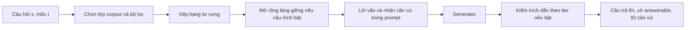

# Chương 5. Phương pháp và các hệ so sánh

**Câu hỏi của chương:** Khi nhận câu hỏi và mốc thời gian, hệ thống chọn bằng chứng, sinh câu trả lời và kiểm trích dẫn như thế nào; thiết kế so sánh tách được vai trò của biểu diễn, bộ lọc và đồ thị đến mức nào?

## 5.1. Bài toán và ranh giới của phương pháp

Đầu vào gồm câu hỏi (x) và mốc (t). Hệ thống trả nội dung cùng các mã bằng chứng đã dùng, hoặc không trả lời khi không xác định được. Mục tiêu thực nghiệm là kiểm tra sự phù hợp với phiên bản gold và hiệu lực theo biểu diễn trong kho. Phương pháp không tự diễn giải toàn bộ hệ thống pháp luật và không thay thế việc kiểm của người có chuyên môn đối với một tình huống pháp lý.
<!-- nguồn: src/vilexgraph/framework/generate.py -->
<!-- nguồn: scripts/eval/score_vilextime.py -->

Có hai vai trò khác nhau của đồ thị. Vai trò ngoại tuyến là dựng chuỗi phiên bản, nối sự kiện với lời văn và lan truyền khoảng hiệu lực qua cây điều khoản. Vai trò trực tuyến là bổ sung đơn vị lân cận cho bằng chứng đã truy xuất. Thang biểu diễn trước hết đo giá trị của thông tin đã tính ngoại tuyến; chỉ các cấu hình có mở rộng mới thực hiện thêm bước láng giềng trong lúc trả lời.
<!-- nguồn: scripts/pipeline/build_versions.py -->
<!-- nguồn: src/vilexgraph/build/temporal/effective_intervals.py -->
<!-- nguồn: src/vilexgraph/framework/graphx.py -->

Sơ đồ mô tả đường thực nghiệm chính dùng truy xuất từ vựng. Các cấu hình dense/hybrid có nhánh xếp hạng riêng nhưng chưa được dùng để đưa ra kết luận test trong bản nháp này.
<!-- nguồn: src/vilexgraph/framework/retrieve.py -->
<!-- nguồn: docs/plans/active/codex-chot-du-lieu-va-thuc-nghiem.md -->

## 5.2. Bộ lọc theo mức thông tin thời gian

Bộ lọc tạo $\mathcal{U}_t$, tức tập ứng viên mà cấu hình cho phép tại mốc hỏi. `none` không đặt ràng buộc thời gian. `document` dùng ngày hiệu lực và ngày kết thúc của văn bản sở hữu. `version` yêu cầu đồng thời khoảng văn bản và khoảng cục bộ của phiên bản. `propagated` yêu cầu khoảng văn bản và sự tồn tại của khoảng hiệu lực đã lan truyền. Các điều kiện được đưa vào truy vấn trước khi lấy top-k, không phải lấy một danh sách nhỏ rồi lọc hậu kỳ.
<!-- nguồn: src/vilexgraph/framework/temporal.py -->
<!-- nguồn: src/vilexgraph/framework/retrieve.py -->

Tất cả các phép chứa thời gian dùng quy ước nửa mở. Ngày bắt đầu thuộc khoảng, ngày kết thúc không thuộc khoảng. Ở mức lan truyền, code có thể lưu nhiều khoảng rời nhau cho một phiên bản; không thay chúng bằng một khoảng rộng bao trùm cả những quãng không có hiệu lực. Quy tắc này nhất quán với lõi thời gian ở Chương 3.
<!-- nguồn: src/vilexgraph/framework/temporal.py -->
<!-- nguồn: src/vilexgraph/build/temporal/effective_intervals.py -->

Cần phân biệt hai cách xử lý đơn vị lệnh. Truy xuất ban đầu ở lớp B trả đơn vị phiên bản; khi mở rộng có thể bổ sung lệnh từ lớp A. Lệnh không có khoảng phiên bản riêng, nên code xét nó theo văn bản ban hành lệnh. Vì vậy, việc một lệnh được cho vào prompt không đồng nghĩa mọi lời văn mà nó nhắc đến còn hiệu lực. Đây là một giới hạn mô hình hóa phải giữ khi diễn giải TVER và các lỗi đọc nhầm.
<!-- nguồn: src/vilexgraph/framework/graphx.py -->
<!-- nguồn: src/vilexgraph/framework/temporal.py -->

## 5.3. Truy xuất và ngữ cảnh cấu trúc

Đường chính dùng SQLite FTS5 để tính thứ hạng từ vựng. Code tạo biểu thức truy vấn từ các từ của câu hỏi, kết hợp các từ bằng OR và cho phép giới hạn vào phần body hoặc thêm phần context. Cấu hình có context đưa tiêu đề cấu trúc vào văn bản truy xuất; phần ngữ cảnh này là lợi ích chunk header thông thường, không tự được xem là hiệu ứng đồ thị. Tài liệu nền về BM25 được quản lý trong danh mục [@robertson2009bm25]; mô tả cài đặt ở đây dựa trên code FTS5 thực tế. [CẦN XÁC MINH: đọc bản gốc tài liệu BM25 và xác nhận metadata thư mục tài liệu tham khảo trước khi nộp].
<!-- nguồn: src/vilexgraph/framework/retrieve.py -->
<!-- nguồn: src/vilexgraph/framework/corpus.py -->
<!-- nguồn: references.bib -->

Kích thước danh sách ban đầu được khóa ở (k=20). Chế độ giảm số từ truy vấn để chạy nhanh không được dùng cho số báo cáo. Đường dense hiện có quét điểm tích vô hướng trên các vector, sau đó kiểm bộ lọc trước khi gom top-k hợp lệ; nó không dùng Milvus. Cấu hình B4 trộn hai thứ hạng bằng tổng đóng góp (1/(60+rank)), không có reranker. Đây là mô tả cấu hình, không phải kết quả chất lượng của B4 trên test. [CẦN TRÍCH DẪN: nguồn gốc phương pháp reciprocal rank fusion; references.bib chưa có khóa tương ứng].
<!-- nguồn: docs/decisions/0005-ke-hoach-phan-tich.md -->
<!-- nguồn: src/vilexgraph/framework/retrieve.py -->

Các khai báo mặc định trong `systems.py` có thể bật dense và rerank. Cấu hình đã chạy lại được ghi trong provenance của từng hệ: biến thể `-lex` tắt hai thành phần này. Bộ tìm kiếm hiện còn từ chối cấu hình yêu cầu reranker chưa được xây dựng. Vì vậy, không suy cấu hình thực nghiệm chỉ từ tên hệ hoặc giá trị mặc định trong registry.
<!-- nguồn: scripts/eval/run_vilextime.py -->
<!-- nguồn: src/vilexgraph/framework/retrieve.py -->
<!-- nguồn: runs/E3_v1/test/proposed.run.json -->

## 5.4. Thang biểu diễn và phép đối chứng

Thang chính giữ truy xuất từ vựng, generator, prompt và kích thước danh sách ban đầu; mỗi bước kề nhau đổi một thành phần biểu diễn hoặc bộ lọc. B7 là phép đối chứng quyết định vì lọc ngày cấp văn bản có thể loại được nhiều bằng chứng sai mà không cần chuỗi phiên bản hoặc mở rộng đồ thị trực tuyến.
<!-- nguồn: src/vilexgraph/framework/systems.py -->
<!-- nguồn: docs/decisions/0005-ke-hoach-phan-tich.md -->

| Hệ | Lớp truy xuất | Bộ lọc | Context | Mở rộng trực tuyến | Verifier |
|---|---|---|---|---|---|
| `b1` | Không có | Không có | Không có | Không | Tắt |
| `b2` | A | none | Không | Không | Tắt |
| `b2ctx` | A | none | Có | Không | Tắt |
| `b7` | A | document | Có | Không | Tắt |
| `b7v` | B | document | Có | Không | Tắt |
| `b7plus` | B | version | Có | Không | Tắt |
| `b7pp` | B | propagated | Có | Không | Tắt |
| `proposed` | B | propagated | Có | Quan hệ lệnh | reject |
| `b5` | A | none | Có | Quan hệ lệnh | Tắt |
| `b6` | A | none | Có | Cha–con | Tắt |

<!-- nguồn: src/vilexgraph/framework/systems.py -->

Sự khác nhau `b7 → b7v` là đưa vào lời văn phiên bản đã hợp nhất, chưa đổi cấp lọc khỏi văn bản. Bước `b7v → b7plus` mới kiểm khoảng cục bộ; `b7plus → b7pp` đưa lan truyền hiệu lực vào. Do đó, không gộp mọi lợi ích từ lớp B thành lợi ích của thuật toán đồ thị trực tuyến. `proposed` được báo riêng vì cộng thêm mở rộng và Verifier vào đỉnh thang.
<!-- nguồn: src/vilexgraph/framework/systems.py -->

Các ablation được định nghĩa trong code: `a1` bỏ ràng buộc thời gian; `a2` bỏ mở rộng; `a3` tắt Verifier; `a4` thay tier lan truyền bằng tier phiên bản. Việc có cấu hình không có nghĩa đã có kết quả test. Vai trò riêng của từng thành phần chỉ có thể được đánh giá sau khi có kết quả ablation phù hợp.
<!-- nguồn: src/vilexgraph/framework/systems.py -->
<!-- nguồn: docs/plans/active/codex-chot-du-lieu-va-thuc-nghiem.md -->

## 5.5. Mở rộng quan hệ

`graphx.py` có hai kiểu láng giềng: cha–con của cây điều khoản và lệnh sửa đổi/bãi bỏ nhắm đến điều khoản. Cấu hình hiện mở rộng một bước, lấy các hit đầu làm seed và giới hạn fanout. Đơn vị trùng bị bỏ; láng giềng mới được nối sau thứ hạng truy xuất ban đầu, không xếp hạng lại bằng một mô hình suy luận đồ thị. Bộ lọc thời gian của cấu hình vẫn được áp vào láng giềng.
<!-- nguồn: src/vilexgraph/framework/graphx.py -->

Trong code, số seed là 5 và fanout giới hạn ở 3 cho các truy vấn láng giềng. Danh sách cuối có thể dài hơn top-20 ban đầu. Vì vậy, “có căn cứ trong prompt” trong E7 được xét trên toàn bộ `retrieved`, còn TV-Recall@20 chỉ xét phần đầu danh sách. Nếu bỏ sự khác biệt này, một căn cứ đúng do mở rộng thêm vào có thể bị phân loại nhầm thành chưa được đưa cho generator.
<!-- nguồn: src/vilexgraph/framework/graphx.py -->
<!-- nguồn: scripts/review/e7_error_analysis.py -->

Cài đặt trực tuyến lấy quan hệ bằng truy vấn SQL trên cây điều khoản và các đơn vị lệnh đã phân giải. Nó không thực hiện tìm đường nhiều bước trên toàn bộ loại cạnh có trong Neo4j, cũng không cài cơ chế cộng đồng và tóm tắt cộng đồng của một hệ GraphRAG khác. Vì vậy, tên “GraphRAG” trong mô tả rộng của dự án phải đi kèm phạm vi: đồ thị phiên bản ngoại tuyến và mở rộng láng giềng hạn chế trực tuyến.
<!-- nguồn: src/vilexgraph/framework/graphx.py -->
<!-- nguồn: docs/decisions/0004-framework-truy-xuat-va-sinh.md -->

## 5.6. Sinh câu trả lời và phân biệt từ chối với hết hiệu lực

Prompt chứa câu hỏi, mốc và các đoạn căn cứ được đánh nhãn. Model được yêu cầu trích lời văn tại đúng mốc và dẫn nhãn đoạn; nhãn được ánh xạ về ID đơn vị. Hàm tạo prompt không nhận gold. Đường không truy xuất có chỉ dẫn riêng cho phép model dùng kiến thức đã học, nhưng không cung cấp nhãn căn cứ để dẫn. Vì thế, điều kiện thông tin của `b1` khác các hệ RAG dù cùng generator.
<!-- nguồn: src/vilexgraph/framework/generate.py -->
<!-- nguồn: tests/test_rag_generate.py -->

Parser phân biệt “còn”, “không” và “không rõ”. Chỉ khẳng định “không” được đổi thành `answerable=False`; “không rõ” vẫn giữ `answerable=True` với phần nội dung model đã trả. Đây là khác biệt giữa kết luận hết hiệu lực và việc model không biết. Nếu chấm mọi từ chối là kết luận hết hiệu lực, hệ gần như không trả lời có thể được thưởng trên dòng bãi bỏ vì sai lý do.
<!-- nguồn: src/vilexgraph/framework/generate.py -->

Generator đã chọn là `Qwen/Qwen3-4B-Instruct-2507`, revision `cdbee75f17c01a7cc42f958dc650907174af0554`, chạy trọng số qua batch Colab, NF4 và greedy, tối đa 512 token mới. Đường này xuất prompt rồi nhập raw có kiểm hash, không gọi API từ runner để sinh cột test chính. Quyết định generator dựa trên dev; các số đo test được trình bày ở Chương 6. Chưa có model khác họ qua cổng để kiểm độ bền.
<!-- nguồn: docs/decisions/0004-framework-truy-xuat-va-sinh.md -->
<!-- nguồn: runs/E3_v1/test/proposed.run.json -->

## 5.7. Temporal Verifier và giới hạn tác dụng

Verifier kiểm các ID được câu trả lời trích, không kiểm đúng sai ngữ nghĩa của toàn câu. Chế độ `warn` chỉ ghi nhận; `reject` lọc căn cứ không hợp lệ rồi cho phép sinh lại theo cơ chế cài đặt. Nếu vẫn không có căn cứ hợp lệ hoặc trích dẫn tiếp tục sai, code trả nội dung trống nhưng giữ `answerable=True`. Việc bỏ trả lời này không được chuyển thành khẳng định pháp lý “hết hiệu lực”.
<!-- nguồn: src/vilexgraph/framework/verify.py -->

Đường nhập batch Colab dùng cho E3 không gọi cơ chế sinh lại của runner. Hàm `import_completions` chỉ kiểm ID trích dẫn bằng `invalid_units`; nếu cần sinh lại thì dừng nhập với lỗi, còn khi qua kiểm thì ghi hành động `pass`. Do đó, mô tả khả năng reject/sinh lại của module không được viết thành khẳng định rằng E3 đã thực sự sinh lại hoặc sửa câu trả lời.
<!-- nguồn: scripts/eval/colab_b1.py -->
<!-- nguồn: src/vilexgraph/framework/verify.py -->

Trong cấu hình đề xuất, truy xuất, mở rộng và Verifier dùng cùng tier. Những đơn vị đã được cho vào prompt vì thế thường cũng qua được kiểm của Verifier. Chính docstring ghi Verifier có thể là phép kiểm không thay đổi đầu ra theo thiết kế. Không được gán mức tăng Accuracy cho Verifier nếu chưa có bằng chứng nó đã sửa hoặc bác câu nào; cũng không coi TVER thấp là bằng chứng rằng câu trả lời nhận ra đúng việc bãi bỏ.
<!-- nguồn: src/vilexgraph/framework/verify.py -->
<!-- nguồn: docs/plans/active/codex-chot-du-lieu-va-thuc-nghiem.md -->

## 5.8. Điều kiện so sánh công bằng và khả năng tái lập

Mỗi dự đoán giữ ID dòng, câu trả lời, cờ hiệu lực, trích dẫn và danh sách căn cứ. Provenance bổ sung cấu hình, mã băm release, prompt, raw và revision model. Các cấu hình được thử trên dev trước khi chạy test; không thay metric khi nhìn thấy kết quả. Cùng engine và prompt làm giảm khác biệt ngoài biến đang nghiên cứu, nhưng không bảo đảm rằng một generator duy nhất là baseline mạnh cho mọi loại câu hỏi.
<!-- nguồn: scripts/eval/run_vilextime.py -->
<!-- nguồn: runs/E3_v1/test/proposed.run.json -->
<!-- nguồn: docs/decisions/0005-ke-hoach-phan-tich.md -->

Các tài liệu cũ mô tả hybrid kèm reranker và truy vấn Neo4j/Milvus; code và provenance hiện tại chỉ xác nhận đường từ vựng, SQL và các biến thể đã nêu. Việc chưa thực hiện một thành phần phải được công bố thay vì suy từ kiến trúc dự kiến sang kết quả thực đo. Khóa luận cũng cần phân biệt bản kernel attention có mã trong repo với biến thể từng dùng trên dev nhưng chưa được lưu đầy đủ.
<!-- nguồn: docs/decisions/0004-framework-truy-xuat-va-sinh.md -->
<!-- nguồn: src/vilexgraph/framework/retrieve.py -->
<!-- nguồn: runs/E3_v1/test/proposed.run.json -->

## 5.9. Câu trả lời có thể rút ra

Phương pháp hiện thực hóa việc truy xuất theo mốc bằng cách kết hợp lớp corpus, khoảng hiệu lực và xếp hạng trong cùng đường truy vấn. Thang biểu diễn cho phép kiểm tác dụng của lời văn hợp nhất và bộ lọc trước khi xét phần mở rộng trực tuyến. Cơ chế sinh có trích dẫn và Verifier tạo khả năng kiểm soát ID căn cứ, nhưng không bảo đảm hiểu đúng nội dung hoặc kết luận bãi bỏ. Do đó, kết quả phải được diễn giải theo từng tầng và đối chiếu B7, thay vì gọi mọi chênh lệch là lợi ích của đồ thị.
<!-- nguồn: src/vilexgraph/framework/systems.py -->
<!-- nguồn: src/vilexgraph/framework/temporal.py -->
<!-- nguồn: src/vilexgraph/framework/verify.py -->

## Việc còn thiếu trước khi nộp

- [CẦN XÁC MINH: đối soát topology GPU thực tế; sổ chạy nói hai T4 nhưng trường gpu trong provenance E3 hiện chỉ liệt kê một tên Tesla T4].
- Bổ sung kết quả ablation trước khi đánh giá tác dụng riêng của mở rộng hoặc Verifier.
- Đọc bản gốc tài liệu BM25; bổ sung tài liệu RRF sau khi nhóm xác nhận khóa thư mục tài liệu tham khảo, không tự tạo khóa mới.
- Hoàn thiện hình kiến trúc theo cài đặt thực; giữ phân biệt phương pháp dự kiến với cấu hình đã đo.
